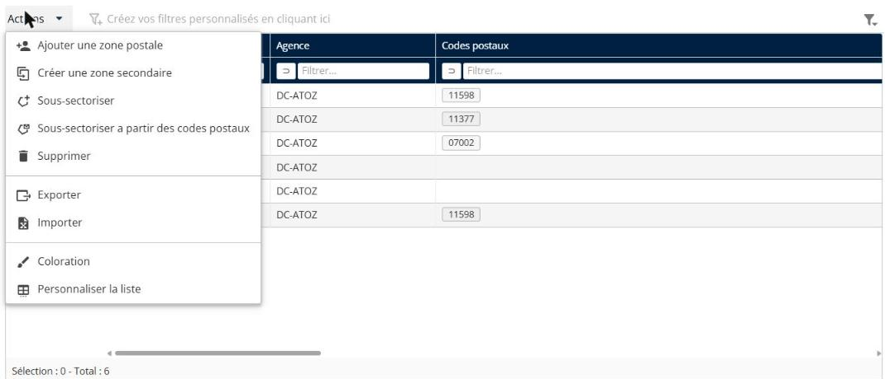
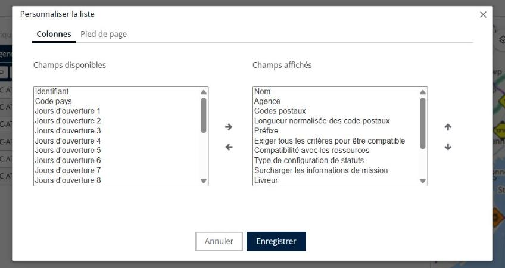
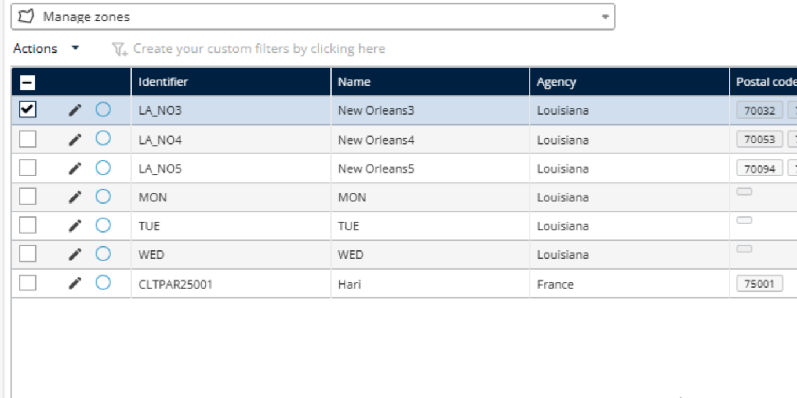

# Personnaliser le tableau des zones

Personnalisez le tableau des zones pour choisir les champs affichés pour les zones d’une mission.

## Avant de commencer

* Connectez-vous à **Nomadia Delivery** avec un profil utilisateur ayant accès à l’onglet **Configuration**.
* Disposez de missions sous **Gérer les études et les zones**, car vous sélectionnez une mission pour personnaliser son tableau des zones.

## Présentation de la fonctionnalité

* Menu déroulant **Actions** : contient l’option **Personnaliser la limite** pour la mission sélectionnée.
* **Personnaliser la limite** : vous permet de choisir les champs affichés dans le tableau des zones.
* **Enregistrer** : applique votre sélection de champs au tableau.

## Personnaliser le tableau des zones

1. Cliquez sur l’onglet **Configuration**.
2. Cliquez sur **Gérer les études et les zones**.
3. Consultez les missions disponibles, affichées dans une liste.
4. Sélectionnez une mission.
5. Cliquez sur le menu déroulant **Actions**.
6. Cliquez sur **Personnaliser la limite**.

7. Choisissez les champs que vous souhaitez afficher dans le tableau.
8. Cliquez sur **Enregistrer**.

### Résultat

Les champs sélectionnés sont affichés dans le tableau.

## Conseils


**Sélection des champs** : évitez de sélectionner trop de champs à la fois, car il peut devenir difficile de lire ou de naviguer.


## Rubriques connexes

* [Gérer les études et les zones](README.md)
* [Gérer les zones postales](manage-postal-zones.md)
* [Créer des zones postales par gestion territoriale (sectorisation)](create-postal-zones-by-territory-management-sectorization.md)
