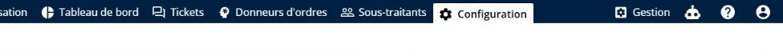
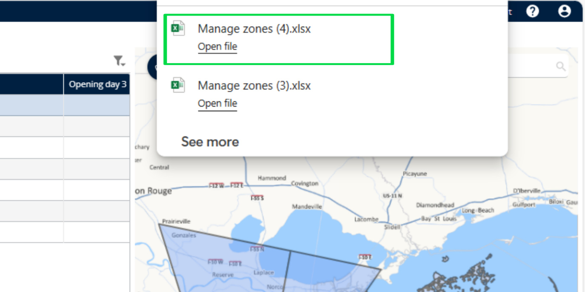

# Gérer les zones postales

La fonctionnalité Gérer les zones postales permet aux administrateurs et aux responsables logistiques de définir et de gérer des zones de livraison géographiques en fonction des codes postaux. Ces zones sont essentielles pour organiser les livraisons, affecter des ressources et optimiser les itinéraires dans des zones spécifiques.

## Avant de commencer

* Connectez-vous à **Nomadia Delivery** avec un profil utilisateur ayant accès à l’onglet **Configuration**.
* Disposez d’une étude sous **Gérer les études et les zones**, car vous ouvrez son tableau des zones avec l’icône **crayon**.
* Pour importer des zones postales, disposez d’un fichier de zone valide sur votre système local.
* Pour ajouter une zone postale, ayez à portée de main le **Code**, le **Nom** et le **Préfixe**.

## Présentation de la fonctionnalité

* **Importer** : téléverse un fichier contenant les données des zones, à l’aide de **Parcourir le fichier**.
* **Ajouter une zone postale** : crée une zone avec un **Code**, un **Nom** et un **Préfixe**.
* **Supprimer** : supprime la zone sélectionnée après confirmation.
* **Exporter** : exporte la zone postale sélectionnée.
* **Coloration** : applique une couleur en fonction des attributs de la zone, tels que le type de mission (livraison, retrait), la priorité de la zone, le livreur affecté ou le préfixe du code postal.

## Importer des zones postales

1. Cliquez sur l’onglet **Configuration**.

2. Sous **Livraison**, cliquez sur **Gérer les études et les zones**.

<figure><figcaption></figcaption></figure>

3. Cliquez sur l’icône **crayon** à côté de l’étude pour ouvrir le tableau des zones.
4. Ouvrez le menu déroulant **Actions**.
5. Cliquez sur **Importer**.

_fr.png>)

6. Cliquez sur **Parcourir le fichier** pour téléverser le fichier contenant les données de la zone.

.png>)

7. Sélectionnez un fichier de zone valide depuis votre système local.

.png>)

### Résultat

Les zones postales sont importées avec succès.

.png>)

## Ajouter une zone postale

1. Cliquez sur l’onglet **Configuration**.
2. Sous **Livraison**, cliquez sur **Gérer les études et les zones**.
3. Cliquez sur l’icône **crayon** à côté de l’étude pour ouvrir le tableau des zones.
4. Cliquez sur le menu déroulant **Actions**.
5. Cliquez sur **Ajouter une zone postale**.

_fr.png>)

6. Renseignez les champs obligatoires : **Code**, **Nom** et **Préfixe**.

.png>)

7. Cliquez sur **Enregistrer**.

.png>)

### Résultat

La zone postale est ajoutée avec succès.

.png>)

## Supprimer une zone postale

1. Cliquez sur l’onglet **Configuration**.
2. Sous **Livraison**, cliquez sur **Gérer les études et les zones**.
3. Cliquez sur l’icône **crayon** à côté de l’étude pour ouvrir le tableau des zones.
4. Sélectionnez une zone.

.png>)

5. Cliquez sur le menu déroulant **Actions**.
6. Cliquez sur **Supprimer**.

.png>)

7. Consultez le message contextuel de confirmation : « Êtes-vous sûr de vouloir supprimer cette zone ? »
8. Cliquez sur **Oui**.

.png>)

### Résultat

La zone postale est supprimée avec succès.

.png>)

## Exporter une zone postale

1. Cliquez sur l’onglet **Configuration**.
2. Sous **Livraison**, cliquez sur **Gérer les études et les zones**.
3. Sélectionnez une zone.
4. Cliquez sur le menu déroulant **Actions**.
5. Cliquez sur **Exporter**.

<figure><figcaption></figcaption></figure>

### Résultat

La zone postale est exportée avec succès.

## Colorer une zone postale

Appliquez des conditions basées sur les attributs de la zone, tels que le type de mission (livraison, retrait), la priorité de la zone, le livreur affecté, le préfixe du code postal, etc.

1. Cliquez sur l’onglet **Configuration**.
2. Sous **Livraison**, cliquez sur **Gérer les études et les zones**.
3. Sélectionnez une zone.
4. Cliquez sur le menu déroulant **Actions**.
5. Cliquez sur **Coloration**.

<figure><figcaption></figcaption></figure>

6. Choisissez une couleur.
7. Cliquez sur **Enregistrer**.

<figure><figcaption></figcaption></figure>

### Résultat

La couleur sélectionnée est appliquée avec succès.

## Conseils


**Préfixe** : le préfixe sert à standardiser les codes postaux à une longueur fixe de 6 chiffres. Dans les régions où les codes postaux sont plus courts (par exemple, 5 chiffres dans certaines zones de France), le système ajoute automatiquement le préfixe défini pour atteindre la longueur requise.


## Rubriques connexes

* [Gérer les études et les zones](README.md)
* [Créer des zones postales par gestion territoriale (sectorisation)](create-postal-zones-by-territory-management-sectorization.md)
* [Personnaliser le tableau des zones](customize-zones-table.md)
