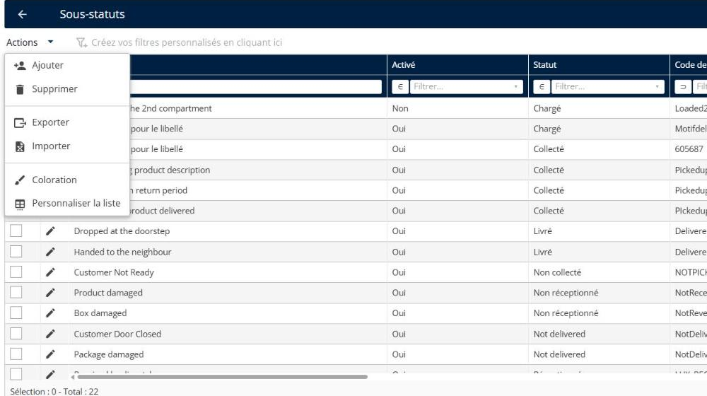
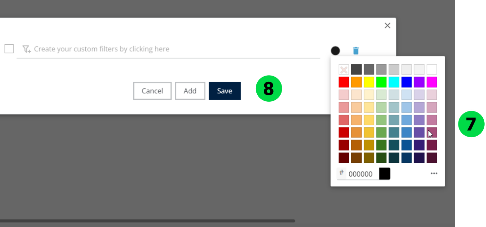
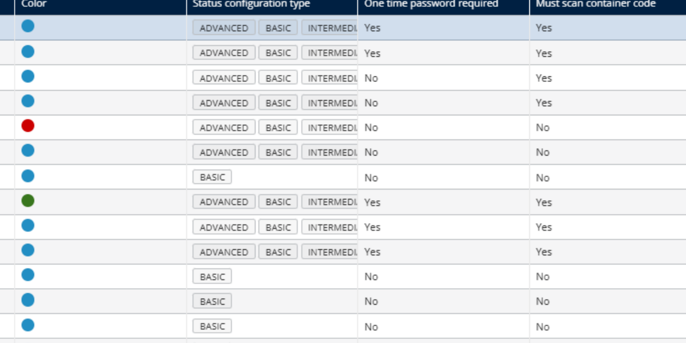

# Gérer les sous-statuts

La fonctionnalité Gérer les sous-statuts permet aux administrateurs de créer, modifier et affecter des libellés de statut détaillés qui reflètent l’avancement en temps réel ou l’état d’une tâche de livraison. Ces sous-statuts offrent un mécanisme de suivi plus granulaire au sein de catégories de statut plus larges telles que « Retrait », « En attente » ou « Livré ».

## Avant de commencer

* Connectez-vous à **Nomadia Delivery** avec un profil utilisateur ayant accès à la page **Configuration**.
* Ouvrez **Configuration**, cliquez sur le menu **Configuration**, puis, sous **Mes données**, cliquez sur **Sous-statuts**.
* Disposez d’au moins un sous-statut à supprimer ou à colorer.

## Présentation de la fonctionnalité

* **Sous-statut** : un libellé de statut détaillé qui reflète l’avancement en temps réel ou l’état d’une tâche de livraison au sein de catégories de statut plus larges telles que « Retrait », « En attente » ou « Livré ».
* **Supprimer** : supprime le sous-statut sélectionné après confirmation.
* **Coloration** : applique une couleur au sous-statut sélectionné.
* Menu déroulant **Actions** : contient les options **Supprimer** et **Coloration**.

## Supprimer un sous-statut

1. Allez dans **Configuration**.
2. Cliquez sur le menu **Configuration**.
3. Sous **Mes données**, cliquez sur **Sous-statuts**.
4. Sélectionnez un sous-statut.
5. Cliquez sur le menu déroulant **Actions**.
6. Cliquez sur **Supprimer**.

7. Consultez le message de confirmation contextuel : « Voulez-vous supprimer le sous-statut ? »
8. Cliquez sur **Oui**.

### Résultat

Le sous-statut est supprimé avec succès.

## Colorer un sous-statut

Appliquez des conditions basées sur les attributs de la zone tels que le type de mission (livraison, retrait), la priorité de la zone, le livreur affecté, le préfixe du code postal, etc.

1. Allez dans **Configuration**.
2. Cliquez sur le menu **Configuration**.
3. Sous **Mes données**, cliquez sur **Sous-statuts**.
4. Sélectionnez un sous-statut.
5. Cliquez sur le menu déroulant **Actions**.
6. Cliquez sur **Coloration**.

7. Choisissez une **Couleur**.
8. Cliquez sur **Enregistrer**.

### Résultat

La couleur sélectionnée est appliquée avec succès.

## Conseils


**Suivi granulaire** : les sous-statuts offrent un mécanisme de suivi plus granulaire au sein de catégories de statut plus larges ; utilisez-les donc pour refléter l’avancement en temps réel d’une tâche de livraison.



**Confirmer avant de supprimer** : une fenêtre contextuelle de confirmation demande « Voulez-vous supprimer le sous-statut ? » avant la suppression du sous-statut ; vérifiez donc votre sélection avant de cliquer sur **Oui**.


## Rubriques connexes

* [Créer un sous-statut](creating-a-substatus.md)
* [Personnaliser les sous-statuts](customizing-substatus.md)
* [Gérer la configuration des sous-statuts](manage-substatus-configuration.md)
* [Déclencher des notifications pour les changements de sous-statut](trigger-notifications-for-sub-status-changes.md)
