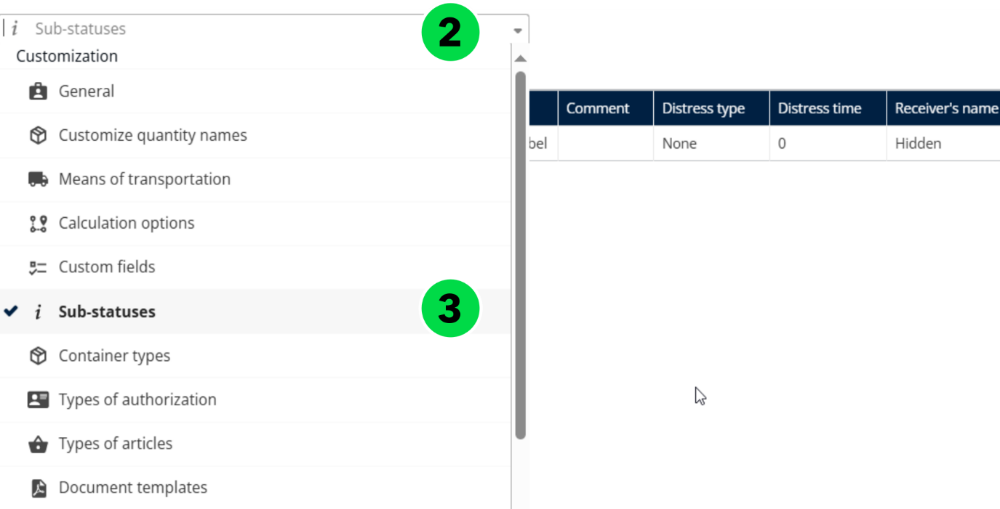
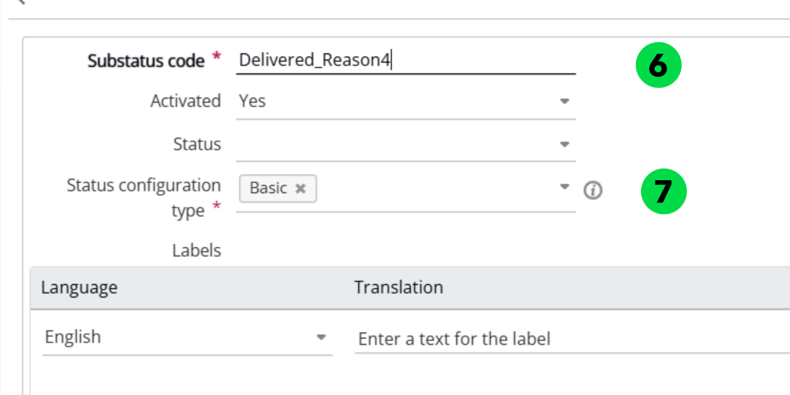

# Créer un sous-statut

Créez un sous-statut avec un code et un type de configuration du statut afin de suivre plus finement l’avancement d’une tâche de livraison.

## Avant de commencer

* Connectez-vous à **Nomadia Delivery** avec un profil utilisateur ayant accès à la page **Configuration**.
* Ayez à portée de main le code du sous-statut et sachez quel type de **Configuration du statut** sélectionner.

## Présentation de la fonctionnalité

* **Sous-statut** : le code qui identifie le sous-statut.
* **Configuration du statut** : le type que vous sélectionnez pour le sous-statut.
* **Actions** > **Ajouter** : ouvre le formulaire de création d’un sous-statut.

## Créer un sous-statut

1. Allez dans **Configuration**.
2. Cliquez sur le menu **Configuration**.
3. Sous **Mes données**, cliquez sur **Sous-statuts**.

4. Cliquez sur le menu déroulant **Actions**.
5. Cliquez sur **Ajouter**.

6. Saisissez le code du **Sous-statut**.
7. Sélectionnez le type de **Configuration du statut**.

8. Cliquez sur **Enregistrer**.

### Résultat

Le sous-statut est créé avec succès.

## Rubriques connexes

* [Gérer les sous-statuts](README.md)
* [Personnaliser les sous-statuts](customizing-substatus.md)
* [Gérer la configuration des sous-statuts](manage-substatus-configuration.md)
* [Déclencher des notifications pour les changements de sous-statut](trigger-notifications-for-sub-status-changes.md)
