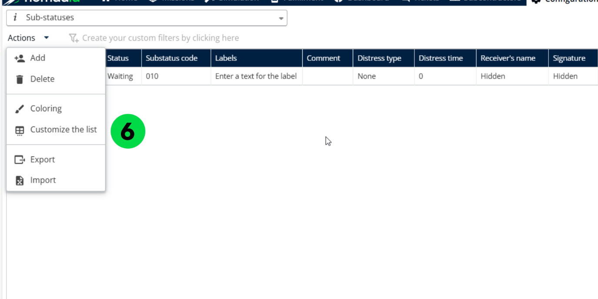

# Personnaliser les sous-statuts

Personnalisez le tableau des sous-statuts pour choisir les champs affichés.

## Avant de commencer

* Connectez-vous à **Nomadia Delivery** avec un profil utilisateur ayant accès à la page **Configuration**.
* Assurez-vous qu’au moins un sous-statut existe sous **Mes données** > **Sous-statuts**.

## Présentation de la fonctionnalité

* **Sous-statuts** : la liste située sous **Mes données** où vous sélectionnez le sous-statut à personnaliser.
* **Actions** : le menu déroulant qui contient l’option **Personnaliser la limite**.
* **Personnaliser la limite** : vous permet de choisir les champs affichés dans le tableau des sous-statuts.

## Personnaliser un sous-statut

1. Allez dans **Configuration**.
2. Cliquez sur le menu **Configuration**.
3. Sous **Mes données**, cliquez sur **Sous-statuts**.
4. Sélectionnez un sous-statut.
5. Cliquez sur le menu déroulant **Actions**.
6. Cliquez sur **Personnaliser la limite**.

7. Choisissez les champs que vous souhaitez afficher dans le tableau.
8. Cliquez sur **Enregistrer**.

### Résultat

Les champs sélectionnés sont affichés avec succès dans le tableau.

## Conseils


**Sélection des champs** : évitez de sélectionner trop de champs à la fois, car cela pourrait rendre la lecture ou la navigation difficile.


## Rubriques connexes

* [Gérer les sous-statuts](README.md)
* [Créer un sous-statut](creating-a-substatus.md)
* [Gérer la configuration des sous-statuts](manage-substatus-configuration.md)
