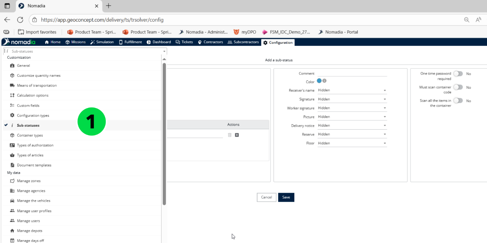
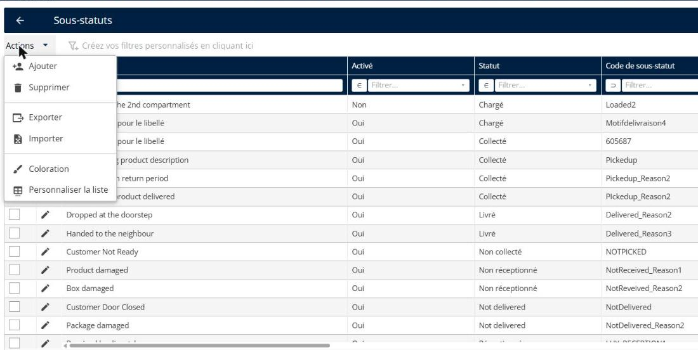
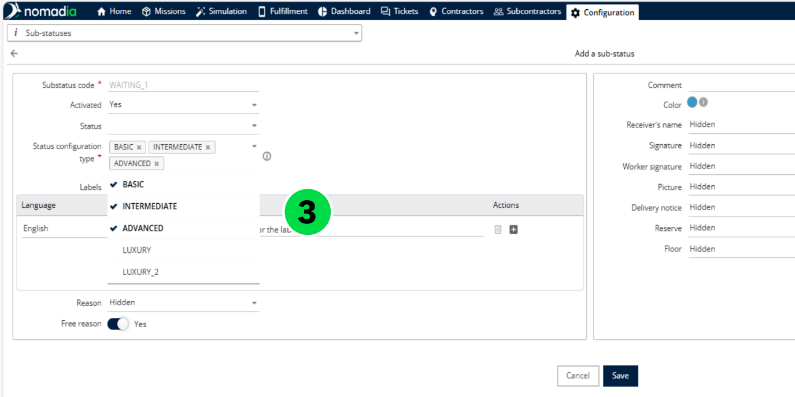

# Gérer la configuration des sous-statuts

Nomadia Delivery propose trois types de modèles de sous-statuts qui permettent aux utilisateurs de personnaliser le flux de livraison selon le type ou la catégorie de client. Ces modèles sont : Basique, Intermédiaire et Avancé.

## Avant de commencer

* Connectez-vous à **Nomadia Delivery** avec un profil utilisateur ayant accès au module **Configuration**.
* Déterminez quel type de modèle (Basique, Intermédiaire ou Avancé) convient à chaque type ou catégorie de client.
* Assurez-vous que les missions qui nécessitent un modèle de sous-statut existent dans l’onglet **Missions**.

## Présentation de la fonctionnalité

* **Types de configuration basiques** : conçus pour les clients qui n’ont besoin que d’une seule étape de vérification, comme la prise d’une photo ou la collecte d’une signature. Cela simplifie le processus de livraison en incluant uniquement les contrôles essentiels.
* **Types de configuration intermédiaires** : adaptés aux clients qui ont besoin de plusieurs étapes de vérification, mais qui n’exigent pas toute la gamme d’options disponibles dans le modèle avancé.
* **Types de configuration avancés** : destinés aux clients qui exigent une vérification complète, comme la prise de photos à chaque étape de la livraison. Ils offrent une flexibilité maximale pour configurer des flux de travail détaillés.

## Configurer et gérer les types de configuration des sous-statuts

1. Ouvrez l’application Nomadia Delivery et accédez au module **Configuration**.

2. Cliquez sur le bouton **Actions**, puis choisissez **Ajouter** pour créer un nouveau sous-statut.

3. Affectez le sous-statut créé à un ou plusieurs modèles.

4. Définissez les actions requises pour chaque sous-statut, comme rendre la signature obligatoire, exiger une photo, etc.

<figure><figcaption></figcaption></figure>

5. Répétez le processus pour créer des sous-statuts supplémentaires et les lier aux modèles souhaités.

<figure><figcaption></figcaption></figure>

6. Une fois tous les modèles configurés, accédez à l’onglet **Missions**.
7. Cliquez sur le bouton Éditeur de **mission** pour associer un modèle de sous-statut à une mission.

<figure><figcaption></figcaption></figure>

8. Sélectionnez le **modèle de configuration de statut** pour la mission choisie.

<figure><figcaption></figcaption></figure>

## Conseils


**Types de configuration** : les options de types de configuration sont fournies uniquement pour aider à différencier les flux de livraison en fonction des catégories de clients. Cependant, la complexité du flux de travail relève entièrement de la discrétion de l’utilisateur. Par exemple, un modèle Basique peut tout de même être configuré pour prendre en charge un processus de livraison complexe si nécessaire.


## Rubriques connexes

* [Gérer les sous-statuts](README.md)
* [Créer un sous-statut](creating-a-substatus.md)
* [Personnaliser les sous-statuts](customizing-substatus.md)
* [Déclencher des notifications pour les changements de sous-statut](trigger-notifications-for-sub-status-changes.md)
