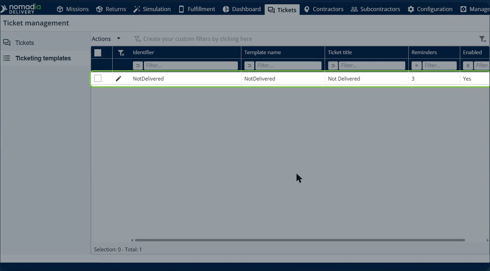
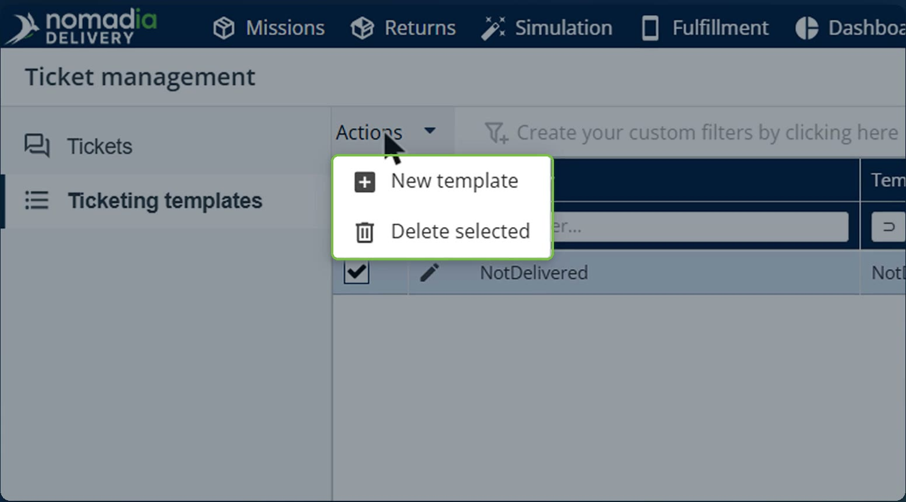
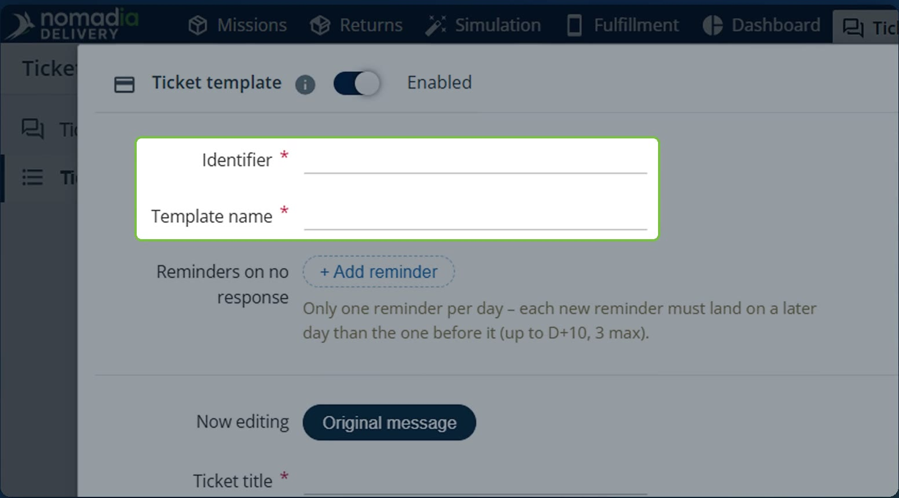
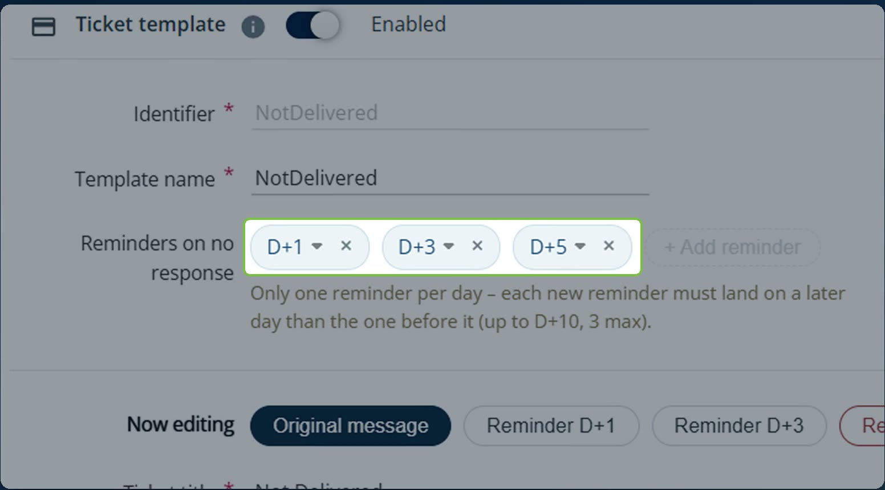
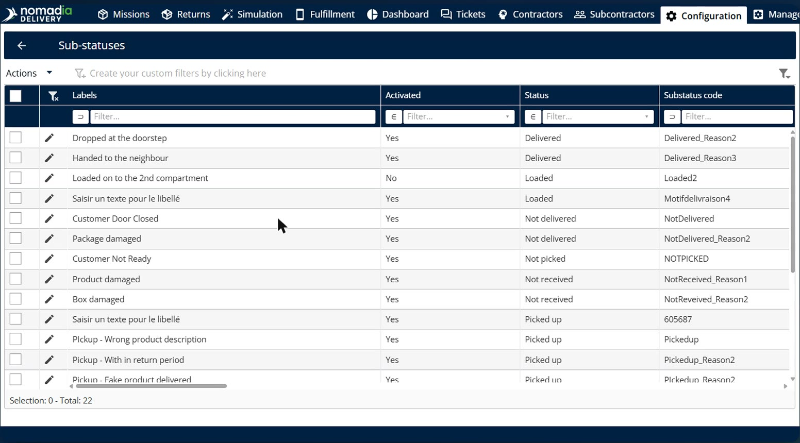
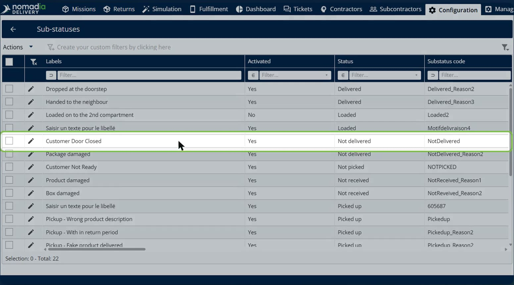
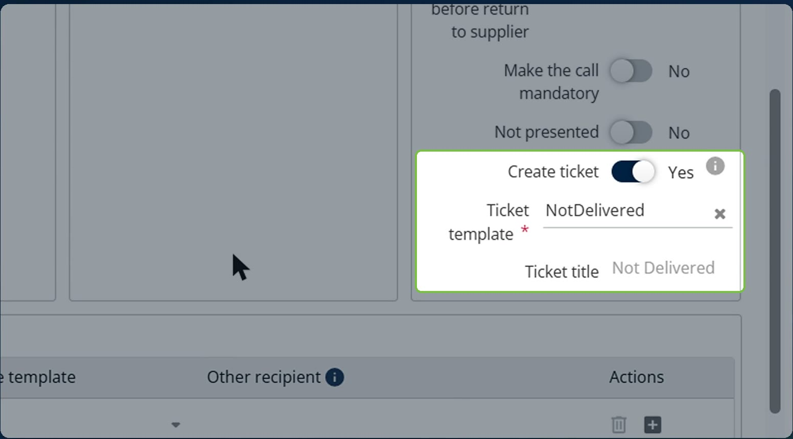
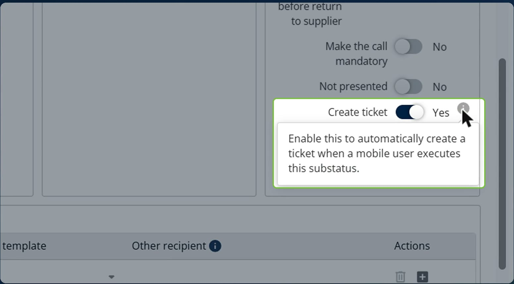
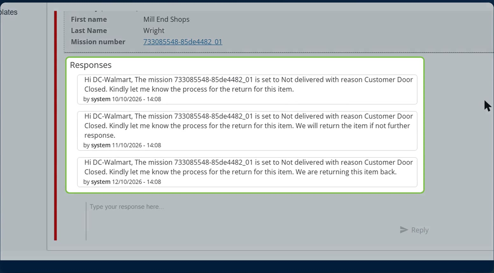
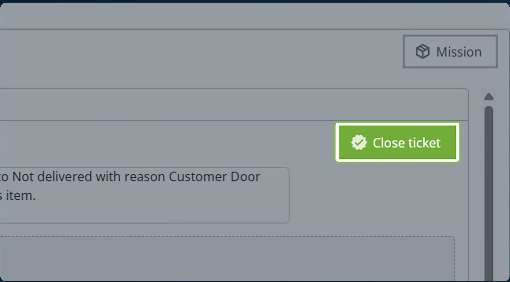

# Tickets et relances automatiques pour les sous-traitants

Les tickets et relances automatiques créent un ticket pour le sous-traitant dès qu’un chauffeur enregistre un sous-statut précis dans l’application mobile, par exemple **Porte du client fermée**. Si le sous-traitant ne répond pas, des relances sont publiées selon un calendrier et une notification par e-mail est envoyée. Les relances s’arrêtent dès que le sous-traitant répond ou que le ticket est fermé, et chaque étape est consignée dans l’historique du ticket.

## Avant de commencer

* Connectez-vous à **Nomadia Delivery** avec un profil utilisateur ayant accès au module **Tickets** et à **Configuration**. Voir [Activation du module de tickets](activating-the-ticket-module.md).
* Assurez-vous que le sous-statut qui doit déclencher le ticket existe. Voir [Gérer les sous-statuts](../manage-substatus/README.md).

## Présentation de la fonctionnalité

* **Modèles de tickets** : page de **Tickets** où vous créez les modèles utilisés pour les tickets automatiques.
* **Modèle de ticket** : modèle comportant un **Identifiant**, un **Nom du modèle**, un interrupteur **Activé**, le message d’origine et jusqu’à trois relances.
* **Relances en l’absence de réponse** : relances publiées lorsque le sous-traitant n’a pas répondu. Vous pouvez ajouter jusqu’à trois relances, une seule par jour, et chaque nouvelle relance doit tomber un jour plus tard que la précédente, jusqu’à J+10.
* **En cours de modification** : sélecteur qui permet de passer du **Message d’origine** à chaque relance, afin que chacun ait son propre titre de ticket et son propre message.
* **Insérer des champs dans votre message** : champs dynamiques, tels que **Statut**, **Sous-statut**, **Motif**, **Commentaire de livraison**, **Commentaire de retrait**, **Prénom du client**, **Nom du client**, **Nom du sous-traitant** et **Numéros de mission**, remplacés par les valeurs de la mission dans le ticket.
* **Créer un ticket** : action de fin d’un sous-statut qui crée automatiquement un ticket lorsqu’un utilisateur mobile exécute ce sous-statut.

## Créer un modèle de ticket

1. Accédez à **Tickets** > **Modèles de tickets**.

2. Cliquez sur **Actions**, puis sur **Nouveau modèle**.

3. Saisissez un **Identifiant** et un **Nom du modèle**.

4. Assurez-vous que l’interrupteur **Activé** est activé.

5. Avec **Message d’origine** sélectionné dans **En cours de modification**, saisissez le **Titre du ticket** et le message dans **Instructions pour l’agent**.

6. Pour ajouter des données de mission au message, cliquez sur les champs sous **Insérer des champs dans votre message**. Par exemple, `$[Name of the contractor]$` est remplacé par le nom du sous-traitant dans le ticket.

7. Sous **Relances en l’absence de réponse**, cliquez sur **+ Ajouter une relance** et choisissez le jour de chaque relance, par exemple **J+1**, **J+3** et **J+5**.

8. Dans **En cours de modification**, sélectionnez tour à tour chaque relance et saisissez son propre **Titre du ticket** et son propre message.

9. Enregistrez le modèle.

### Résultat

Le modèle apparaît dans la liste **Modèles de tickets**, avec son nombre de relances et son état d’activation.

## Lier le modèle à un sous-statut

1. Accédez à **Configuration** > **Sous-statuts**.

2. Cliquez sur l’**icône crayon** à côté du sous-statut qui doit déclencher le ticket, par exemple **Porte du client fermée**.

3. Dans les actions de fin, activez **Créer un ticket**, puis choisissez le **Modèle de ticket**. Le **Titre du ticket** est renseigné à partir du modèle.

4. Enregistrez le sous-statut.

### Résultat

Désormais, lorsqu’un chauffeur enregistre ce sous-statut dans l’application mobile :

1. Un ticket est créé à partir de votre modèle.
2. Si le sous-traitant ne répond pas, les relances sont publiées selon le calendrier, par exemple à J+1, J+3 et J+5, et une notification par e-mail est envoyée.
3. Les relances s’arrêtent dès que le sous-traitant répond ou que le ticket est fermé.

## Suivre un ticket automatique

1. Accédez à **Tickets** et ouvrez le ticket. Il affiche le message d’origine.

2. Consultez **Détails de la mission au moment de la création**. Cette section affiche un instantané de la mission au moment de la création du ticket, comme le statut de la mission, le sous-statut, le motif, le commentaire, le nom du client et le numéro de mission.

3. Consultez **Réponses**. Les relances y sont publiées selon le calendrier.

4. Pour répondre, saisissez votre réponse dans la zone de réponse et cliquez sur **Répondre**.

5. Pour mettre fin au suivi, cliquez sur **Fermer le ticket**.

### Résultat

Lorsque le sous-traitant répond ou que le ticket est fermé, les relances restantes s’arrêtent. Chaque étape est consignée dans l’historique du ticket.

## Conseils


**Calendrier des relances** : vous pouvez ajouter jusqu’à trois relances, une seule par jour. Chaque nouvelle relance doit tomber un jour plus tard que la précédente, jusqu’à J+10.


## Rubriques connexes

* [Gérer les tickets](README.md)
* [Créer un ticket](creating-a-ticket.md)
* [Gérer les sous-statuts](../manage-substatus/README.md)
