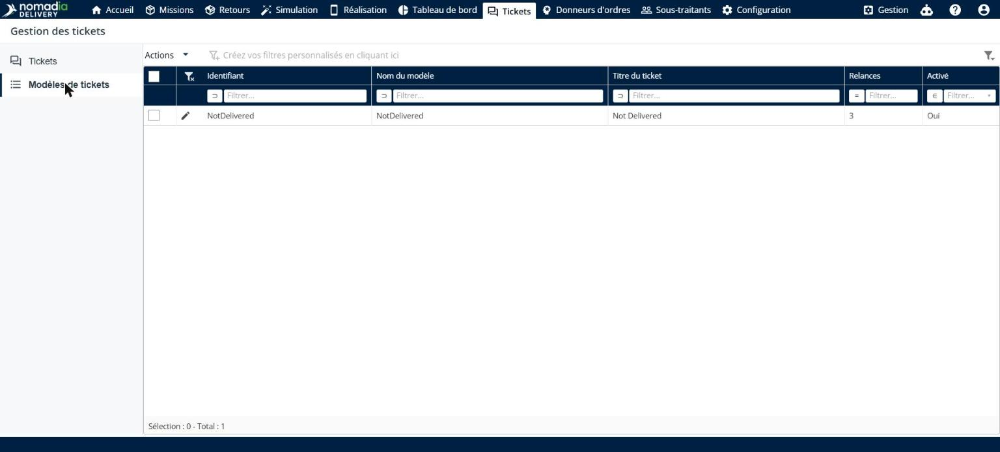
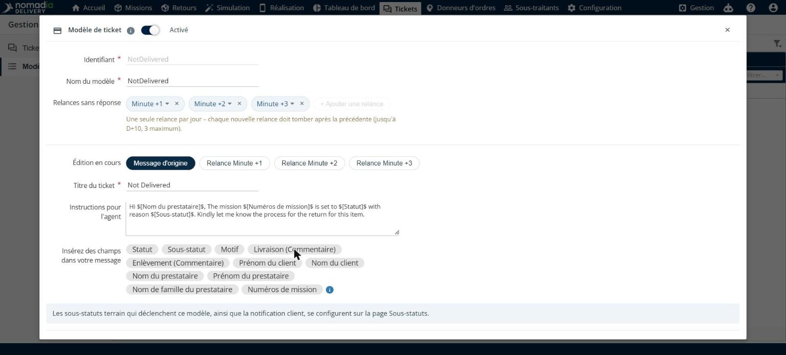
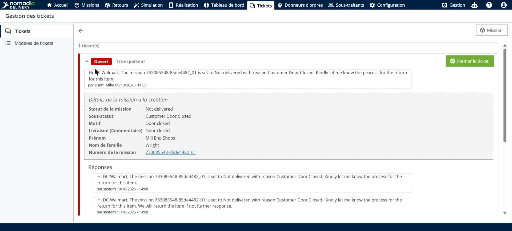
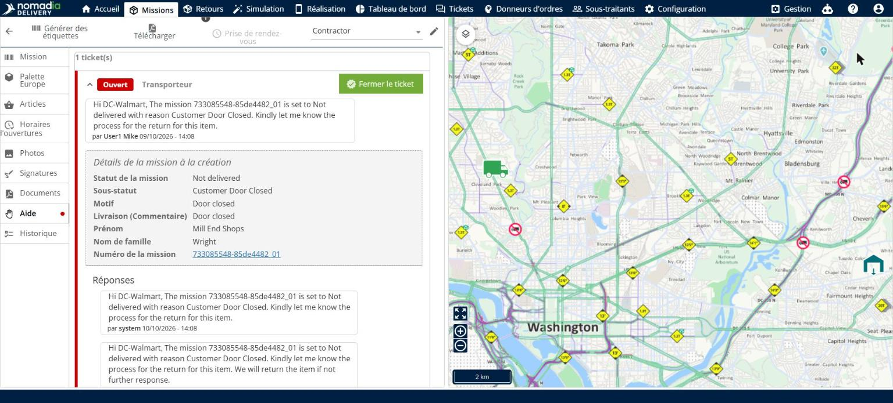
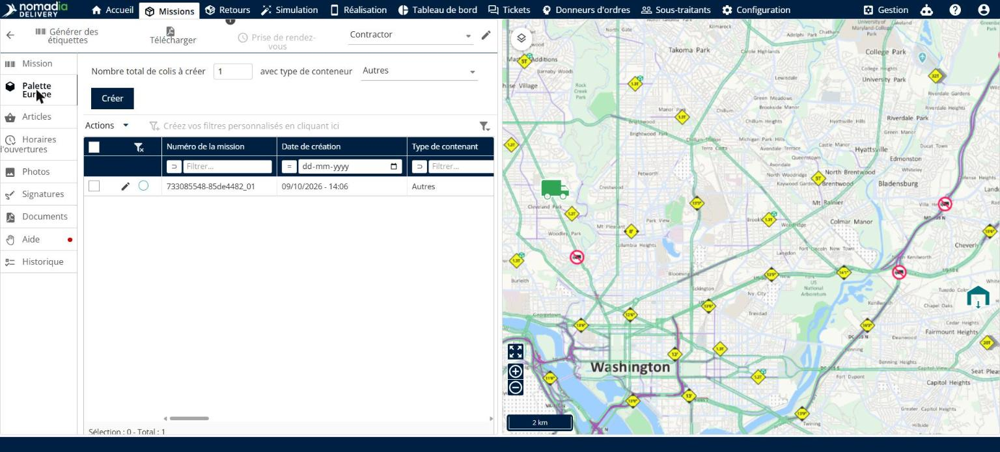

# Détails de la mission dans les tickets

Les détails de la mission dans les tickets donnent aux donneurs d’ordres et à votre équipe tout le contexte de la mission directement dans chaque ticket. Vous insérez des champs de mission dans le message du modèle de ticket, et leurs valeurs sont renseignées automatiquement à la création du ticket. Chaque ticket conserve aussi un instantané des détails de la mission au moment de sa création, le ticket est visible sur la mission, et pour les missions de conteneur, un seul ticket est créé sur la mission parente au lieu d’un ticket par élément.

## Avant de commencer

* Connectez-vous à **Nomadia Delivery** avec un profil utilisateur ayant accès au module **Tickets**. Voir [Activation du module de tickets](activating-the-ticket-module.md).
* Assurez-vous qu’un modèle de ticket existe. Voir [Tickets et relances automatiques pour les donneurs d’ordres](automated-contractor-tickets-and-reminders.md).

## Présentation de la fonctionnalité

* **Insérez des champs dans votre message** : section du modèle de ticket qui répertorie les champs de mission que vous pouvez ajouter au message, tels que **Statut**, **Sous-statut**, **Motif**, **Livraison (Commentaire)**, **Enlèvement (Commentaire)**, **Prénom du client**, **Nom du client**, **Nom du prestataire** et **Numéros de mission**.
* **Champ dynamique** : champ inséré dans le message, par exemple `$[Livraison (Commentaire)]$`. Il est remplacé par la valeur de la mission à la création du ticket.
* **Détails de la mission à la création** : section du ticket qui affiche le statut de la mission, le sous-statut, le motif, le commentaire, le nom du client et le numéro de la mission tels qu’ils étaient à la création du ticket.
* **Onglet Aide** : onglet de l’éditeur de mission où les tickets de la mission sont également visibles.
* **Un ticket par conteneur** : pour une mission de conteneur, un seul ticket est créé sur la mission parente pour tous ses éléments, au lieu d’un ticket par élément.

## Ajouter des champs de mission à un modèle de ticket

1. Accédez à **Tickets** > **Modèles de tickets**, puis cliquez sur l’**icône crayon** à côté du modèle.

2. Avec **Message d’origine** sélectionné dans **Édition en cours**, placez le curseur dans **Instructions pour l’agent** à l’endroit où vous voulez ajouter une valeur de la mission.
3. Sous **Insérez des champs dans votre message**, cliquez sur le champ à ajouter, par exemple **Livraison (Commentaire)**. Le champ est ajouté au message sous la forme `$[Livraison (Commentaire)]$`.

4. Cliquez sur **Enregistrer le modèle**.

### Résultat

Dans les nouveaux tickets créés à partir de ce modèle, les champs insérés sont remplacés par les valeurs de la mission.

## Consulter les détails de la mission dans un ticket

1. Accédez à **Tickets** et ouvrez le ticket. Le message affiche les valeurs de la mission à la place des champs insérés.
2. Consultez **Détails de la mission à la création**. Cette section affiche le statut de la mission, le sous-statut, le motif, le commentaire, le nom du client et le numéro de la mission tels qu’ils ont été enregistrés à la création du ticket.

## Consulter le ticket sur la mission

1. Dans le ticket, cliquez sur **Mission**, ou ouvrez la mission dans l’éditeur de mission, puis cliquez sur l’onglet **Aide**. Le ticket y est également visible, avec son message et les détails de la mission.

2. Pour une mission de conteneur, cliquez sur l’onglet du type de conteneur, par exemple **Palette Europe**. Le ticket est créé sur cette mission parente, qui répertorie ses missions enfants.

### Résultat

Lorsque plusieurs éléments d’un conteneur rencontrent le même problème, un seul ticket est créé sur la mission parente pour l’ensemble du conteneur, au lieu d’un ticket par élément.

## Conseils


**Insérer un champ au clavier** : saisissez `$` dans le message pour insérer l’un des champs disponibles.



**Enregistré à la création** : les détails de la mission d’un ticket sont enregistrés à la création du ticket. Les modifications ultérieures de la mission ne les changent pas : le ticket montre toujours la situation sur laquelle le donneur d’ordres a été interrogé.


## Rubriques connexes

* [Gérer les tickets](README.md)
* [Tickets et relances automatiques pour les donneurs d’ordres](automated-contractor-tickets-and-reminders.md)
* [Missions enfants de conteneur](../manage-container-types/container-child-missions.md)
