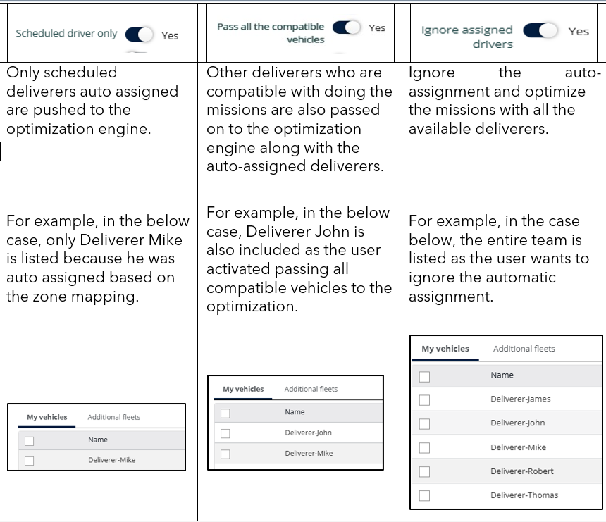

# Affectation automatique des missions aux livreurs

La fonctionnalité d’affectation automatique dans Nomadia Delivery simplifie la répartition en affectant automatiquement les missions aux bons livreurs et véhicules, en fonction de zones spatiales ou postales prédéfinies. Cela réduit les tâches manuelles, limite la charge administrative et améliore l’efficacité, en particulier dans les opérations à fort volume.

## Avant de commencer

* Pour utiliser l’affectation automatique des missions, vous devez disposer au préalable d’une zone de code postal ou d’une zone spatiale configurée. Pour un guide pas à pas, reportez-vous au guide Création de zones par sectorisation automatique.

## Présentation de la fonctionnalité

* Onglet **Agences** et **zones** : permet de configurer les affectations de zones pour les utilisateurs disposant d’un accès mobile.
* **Livreur planifié** : champ mis à jour avec l’utilisateur ou le véhicule lié à la zone dans laquelle se trouve le point de retrait ou de livraison d’une mission.
* **Synchronisation des zones** : lorsqu’un utilisateur est lié à un véhicule, tous les paramètres de zone se synchronisent automatiquement avec ce véhicule.
* **Options d’optimisation** : utiliser uniquement le livreur planifié affecté automatiquement, autoriser tous les véhicules compatibles ou ignorer les livreurs affectés automatiquement.

## Associer des zones aux utilisateurs et aux véhicules

1. Ouvrez l’application Nomadia Delivery et accédez à l’onglet **Configuration**.
2. Dans la liste déroulante, sélectionnez **Gérer les utilisateurs**.
3. Cliquez sur l’icône **crayon** à côté de l’utilisateur mobile souhaité.

<figure><figcaption></figcaption></figure>

4. Cliquez sur **Agences** et **zones** pour configurer les affectations de zones. Les utilisateurs disposant d’un accès mobile voient cet onglet supplémentaire pour configurer les droits sur les zones.
5. Déplacez les zones disponibles des agences associées vers le panneau de droite pour les affecter à l’utilisateur.

<figure><figcaption></figcaption></figure>

6. Après avoir ajusté les paramètres de zone, cliquez sur **Enregistrer** pour confirmer les modifications.

<figure><figcaption></figcaption></figure>

### Résultat

Si l’utilisateur est lié à un véhicule, tous les paramètres de zone se synchronisent automatiquement avec ce véhicule.

<figure><figcaption></figcaption></figure>

## Affecter les missions automatiquement

Une fois que les utilisateurs et les véhicules sont correctement synchronisés avec leurs paramètres de zone, les missions sont automatiquement affectées en fonction de l’alignement spatial. Si le point de retrait ou de livraison d’une mission se trouve dans une zone configurée, l’utilisateur ou le véhicule correspondant lié à cette zone est automatiquement affecté, et le champ **Livreur planifié** est mis à jour.

<figure><figcaption></figcaption></figure>

Si plusieurs utilisateurs partagent la même zone, le système affecte la mission au premier utilisateur.

<figure><figcaption></figcaption></figure>

## Optimiser les missions affectées automatiquement

Pendant l’optimisation, le planificateur dispose de trois options :

* Utiliser uniquement le livreur planifié affecté automatiquement.
* Autoriser la prise en compte de tous les véhicules compatibles pour l’optimisation.
* Ignorer les livreurs affectés automatiquement.

<figure><figcaption></figcaption></figure>

## Conseils


**Accès mobile uniquement** : les zones ne peuvent être associées qu’aux utilisateurs disposant d’un accès mobile.



**Zones différentes pour les utilisateurs et les véhicules** : Nomadia Delivery permet également, dans des cas exceptionnels tels qu’un arrêt maladie ou une indisponibilité soudaine, d’affecter les utilisateurs et les véhicules à différentes zones. Dans ce type de situation, une erreur de synchronisation apparaît dans la section Générale du véhicule.


<figure><figcaption></figcaption></figure>

## Rubriques connexes

* [Gérer les utilisateurs](README.md)
* [Activation de l’accès mobile](enabling-mobile-access.md)
* [Gérer les zones postales](../manage-studies-and-zones/manage-postal-zones.md)
* [Créer des zones postales par gestion de territoire (sectorisation)](../manage-studies-and-zones/create-postal-zones-by-territory-management-sectorization.md)
