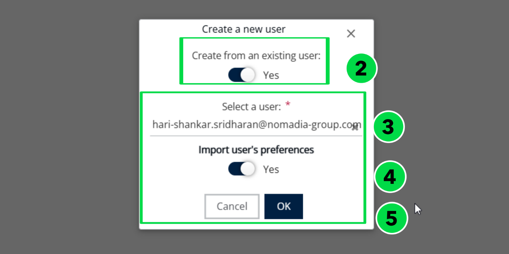
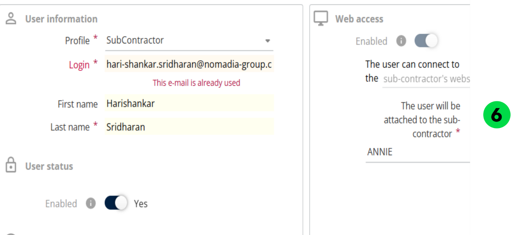

# Créer un utilisateur à partir d’un utilisateur existant

Créez un utilisateur à partir d’un utilisateur existant dans Gérer les utilisateurs pour partir des paramètres de l’utilisateur existant.

## Avant de commencer

* Connectez-vous à **Nomadia Delivery** avec un profil utilisateur ayant accès à **Gérer les utilisateurs**.
* Disposez d’un utilisateur existant dont vous souhaitez reprendre les paramètres.

## Présentation de la fonctionnalité

* **Actions** > **Ajouter** : lance la création d’un nouvel utilisateur.
* **Créer à partir d’un utilisateur existant** : option à définir sur **Oui** pour copier un utilisateur existant.
* **Importer les préférences de l’utilisateur** : option permettant de choisir **Oui** ou **Non** pour importer les préférences de l’utilisateur existant.
* **OK** : confirme vos choix et ouvre les détails du nouvel utilisateur.

## Créer un utilisateur à partir d’un utilisateur existant

1. Dans **Gérer les utilisateurs**, cliquez sur le menu déroulant **Actions** et sélectionnez **Ajouter**.
2. Définissez **Créer à partir d’un utilisateur existant** sur **Oui**.
3. Sélectionnez l’utilisateur existant dans la liste.
4. Choisissez **Oui** ou **Non** pour **Importer les préférences de l’utilisateur**, selon vos besoins.
5. Cliquez sur **OK**.

6. Modifiez les détails de l’utilisateur si nécessaire.

7. Cliquez sur **Enregistrer** pour terminer le processus.

## Rubriques connexes

* [Gérer les utilisateurs](README.md)
* [Créer un utilisateur à partir de zéro](creating-user-from-a-scratch.md)
* [Activation de l’accès Web](enabling-web-access.md)
* [Activation de l’accès mobile](enabling-mobile-access.md)
