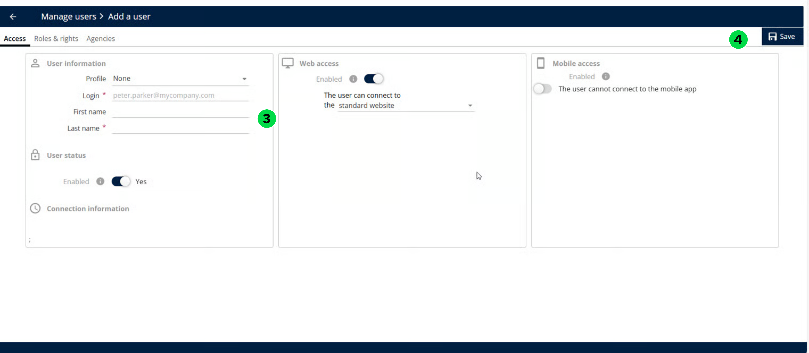

# Créer un utilisateur à partir de zéro

Créez un nouvel utilisateur dans Gérer les utilisateurs sans copier un utilisateur existant.

## Avant de commencer

* Connectez-vous à **Nomadia Delivery** avec un profil utilisateur ayant accès à **Gérer les utilisateurs**.
* Préparez les détails de l’utilisateur et déterminez si l’utilisateur a besoin d’un accès **Web**, d’un **Accès mobile**, ou des deux.

## Présentation de la fonctionnalité

* **Actions** > **Ajouter** : lance la création d’un nouvel utilisateur.
* **Créer à partir d’un utilisateur existant** : option à définir sur **Non** pour créer un utilisateur sans copier un utilisateur existant.
* **détails de l’utilisateur** : informations que vous saisissez pour le nouvel utilisateur.
* **Web** et **Accès mobile** : options que vous activez selon les besoins de l’utilisateur.

## Créer un utilisateur à partir de zéro

1. Dans **Gérer les utilisateurs**, cliquez sur le menu déroulant **Actions** et sélectionnez **Ajouter**.
2. Définissez **Créer à partir d’un utilisateur existant** sur **Non** et cliquez sur **OK**.

<figure><figcaption></figcaption></figure>

3. Saisissez les **détails de l’utilisateur** et activez **Web** et **Accès mobile** selon les besoins.
4. Cliquez sur **Enregistrer** pour terminer le processus.

<figure><figcaption></figcaption></figure>

## Rubriques connexes

* [Gérer les utilisateurs](README.md)
* [Créer un utilisateur à partir d’un utilisateur existant](creating-a-user-from-an-existing-user.md)
* [Activation de l’accès Web](enabling-web-access.md)
* [Activation de l’accès mobile](enabling-mobile-access.md)
