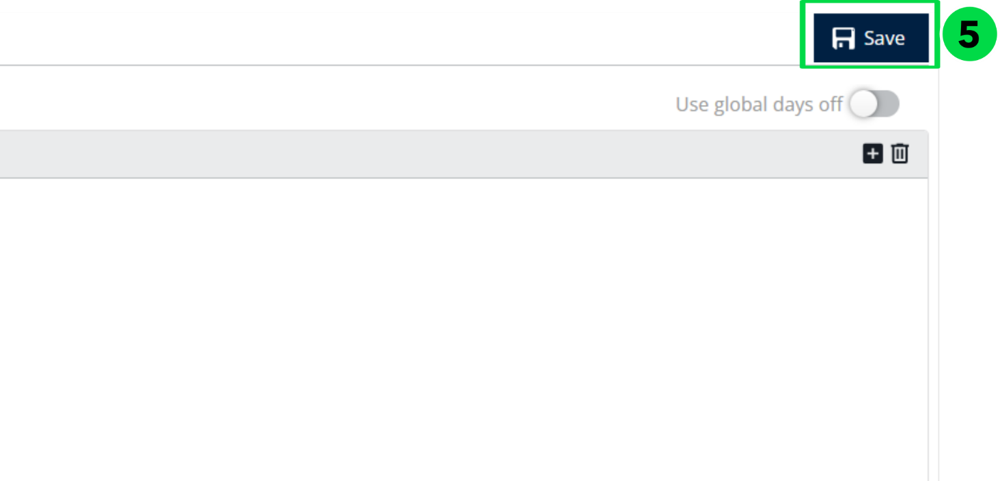

# Jours de congé

Si un utilisateur a prévu un congé ou des vacances, la section Jours d’absence peut être utilisée pour enregistrer les dates d’indisponibilité.

## Avant de commencer

* Connectez-vous à **Nomadia Delivery** avec un profil utilisateur ayant accès à **Gérer les utilisateurs**.
* Connaissez les dates du congé ou des vacances prévus et le motif.

## Présentation de la fonctionnalité

* **Jours d’absence** : section où vous enregistrez les dates auxquelles un utilisateur est indisponible.
* **+ (Ajouter)** : icône qui ouvre la saisie d’une nouvelle période d’indisponibilité.
* **Date de début** et **Date de fin** : champs qui définissent les dates d’indisponibilité.
* **Motif** : champ qui précise pourquoi l’utilisateur est indisponible.

## Enregistrer des jours d’absence

1. Accédez à **Jours d’absence**.

2. Cliquez sur l’icône **+ (Ajouter)**.

3. Saisissez la **Date de début**, la **Date de fin**, et précisez le **Motif**.
4. Cliquez sur **Ajouter**.

5. Cliquez sur **Enregistrer** pour mettre à jour les détails.

## Rubriques connexes

* [Gérer les utilisateurs](README.md)
* [Gérer le profil utilisateur](manage-user-profile.md)
