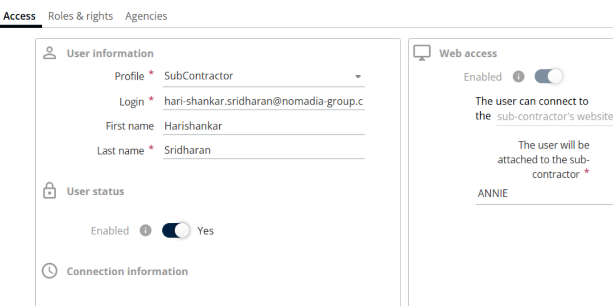
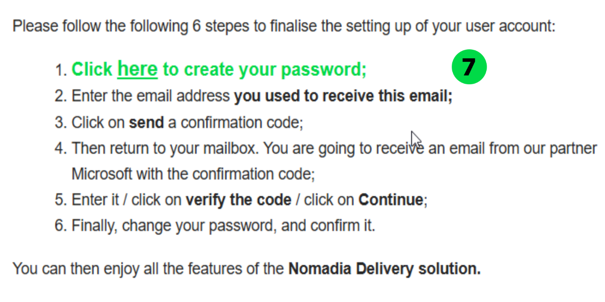

# Activation de l’accès Web

Activez l’accès web lorsque vous créez un utilisateur afin qu’il puisse se connecter à l’application web. L’utilisateur reçoit un e-mail de notification et définit un mot de passe.

## Avant de commencer

* Déterminez quel **Nom du profil** s’applique à l’utilisateur : **Planificateur (Standard)**, **Sous-traitant** ou **Sous-sous-traitant**.

## Présentation de la fonctionnalité

* **Planificateur (Standard)** : l’accès peut être accordé à un **Transporteur**.
* **Sous-traitant** : l’accès peut être accordé à un **Sous-traitant**.
* **Sous-sous-traitant** : l’accès peut être accordé à un **Sous-sous-traitant**.

## Activer l’accès web pour un utilisateur

1. Accédez à **Configuration**.
2. Dans la liste, sélectionnez **Gérer les utilisateurs**.
3. Cliquez sur le menu déroulant **Actions** et sélectionnez **Ajouter**.
4. Définissez **Créer à partir d’un utilisateur existant** sur **Non**, puis cliquez sur **OK**.
5. Sélectionnez le **Nom du profil** approprié : **Planificateur (Standard)**, **Sous-traitant** ou **Sous-sous-traitant**.
6. Saisissez les détails suivants :
   * **ID de connexion**
   * **Prénom**
   * **Nom de famille**

7. Définissez le **Statut de l’utilisateur** sur **Oui** ou **Non**, selon les besoins.
8. Activez ou désactivez l’**Accès web** selon les besoins et sélectionnez le **Nom du sous-sous-traitant**, le cas échéant.

9. Cliquez sur **Enregistrer**. Un e-mail de notification est envoyé à l’utilisateur.

## Définir le mot de passe

1. Ouvrez l’e-mail et cliquez sur le lien fourni pour définir le mot de passe.

2. Saisissez votre **adresse e-mail** et cliquez sur **Envoyer le code de vérification**.

3. Saisissez le code de vérification reçu et cliquez sur **Vérifier le code**.

4. Cliquez sur **Continuer**.

5. Saisissez le **nouveau mot de passe** et confirmez-le. Pour plus d’informations sur la politique de mot de passe, reportez-vous à [Politique de mot de passe pour l’accès Web](web-roles-and-rights.md).
6. Cliquez sur **Continuer**.

### Résultat

Le mot de passe a été modifié avec succès.

## Conseils


**Format de l’ID de connexion** : pour les **utilisateurs web**, l’**ID de connexion** doit être au format e-mail valide (par exemple, user@example.com).



**Rôles et droits hérités** : lorsqu’un profil est sélectionné, tous les rôles et droits d’accès sont hérités automatiquement. Les rôles et droits ne peuvent pas être activés ou désactivés manuellement au niveau de l’utilisateur. Pour modifier des rôles ou des droits d’accès, les modifications doivent être apportées dans la **configuration du profil**.


## Rubriques connexes

* [Gérer les utilisateurs](README.md)
* [Web - Rôles et droits](web-roles-and-rights.md)
* [Activation de l’accès mobile](enabling-mobile-access.md)
* [Créer un utilisateur à partir d’un utilisateur existant](creating-a-user-from-an-existing-user.md)
* [Créer un utilisateur à partir de zéro](creating-user-from-a-scratch.md)
