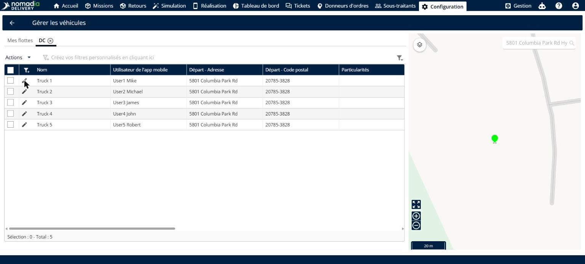
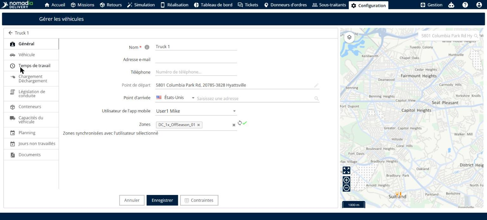
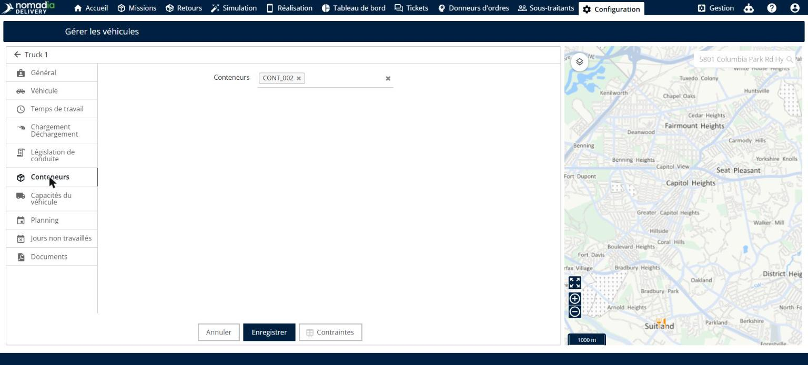
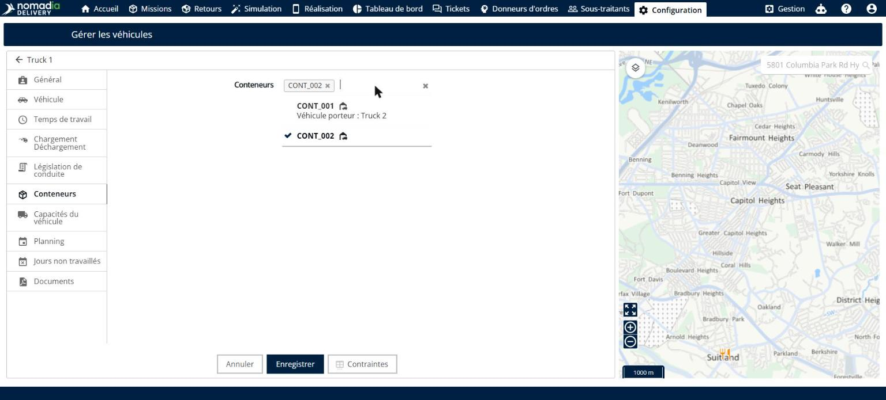
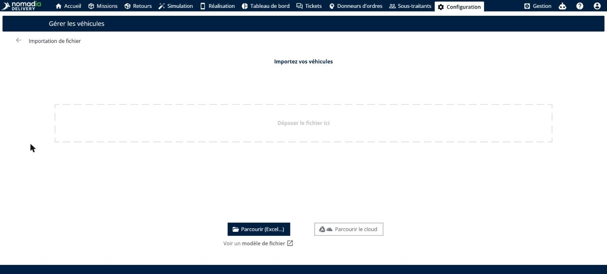
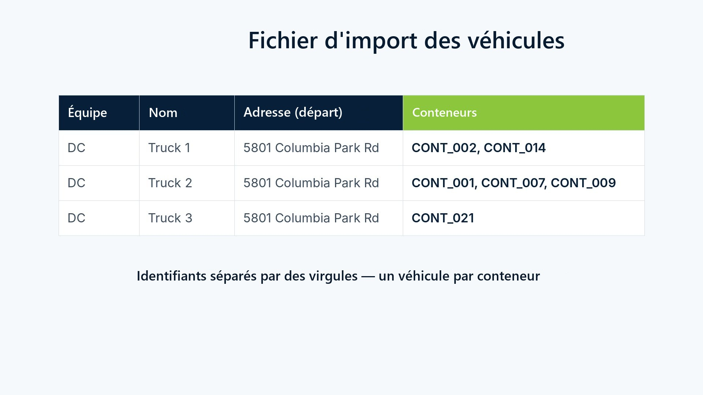
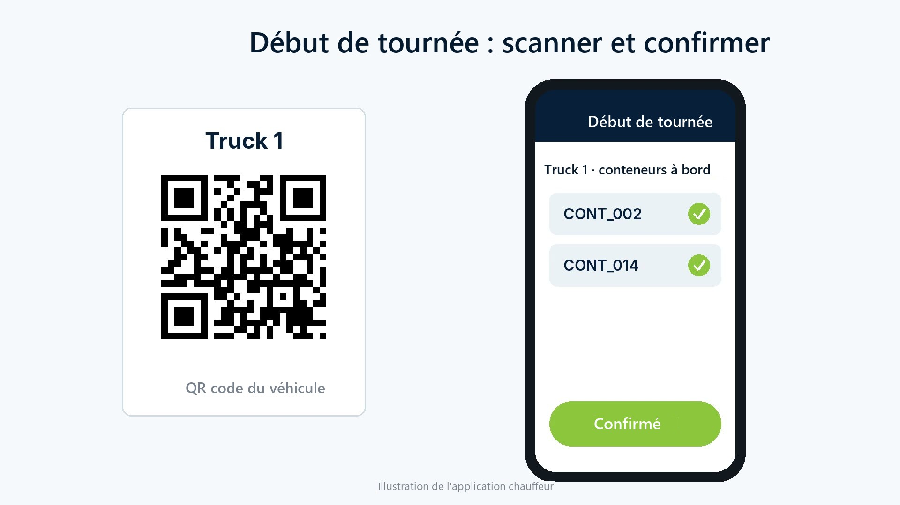

# Associer des conteneurs aux véhicules

L’association des conteneurs aux véhicules vous permet de définir les conteneurs présents à bord de chaque véhicule. Les chauffeurs voient leurs conteneurs au début de la tournée et les confirment en un seul scan du QR code du véhicule, ce qui réduit les erreurs de dépôt et accélère les départs de tournée. Vous pouvez associer les conteneurs véhicule par véhicule, ou en masse avec un fichier d’import des véhicules.

## Avant de commencer

* Connectez-vous à **Nomadia Delivery** avec un profil utilisateur ayant accès à la page **Configuration**.
* Assurez-vous que les conteneurs existent dans la liste des conteneurs. Voir [Suivre chaque conteneur par son identifiant unique](../manage-container-types/track-individual-containers-by-unique-id.md).

## Présentation de la fonctionnalité

* **Gérer les véhicules** : page de **Configuration**, dans la section **Véhicules et optimisation**, qui répertorie les véhicules de chaque flotte.
* **Onglet Conteneurs** : onglet d’un véhicule où vous choisissez les conteneurs à bord.
* **Véhicule porteur** : véhicule auquel un conteneur est déjà associé. Un conteneur ne peut être associé qu’à un seul véhicule à la fois.
* **Colonne Conteneurs** : colonne du fichier d’import des véhicules dans laquelle vous indiquez les identifiants des conteneurs de chaque véhicule, séparés par des virgules.
* **Imprimer les QR codes** : action qui imprime le QR code des véhicules sélectionnés, que les chauffeurs scannent au début de la tournée.

## Associer des conteneurs à un véhicule

1. Accédez à **Configuration** > **Gérer les véhicules**, puis ouvrez la flotte, par exemple **DC**.

2. Cliquez sur l’**icône crayon** à côté du véhicule. La fiche du véhicule s’ouvre sur l’onglet **Général**.

3. Cliquez sur l’onglet **Conteneurs**.

4. Dans le champ **Conteneurs**, choisissez les conteneurs à bord du véhicule. La liste affiche le **Véhicule porteur** des conteneurs déjà associés à un autre véhicule, car un conteneur ne peut être à bord que d’un seul véhicule.

5. Cliquez sur **Enregistrer**.

## Associer des conteneurs aux véhicules en masse

1. Sur la page **Gérer les véhicules**, cliquez sur **Actions**, puis sur **Importer**.

2. Dans votre fichier d’import des véhicules, ajoutez une colonne **Conteneurs**. Pour chaque véhicule, saisissez les identifiants des conteneurs séparés par des virgules. Chaque conteneur ne peut être indiqué que pour un seul véhicule. Pour partir d’un exemple, cliquez sur **Voir un modèle de fichier**.

3. Déposez le fichier sur la page d’import, ou cliquez sur **Parcourir (Excel…)** pour le sélectionner, puis terminez l’import.

### Résultat

Les conteneurs sont associés aux véhicules indiqués dans le fichier.

## Imprimer les QR codes des véhicules

1. Sur la page **Gérer les véhicules**, cochez les cases des véhicules.
2. Cliquez sur **Actions**, puis sur **Imprimer les QR codes**.

3. Placez chaque QR code dans son véhicule.

### Résultat

Au début de la tournée, le chauffeur scanne le QR code du véhicule dans l’application mobile. L’application affiche les conteneurs à bord du véhicule, et le chauffeur les confirme en un seul scan.

## Conseils


**Un véhicule par conteneur** : un conteneur ne peut être à bord que d’un seul véhicule à la fois. Vérifiez le **Véhicule porteur** affiché dans la liste avant de choisir un conteneur.


## Rubriques connexes

* [Gérer les véhicules d’une flotte](manage-vehicles-in-a-fleet.md)
* [Suivre chaque conteneur par son identifiant unique](../manage-container-types/track-individual-containers-by-unique-id.md)
* [Gérer les types de conteneurs](../manage-container-types/README.md)
