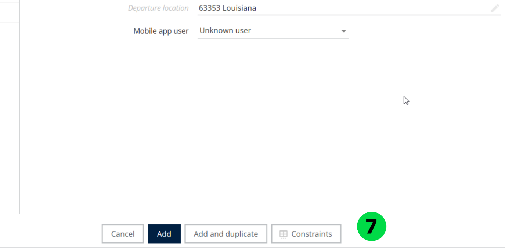
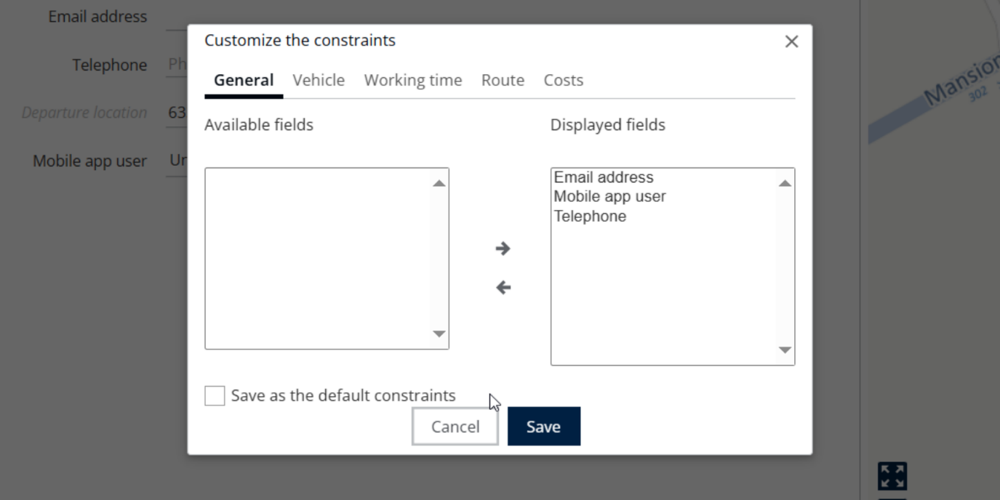
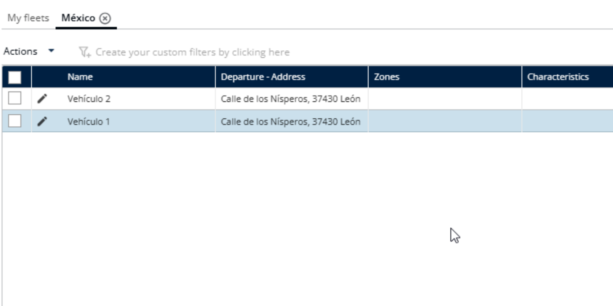

# Personnaliser les contraintes

Choisissez les champs de contraintes à afficher dans le tableau des véhicules.

## Avant de commencer

* Connectez-vous à **Nomadia Delivery** avec un profil utilisateur ayant accès à la page **Configuration**.
* Assurez-vous qu’une flotte existe sous **Gérer les véhicules** dans **Mes données**.

## Présentation de la fonctionnalité

* **Gérer les véhicules** : option sous **Mes données** qui liste vos flottes de véhicules.
* **Actions** : menu que vous utilisez pour ajouter et ouvrir **Contraintes**.
* **Contraintes** : champs que vous pouvez choisir d’afficher dans le tableau des véhicules.

## Personnaliser les contraintes

1. Allez dans **Configuration**.
2. Cliquez sur le menu **Configuration**.
3. Sous Mes données, cliquez sur **Gérer les véhicules**.
4. Cliquez sur le nom souhaité.
5. Cliquez sur **Actions**.
6. Cliquez sur **Ajouter**.
7. Cliquez sur **Contraintes**.

8. Choisissez les champs que vous souhaitez afficher dans le tableau.
9. Cliquez sur **Enregistrer**.

### Résultat

Les champs ont été affichés avec succès.

## Conseils


**Sélection des champs** : évitez de sélectionner trop de champs à la fois, car cela pourrait rendre la lecture ou la navigation difficile.


## Rubriques connexes

* [Gérer les flottes de véhicules](README.md)
* [Gérer les véhicules d’une flotte](manage-vehicles-in-a-fleet.md)
