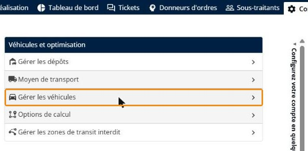
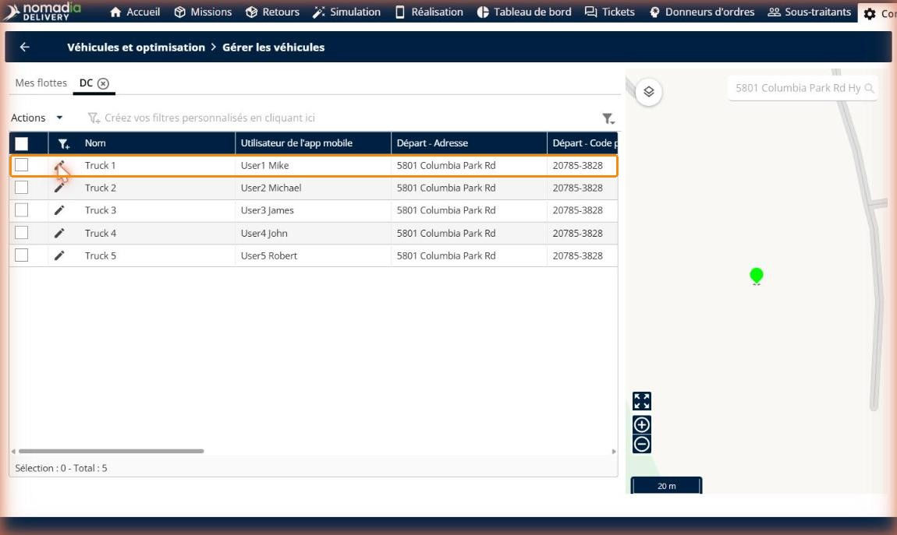
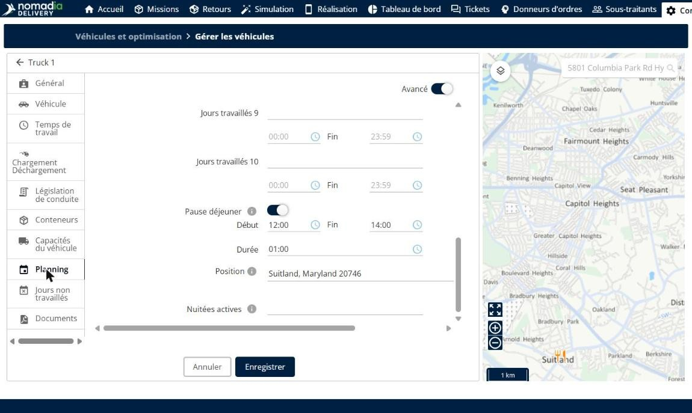
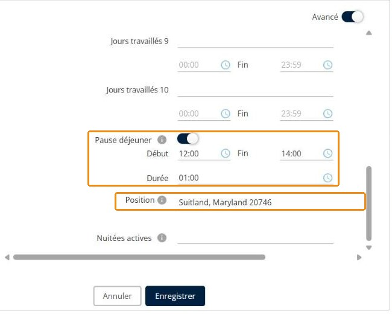
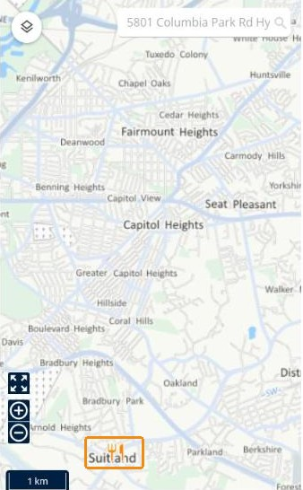
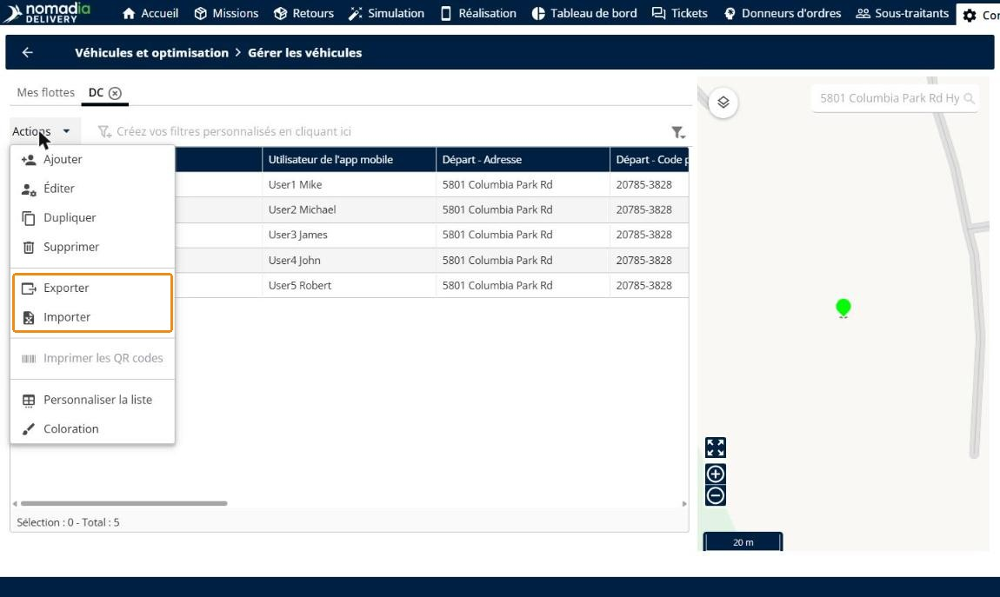
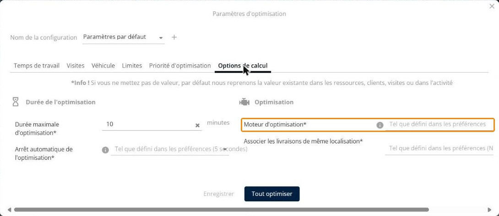
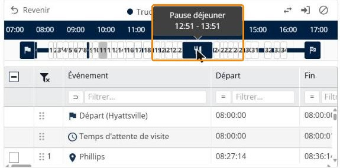
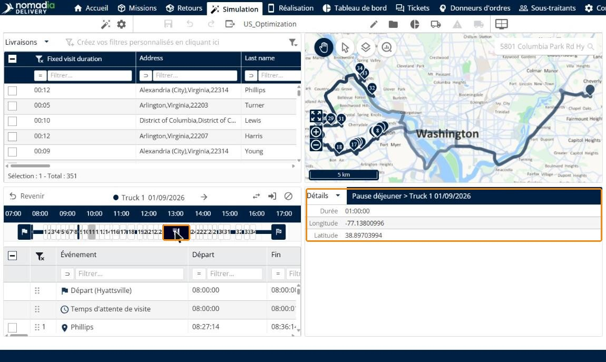
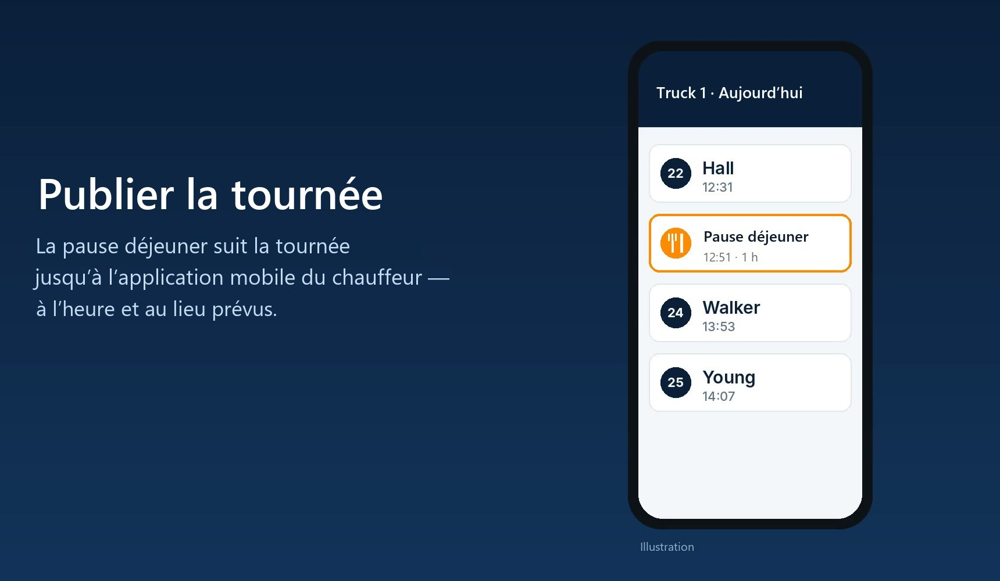

# Lieu de pause déjeuner du chauffeur

**Lieu de pause déjeuner du chauffeur** vous permet d’intégrer le trajet vers le lieu de déjeuner dans chaque tournée optimisée. Sur chaque véhicule, vous définissez une plage horaire de pause déjeuner, sa durée et le lieu où le chauffeur déjeune. L’optimisation intègre alors le trajet aller et retour vers ce lieu dans la tournée, afin que le planning reflète l’endroit et le moment où le chauffeur s’arrête réellement. La pause déjeuner apparaît sur la carte, dans le détail de la tournée et dans l’application mobile du chauffeur.

## Avant de commencer

* Connectez-vous à **Nomadia Delivery** avec un accès à **Configuration**.
* Assurez-vous que le véhicule du chauffeur existe dans une flotte. Pour en savoir plus, consultez [Gérer les véhicules d’une flotte](manage-vehicles-in-a-fleet.md).

## Présentation de la fonctionnalité

* **Pause déjeuner** : interrupteur de l’onglet **Planning** du véhicule qui active une pause déjeuner pour le chauffeur.
* **Début** et **Fin** : plage horaire pendant laquelle la pause déjeuner peut avoir lieu, par exemple de **12:00** à **14:00**.
* **Durée** : durée de la pause déjeuner, par exemple **01:00**.
* **Position** : adresse où le chauffeur déjeune. L’optimisation intègre le trajet aller et retour vers ce lieu dans la tournée.
* **Icône sur la carte** : le lieu de déjeuner apparaît sur la carte du véhicule avec une icône couteau et fourchette.
* **Import et export** : l’adresse de déjeuner est incluse lorsque vous exportez ou importez des véhicules.
* **Changement automatique de moteur** : lorsqu’un lieu de déjeuner est défini, l’optimisation utilise le moteur **Standard – Expérimental**.

## Définir la pause déjeuner et son lieu

1. Allez dans **Configuration** > **Véhicules et optimisation** > **Gérer les véhicules**.

2. Ouvrez la flotte, puis cliquez sur l’icône de modification du véhicule du chauffeur, par exemple **Truck 1**.

3. Cliquez sur l’onglet **Planning**.

4. Activez **Pause déjeuner**.
5. Dans **Début** et **Fin**, saisissez la plage horaire de la pause déjeuner, par exemple **12:00** et **14:00**.
6. Dans **Durée**, saisissez la durée de la pause, par exemple **01:00**.
7. Dans **Position**, saisissez l’adresse où le chauffeur déjeune, par exemple **Suitland, Maryland 20746**.

8. Cliquez sur **Enregistrer**.

### Résultat

Le lieu de déjeuner apparaît sur la carte avec une icône couteau et fourchette.

## Importer ou exporter les adresses de déjeuner

Pour définir l’adresse de déjeuner de nombreux véhicules en une seule fois, utilisez l’import et l’export des véhicules.

1. Sur la page **Gérer les véhicules**, cliquez sur **Actions**.
2. Cliquez sur **Exporter** pour télécharger les véhicules avec leur adresse de déjeuner, ou sur **Importer** pour charger un fichier de véhicules qui contient l’adresse de déjeuner.

## Optimiser les tournées

1. Optimisez vos tournées comme d’habitude.

Lorsqu’un lieu de déjeuner est défini, l’optimisation utilise automatiquement le moteur **Standard – Expérimental**, quel que soit le **Moteur d’optimisation** choisi dans les **Options de calcul**. Si le moteur **Logistic** était actif, une fenêtre explique ce changement.

### Résultat

La pause déjeuner est intégrée à la tournée optimisée. Sur la frise de la tournée, l’icône couteau et fourchette indique le moment de la pause déjeuner, par exemple de **12:51** à **13:51**.

## Vérifier la pause déjeuner pendant la validation

1. Sur la frise de la tournée, cliquez sur la **Pause déjeuner**.

Le panneau **Détails** affiche la durée de la pause, ainsi que la longitude et la latitude du lieu de déjeuner.

## Publier la tournée

1. Publiez la tournée comme d’habitude.

### Résultat

La pause déjeuner suit la tournée jusqu’à l’application mobile du chauffeur, à l’heure et au lieu prévus.

## Conseils


**Prévoyez une plage horaire réaliste** : une plage **Début** – **Fin** plus large permet à l’optimisation de placer la pause déjeuner là où elle s’intègre le mieux à la tournée.



**Configurez plusieurs véhicules à la fois** : exportez vos véhicules, ajoutez les adresses de déjeuner dans le fichier, puis importez-le à nouveau.


## Rubriques connexes

* [Gérer les véhicules d’une flotte](manage-vehicles-in-a-fleet.md)
* [Personnaliser les contraintes](customize-the-constraints.md)
* [Suivre chaque conteneur par son identifiant unique](../manage-container-types/track-individual-containers-by-unique-id.md)
