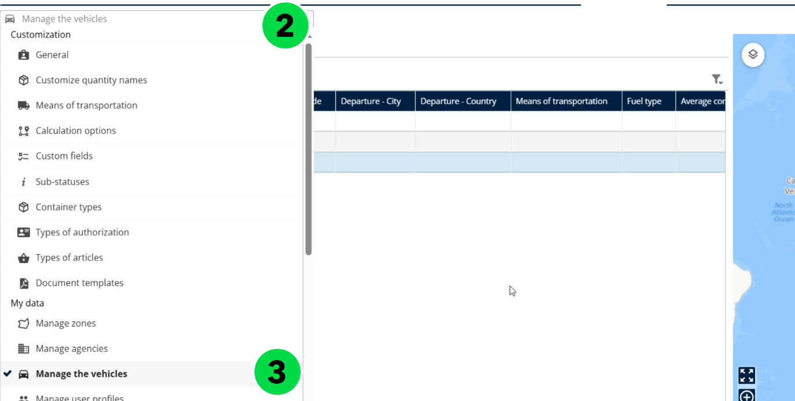
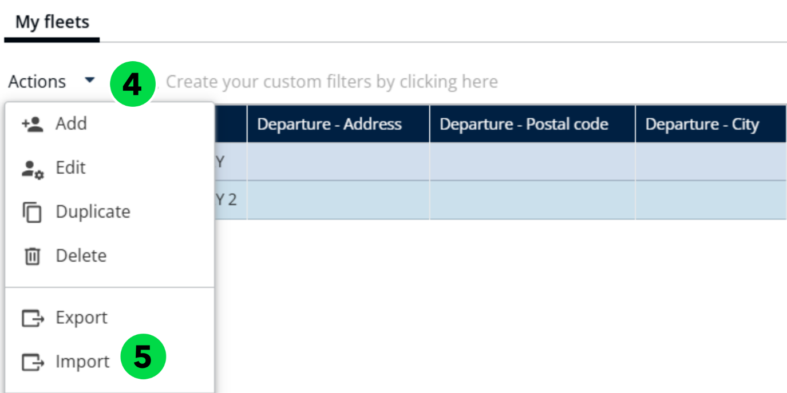
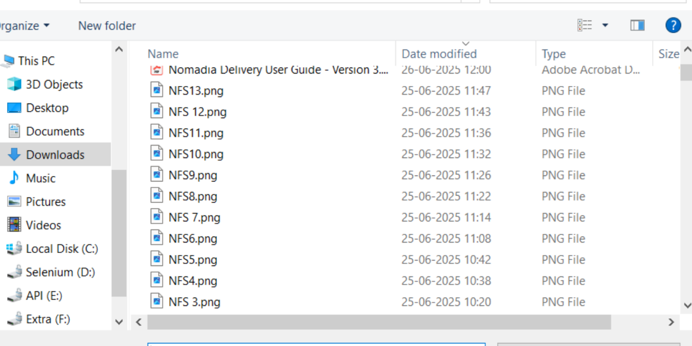
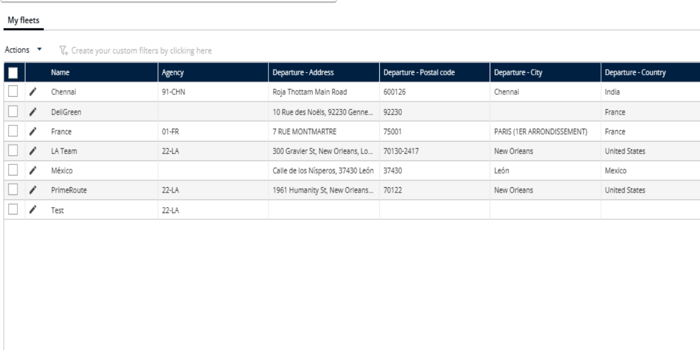
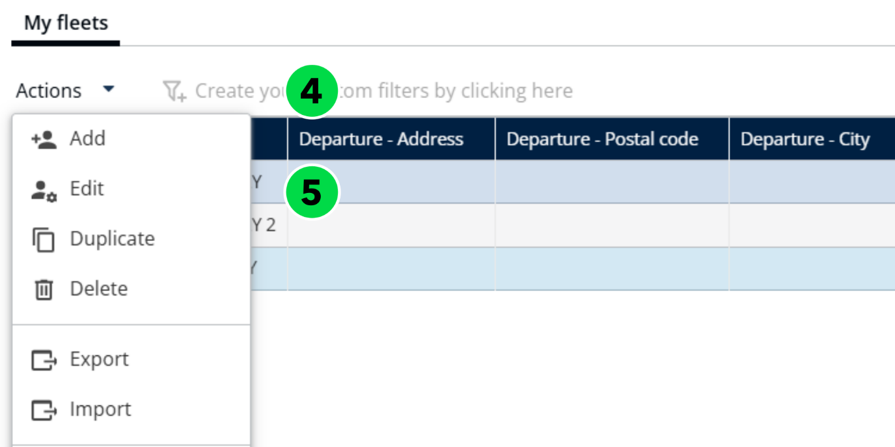
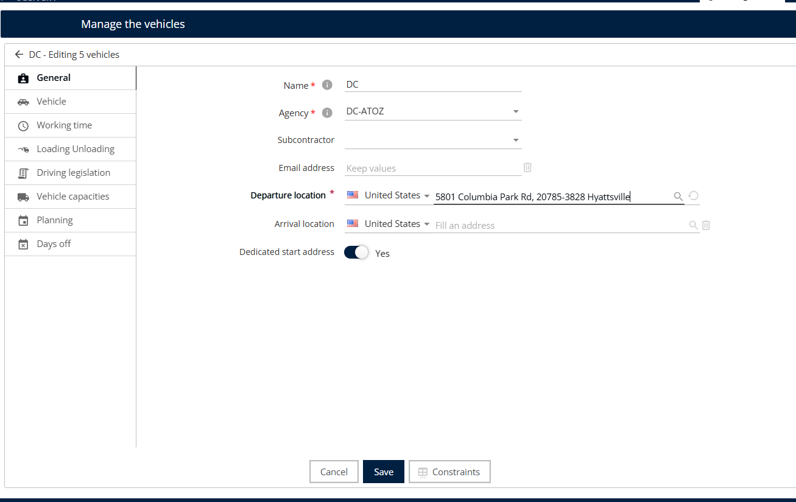
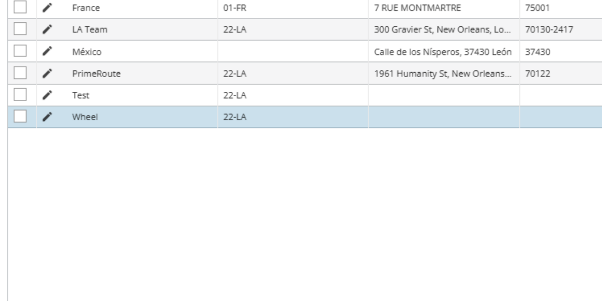
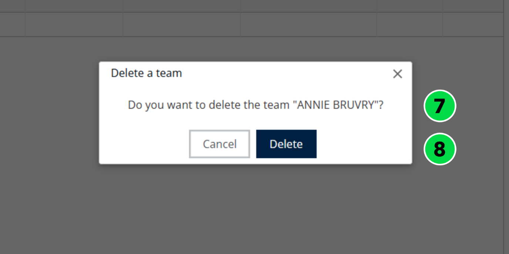
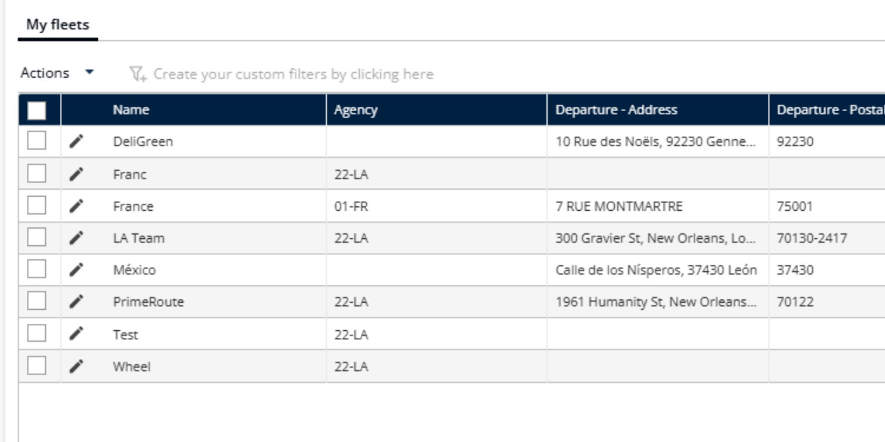

# Gérer les flottes de véhicules

La fonctionnalité **Gérer les flottes de véhicules** de Nomadia Delivery permet aux administrateurs et aux planificateurs de tenir un registre à jour des véhicules utilisés pour les opérations de livraison. Cela comprend l’ajout, la modification ou la désactivation de véhicules, l’attribution de caractéristiques spécifiques et la garantie que chaque véhicule est correctement configuré pour répondre aux besoins logistiques.

## Importer des flottes de véhicules

1. Ouvrez la page **Configuration**.

2. Sous **Mes données**, cliquez sur **Gérer les véhicules**.

3. Sous **Mes flottes**, cliquez sur le menu déroulant **Actions**.
4. Cliquez sur **Importer**.

5. Cliquez sur **Parcourir un fichier** pour téléverser le fichier.

6. Sélectionnez un fichier valide depuis votre système local.

### Résultat

Les flottes de véhicules ont été importées avec succès.

## Ajouter une flotte de véhicules

1. Ouvrez la page **Configuration**.
2. Sous **Mes données**, cliquez sur **Gérer les véhicules**.
3. Sous **Mes flottes**, cliquez sur le menu déroulant **Actions**.
4. Cliquez sur **Ajouter**.

5. Saisissez le **Nom** et le **Nom de l’agence**.

Lors de l’ajout d’un véhicule, activez le bouton bascule **Adresse de départ dédiée** pour modifier l’**Adresse de départ**.

6. Cliquez sur **Ajouter**.

<figure><figcaption></figcaption></figure>

### Résultat

Le champ d’adresse est désormais activé afin que vous puissiez le modifier.

<figure><figcaption></figcaption></figure>

Les flottes de véhicules ont été ajoutées avec succès.

## Supprimer une flotte de véhicules

1. Ouvrez la page **Configuration**.
2. Sous **Mes données**, cliquez sur **Gérer les véhicules**.
3. Sélectionnez une **Équipe**.
4. Sous **Mes flottes**, cliquez sur le menu déroulant **Actions**.
5. Cliquez sur **Supprimer**.

6. Un message contextuel de confirmation s’affiche : « Voulez-vous supprimer le véhicule ? »
7. Cliquez sur **Supprimer**.

### Résultat

Les flottes de véhicules ont été supprimées avec succès.

## Rubriques connexes

* [Gérer les véhicules d’une flotte](manage-vehicles-in-a-fleet.md)
* [Personnaliser les contraintes](customize-the-constraints.md)
