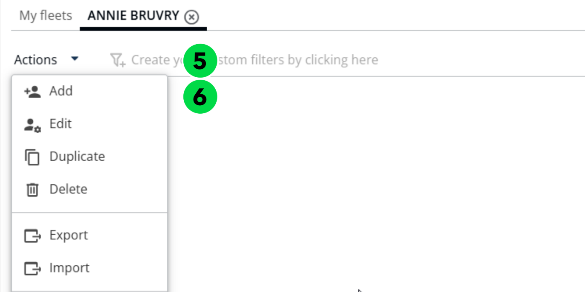
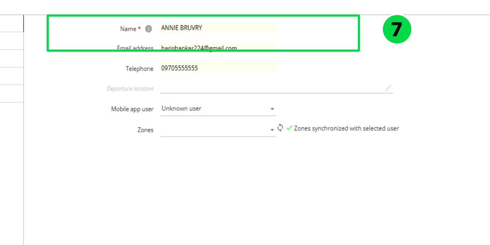
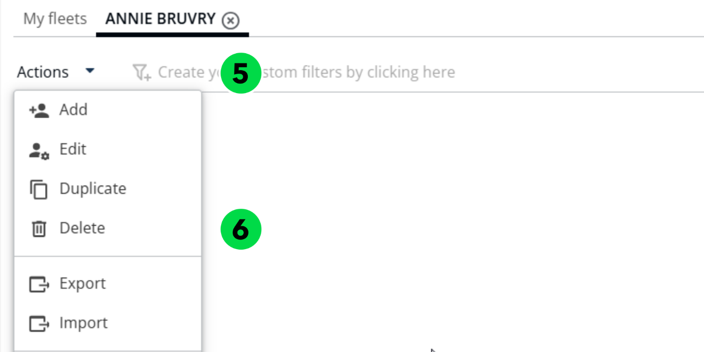
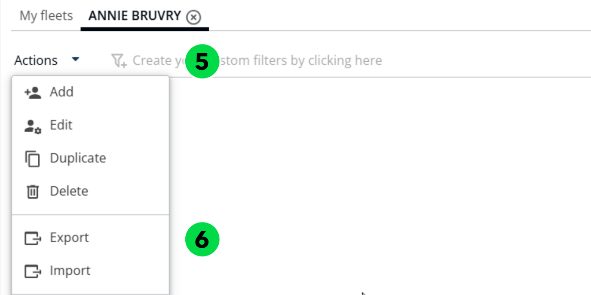
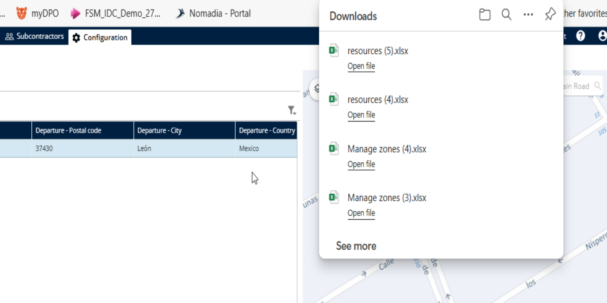
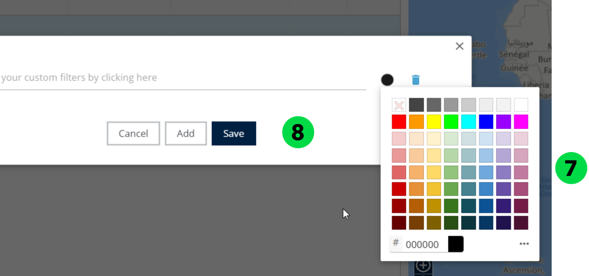
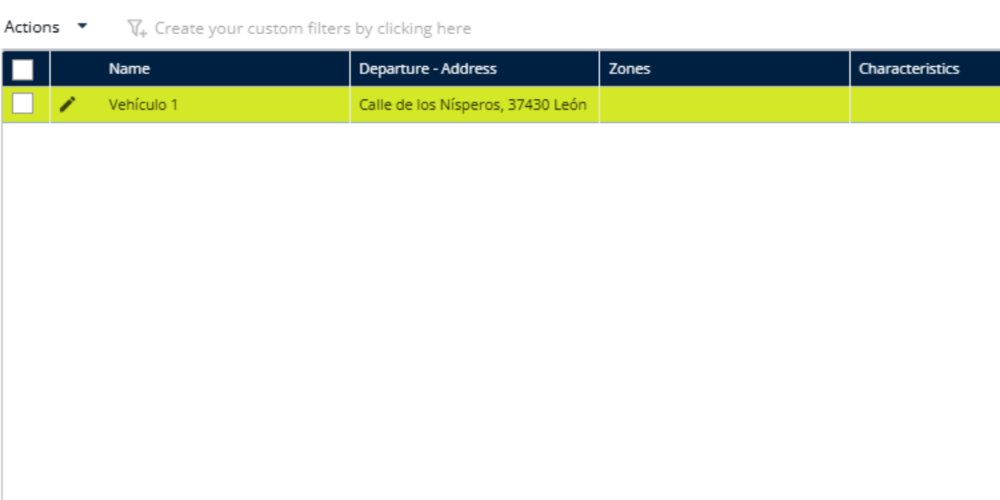
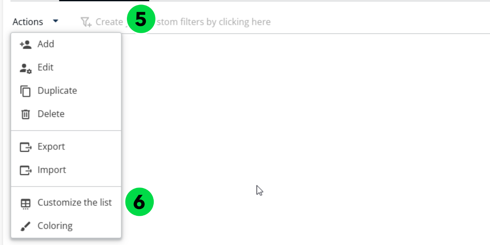
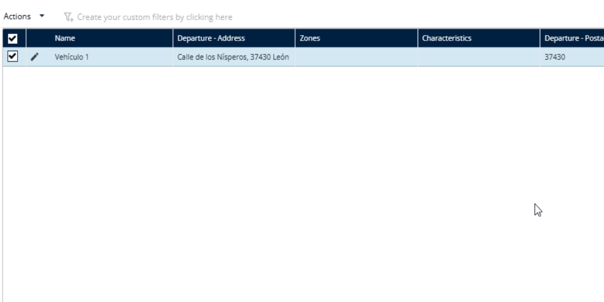
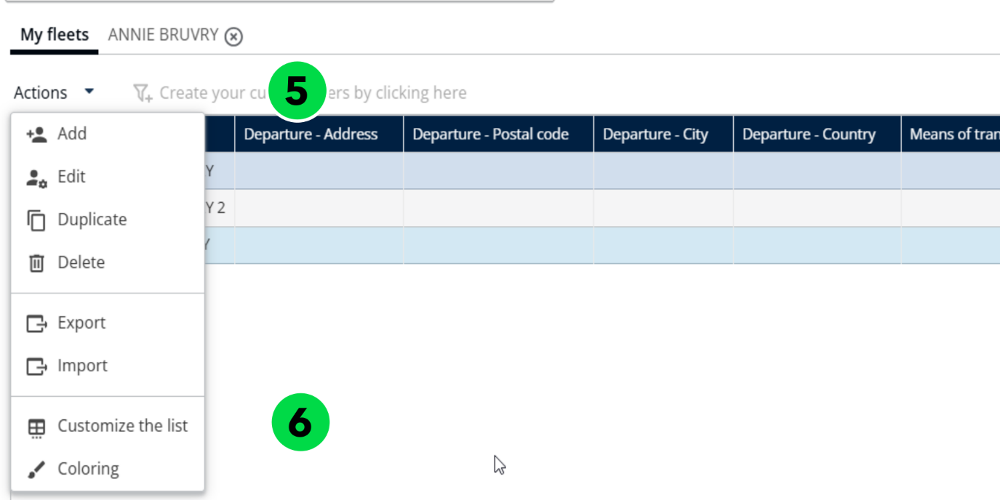

# Gérer les véhicules d’une flotte

Ajoutez, supprimez, exportez et colorez les véhicules d’une flotte, et personnalisez leur affichage.

## Avant de commencer

* Connectez-vous à **Nomadia Delivery** avec un profil utilisateur ayant accès à la page **Configuration**.
* Ouvrez **Gérer les véhicules** sous **Mes données** et sélectionnez le nom de la flotte avec laquelle vous souhaitez travailler.

## Présentation de la fonctionnalité

* **Ajouter** : ajoute un véhicule avec un **Nom**.
* **Supprimer** : supprime un véhicule après confirmation du message contextuel.
* **Exporter** : exporte les véhicules.
* **Coloration** : applique une couleur à un véhicule.
* **Personnaliser la liste** : permet de choisir les champs à afficher dans le tableau des véhicules ou dans le tableau des flottes de véhicules.

## Ajouter un véhicule

1. Allez dans **Configuration**.
2. Cliquez sur le menu **Configuration**.
3. Sous Mes données, cliquez sur **Gérer les véhicules**.
4. Cliquez sur le nom souhaité.
5. Cliquez sur **Actions**.
6. Cliquez sur **Ajouter** dans le menu déroulant.

7. Saisissez le **Nom**.

8. Cliquez sur **Ajouter**.

## Supprimer un véhicule

1. Allez dans **Configuration**.
2. Cliquez sur le menu **Configuration**.
3. Sous Mes données, cliquez sur **Gérer les véhicules**.
4. Cliquez sur le nom souhaité.
5. Cliquez sur **Actions**.
6. Cliquez sur **Supprimer** dans le menu déroulant.

7. Consultez le message contextuel de confirmation qui indique : « Voulez-vous supprimer le véhicule ? »
8. Cliquez sur **Supprimer**.

### Résultat

Les véhicules ont été supprimés avec succès.

## Exporter un véhicule

1. Allez dans **Configuration**.
2. Cliquez sur le menu **Configuration**.
3. Sous Mes données, cliquez sur **Gérer les véhicules**.
4. Cliquez sur le nom souhaité.
5. Cliquez sur **Actions**.
6. Cliquez sur **Exporter** dans le menu déroulant.

### Résultat

Les véhicules ont été exportés avec succès.

## Colorer un véhicule

1. Allez dans **Configuration**.
2. Cliquez sur le menu **Configuration**.
3. Sous Mes données, cliquez sur **Gérer les véhicules**.
4. Cliquez sur le nom souhaité.
5. Cliquez sur **Actions**.
6. Cliquez sur **Coloration** dans le menu déroulant.

7. Choisissez une couleur.
8. Cliquez sur **Enregistrer**.

### Résultat

La couleur a été appliquée avec succès.

## Personnaliser le tableau des véhicules

1. Allez dans **Configuration**.
2. Cliquez sur le menu **Configuration**.
3. Sous Mes données, cliquez sur **Gérer les véhicules**.
4. Cliquez sur le nom souhaité.
5. Cliquez sur **Actions**.
6. Cliquez sur **Personnaliser la liste** dans le menu déroulant.

7. Choisissez les champs que vous souhaitez afficher dans le tableau.
8. Cliquez sur **Enregistrer**.

### Résultat

Les champs sélectionnés sont affichés avec succès dans le tableau.

## Personnaliser le tableau des flottes de véhicules

1. Allez dans **Configuration**.
2. Cliquez sur le menu **Configuration**.
3. Sous Mes données, cliquez sur **Gérer les véhicules**.
4. Sélectionnez une équipe.
5. Sous Mes flottes, cliquez sur le menu déroulant **Actions**.
6. Cliquez sur **Personnaliser la liste**.

7. Choisissez les champs que vous souhaitez afficher dans le tableau.
8. Cliquez sur **Enregistrer**.

### Résultat

Les champs sélectionnés sont affichés avec succès dans le tableau.

## Conseils


**Sélection des champs** : évitez de sélectionner trop de champs à la fois, car le tableau pourrait devenir difficile à lire ou à parcourir.


## Rubriques connexes

* [Gérer les flottes de véhicules](README.md)
* [Personnaliser les contraintes](customize-the-constraints.md)
