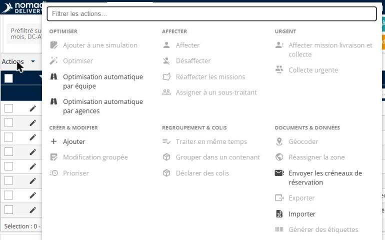
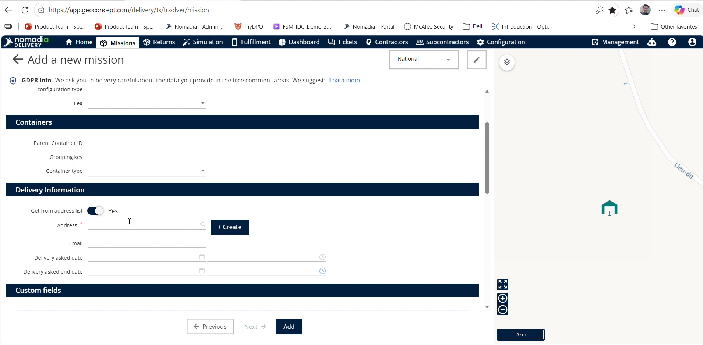
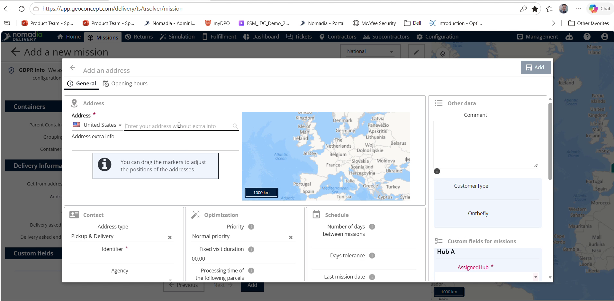
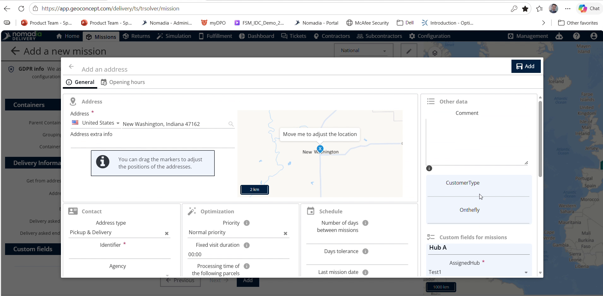
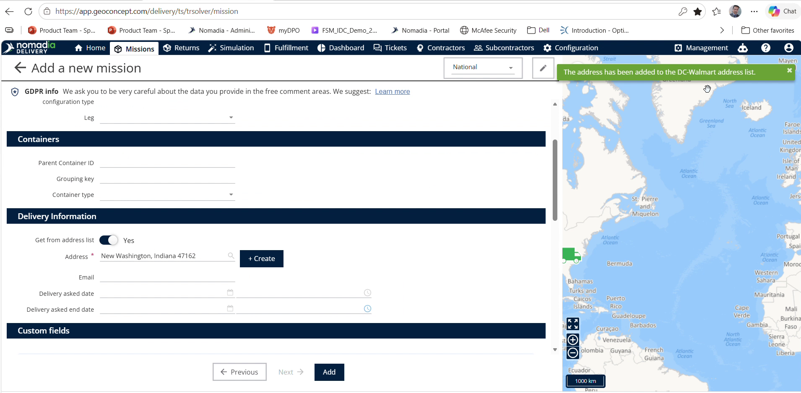
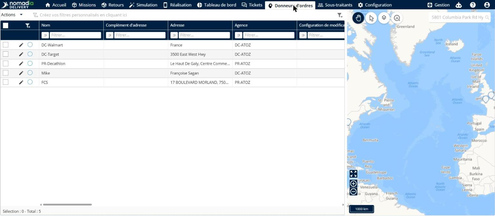
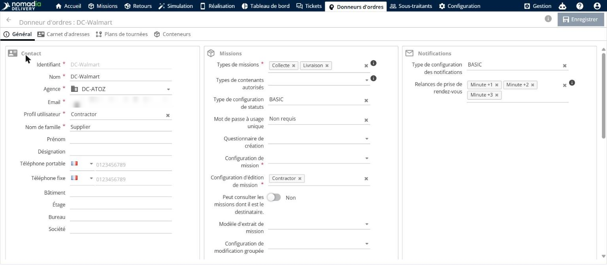
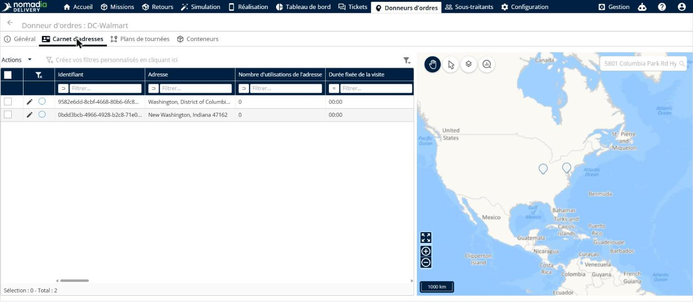

# Création d’adresse ad hoc

Créez et enregistrez une nouvelle adresse à la volée lors de l’ajout d’une mission dans Nomadia Delivery. Cela évite de devoir configurer les données de localisation au préalable et fait gagner du temps de configuration aux répartiteurs. Affectez les nouvelles adresses directement à des contrats spécifiques ou stockez-les dans la liste globale d’adresses.

## Avant de commencer

* Accès à **Nomadia Delivery** avec les autorisations de répartiteur.
* Informations valides de **Type de mission**, **Contrat** et **Agence**.

1. Accédez au menu **Mission** dans **Nomadia Delivery**.
2. Cliquez sur **Actions** et sélectionnez **Ajouter**.

## Présentation de la fonctionnalité

* **Champ Contrat** : sélectionne le contrat associé à l’adresse. S’il est laissé vide, l’adresse est enregistrée dans la liste globale d’adresses.
* **Champ Type de mission** : indique la catégorie de la mission lors de la configuration. Garantit la bonne classification des actifs.
* **Champ Agence** : définit l’agence affectée à la mission et à l’enregistrement de l’adresse. Garantit un acheminement organisationnel correct.
* **Bouton Suivant** : passe des informations initiales au formulaire de configuration de l’adresse. Fait avancer le flux de travail.
* **Bouton Créer** : confirme la saisie initiale de l’adresse et ouvre le mappage détaillé des champs. Génère l’enregistrement de localisation.
* **Bouton Ajouter** : finalise et enregistre l’adresse créée à la volée dans le système. Termine la création de l’adresse.
* **Menu Sous-traitants** : donne accès aux profils des sous-traitants et aux enregistrements d’adresses associés. Permet de vérifier les adresses enregistrées.
* **Onglet Liste d’adresses** : affiche toutes les adresses de localisation enregistrées pour un sous-traitant sélectionné. Permet de confirmer les emplacements créés.

## Créer une adresse ad hoc

1. Accédez à l’écran **Mission** et cliquez sur **Actions**.
2. Sélectionnez **Ajouter** dans le menu déroulant.

3. Sélectionnez le **Sous-traitant**, le **Type de mission** et l’**Agence**.

4. Cliquez sur **Suivant**.

5. Saisissez les informations de l’adresse à enregistrer.

6. Cliquez sur **Créer**.

7. Saisissez les informations complémentaires de l’adresse.

8. Sélectionnez les options des **Champs obligatoires**.

9. Cliquez sur **Ajouter** pour terminer l’enregistrement de l’adresse.

## Consulter une adresse enregistrée

1. Cliquez sur **Sous-traitants** dans le menu principal.

2. Sélectionnez le sous-traitant concerné dans la liste.

3. Sélectionnez les **Champs obligatoires** appropriés.

4. Cliquez sur **Liste d’adresses**.

### Résultat

Consultez les adresses enregistrées.

## Conseils


**Affectation à la liste globale d’adresses** : laissez le champ **Contrat** vide pour enregistrer automatiquement l’adresse dans la liste globale d’adresses, utilisable dans toute l’entreprise.



**Omission de l’affectation du contrat** : évitez de laisser le champ **Contrat** vide si l’adresse doit être limitée à un contrat spécifique.



**Consultation des adresses enregistrées** : accédez à **Sous-traitants**, puis à **Liste d’adresses**, pour vérifier rapidement les adresses nouvellement créées.


## Rubriques connexes

* [Gérer la liste globale d’adresses](../manage-global-address-list.md)
* [Gérer la liste d’adresses](../contractors/manage-address-list.md)
* [Personnaliser la visibilité des adresses](../contractors/customizetheaddresslistvisibility.md)
