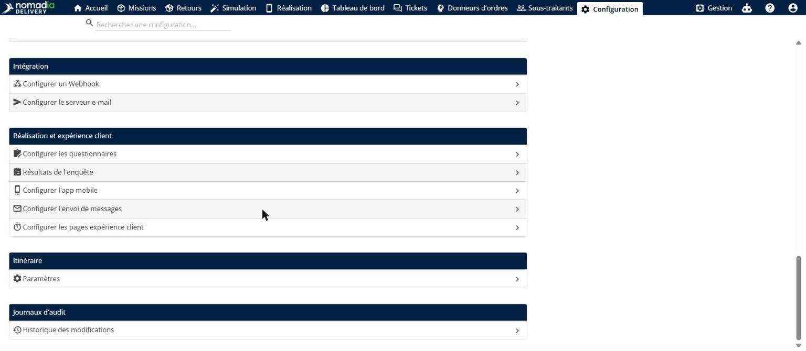
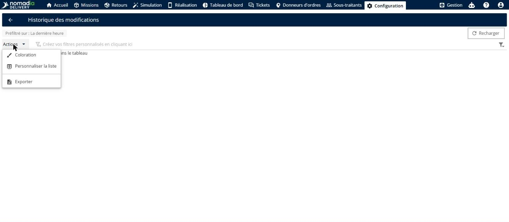
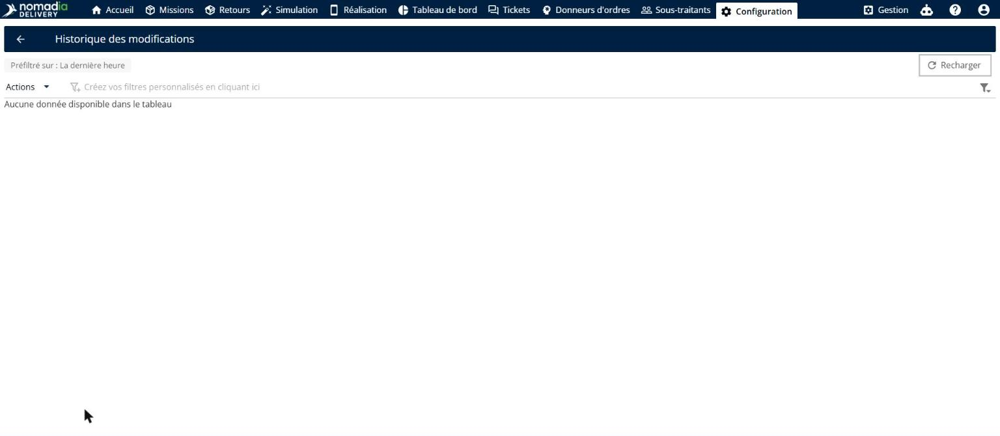
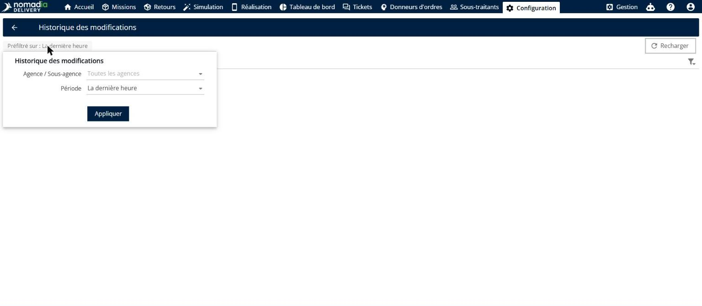

# Journaux d’audit

La fonctionnalité **Journaux d’audit** de Nomadia Delivery suit et enregistre l’activité du système ainsi que les modifications récentes effectuées sur l’ensemble de la plateforme. Les répartiteurs et les planificateurs en ont besoin pour assurer la supervision opérationnelle, vérifier les modifications et auditer les actions de configuration. Avec cet outil, vous pouvez consulter l’historique des modifications, filtrer les journaux par agence ou par période et exporter les enregistrements vers Excel.

## Avant de commencer

Prérequis et exigences système :

* Accès actif à un compte répartiteur ou planificateur **Nomadia Delivery**.

Étapes de configuration initiale :

1. Ouvrez la page **Configuration**.
2. Faites défiler vers le bas et cliquez sur **Historique des modifications**.

## Présentation de la fonctionnalité

* **Date et heure** : affiche l’horodatage exact de la modification.
* **Détails de connexion** : indique le compte utilisateur à l’origine de la modification.
* **Nom de l’objet** : identifie l’élément ou l’enregistrement précis qui a été modifié.
* **Type** : indique la catégorie de la modification enregistrée.
* **Rapport** : reflète les rapports définis par l’utilisateur, créés ou modifiés dans la plateforme.
* **Profil** : affiche le profil utilisateur associé à l’activité.
* **ID de l’objet** : indique l’identifiant système unique de l’élément modifié.
* **Recharger** : actualise le tableau des journaux pour afficher les modifications récentes en cas d’échec du chargement.
* **Préfiltre** : ouvre les options permettant de filtrer les entrées du journal par agence ou par période.

## Afficher et exporter les journaux d’audit

1. Ouvrez la page **Configuration**, faites défiler vers le bas et cliquez sur **Historique des modifications**.

2. Examinez le tableau qui affiche **Date et heure**, **Détails de connexion**, **Nom de l’objet**, **Type**, **Rapport**, **Profil** et **ID de l’objet**.

3. Cliquez sur **Actions** au-dessus du tableau des modifications récentes.

4. Sélectionnez **Exporter** pour télécharger les données du journal sous forme de feuille de calcul Excel.

### Dépannage

* **Les journaux ou les fichiers ne se chargent pas** : cliquez sur **Recharger** pour récupérer les modifications système les plus récentes.

## Filtrer les journaux d’audit par agence et par période

1. Cliquez sur l’étiquette **Préfiltré activé** en haut de l’écran **Historique des modifications**.

2. Sélectionnez l’agence ou la sous-agence cible dans le menu déroulant **Agence / Sous-agence**.

3. Choisissez une plage horaire sous **Période**, par exemple **Dernière heure**, **6 dernières heures**, **24 dernières heures**, **7 derniers jours** ou **14 derniers jours**.

4. Sélectionnez **Personnalisé** pour définir une plage de dates personnalisée précise.

## Conseils


**Recharger les journaux en échec** : cliquez sur **Recharger** chaque fois que des entrées du journal ne se chargent pas, afin de voir immédiatement les modifications récentes du système.



**Recherche par date personnalisée** : sélectionnez l’option de période **Personnalisé** pour vous concentrer sur une fenêtre de temps précise pendant les audits.



**Hypothèse de données non chargées** : ne supposez pas qu’aucune modification n’a eu lieu si la liste est vide ; cliquez sur **Recharger** pour récupérer les journaux manquants.


## Rubriques connexes

* [Journaux des missions](journaux-des-missions.md)
* [Comprendre la page des missions](understanding-the-missions-page/README.md)
