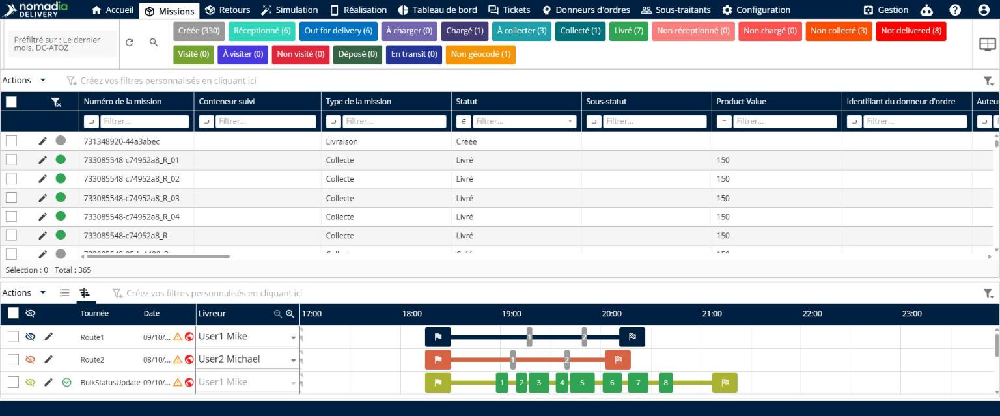
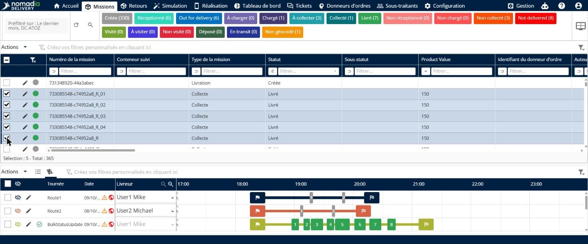
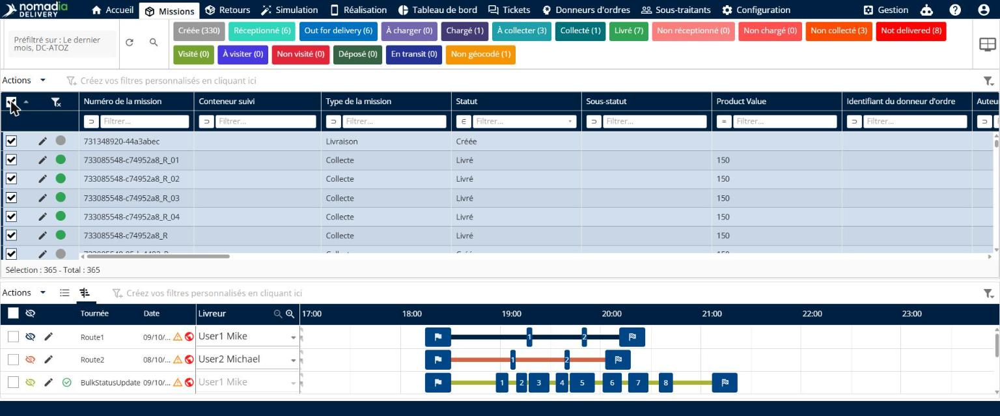
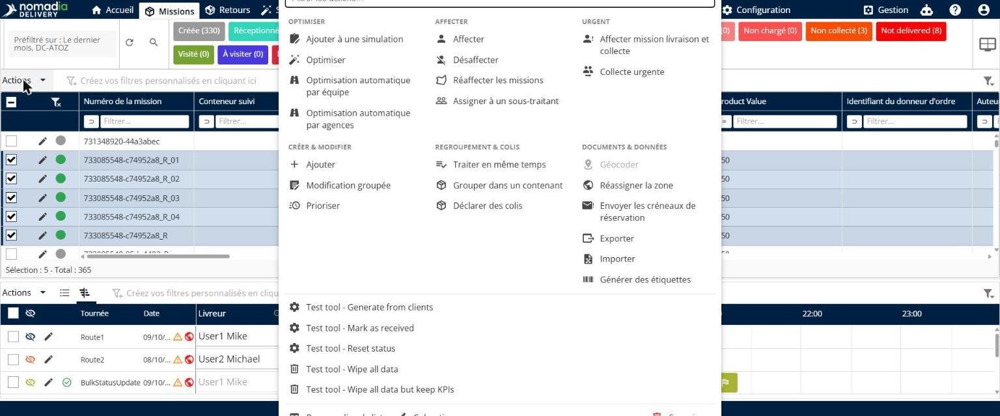
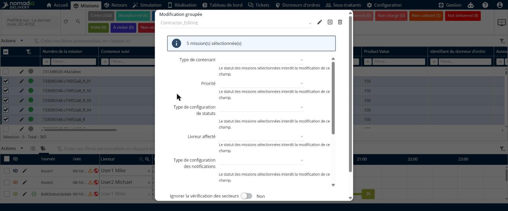
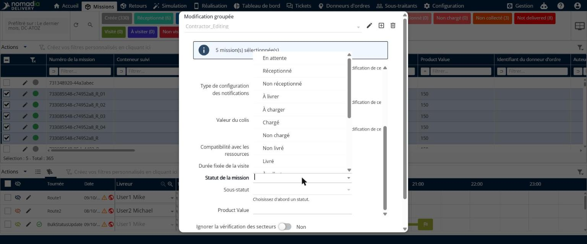
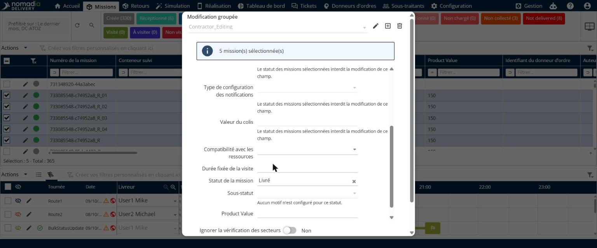
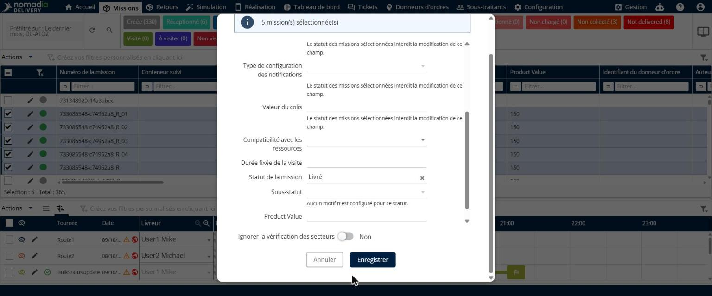

# Mettre à jour le statut des missions en masse

La mise à jour en masse du statut des missions vous permet de modifier le statut de plusieurs missions en une seule action, au lieu de mettre à jour chaque mission une par une. Elle est utile pour les livraisons groupées, les corrections d’erreurs et la gestion des incidents.

## Avant de commencer

* Connectez-vous à **Nomadia Delivery** avec un profil utilisateur disposant de l’autorisation **Modifier les missions**. Si vous ne voyez pas **Modification groupée** dans le menu **Actions**, contactez votre administrateur.
* Assurez-vous que les missions que vous souhaitez mettre à jour existent dans le tableau des missions.
* Déterminez le statut que vous souhaitez appliquer aux missions.

## Présentation de la fonctionnalité

* **Page Missions** : page de l’en-tête principal où vous sélectionnez les missions à mettre à jour.
* **Case à cocher Tout sélectionner** : case à cocher de l’en-tête du tableau qui sélectionne toutes les missions du tableau.
* **Compteur de sélection** : compteur situé sous le tableau qui indique le nombre de missions sélectionnées, par exemple **Sélection : 5 - Total : 365**.
* **Menu Actions** : menu qui contient **Modification groupée**, sous **Créer et modifier**.
* **Fenêtre contextuelle Modification groupée** : fenêtre contextuelle qui indique le nombre de missions sélectionnées et les champs que vous pouvez modifier.
* **Statut de la mission** : champ où vous choisissez le nouveau statut des missions sélectionnées.
* **Sous-statut** : champ facultatif où vous choisissez un motif pour le nouveau statut. Il n’est disponible que lorsqu’un sous-statut est configuré pour le statut choisi.
* **Confirmer le changement de statut** : fenêtre contextuelle qui vous demande de confirmer avant l’application du statut.

## Mettre à jour le statut de plusieurs missions

1. Depuis l’en-tête principal, cliquez sur la page **Missions**.

2. Cochez les cases des missions que vous souhaitez mettre à jour. Le compteur de sélection situé sous le tableau indique le nombre de missions sélectionnées.

3. Pour sélectionner toutes les missions du tableau, cliquez plutôt sur la case à cocher de l’en-tête du tableau.

4. Cliquez sur **Actions**, puis sur **Modification groupée**.

La fenêtre contextuelle **Modification groupée** s’ouvre et indique le nombre de missions sélectionnées.

5. Dans le champ **Statut de la mission**, ouvrez la liste déroulante et choisissez le nouveau statut.

6. Facultatif : dans le champ **Sous-statut**, choisissez un sous-statut pour le nouveau statut. Si aucun sous-statut n’est configuré, le champ affiche **Aucun motif n’est configuré pour ce statut.**

7. Cliquez sur **Enregistrer**.

8. Dans la fenêtre contextuelle **Confirmer le changement de statut**, lisez le message et cliquez sur **OK**. Cliquez sur **Annuler** pour laisser les statuts inchangés.

### Résultat

Une notification confirme que les missions ont été déplacées vers le nouveau statut, et la colonne **Statut** du tableau des missions affiche le nouveau statut pour toutes les missions sélectionnées.

## Conseils


**Les changements de statut sont enregistrés** : vous pouvez rétablir le statut précédent par la suite, mais chaque changement est enregistré dans l’historique de la mission. Voir [Journaux des missions](journaux-des-missions.md).


## Rubriques connexes

* [Missions](README.md)
* [Modifier en masse les données de mission](bulk-edit-mission-data.md)
* [Journaux des missions](journaux-des-missions.md)
* [Gérer les sous-statuts](../manage-substatus/README.md)
