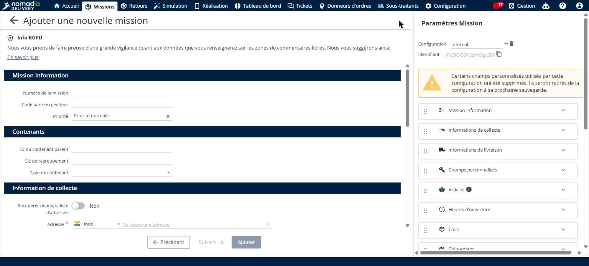
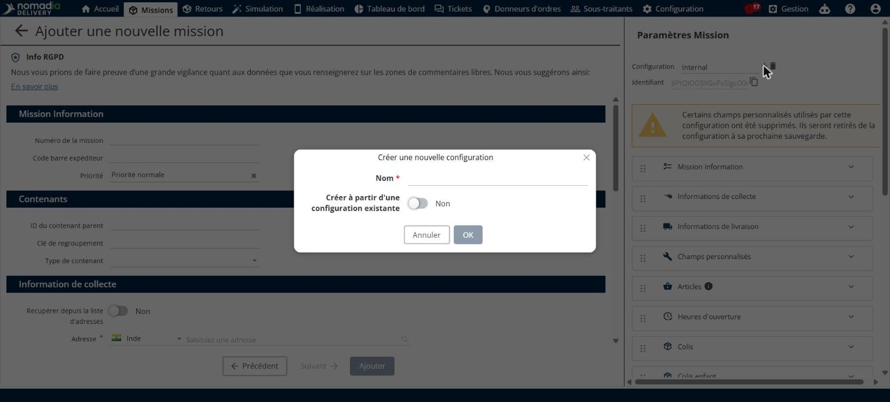
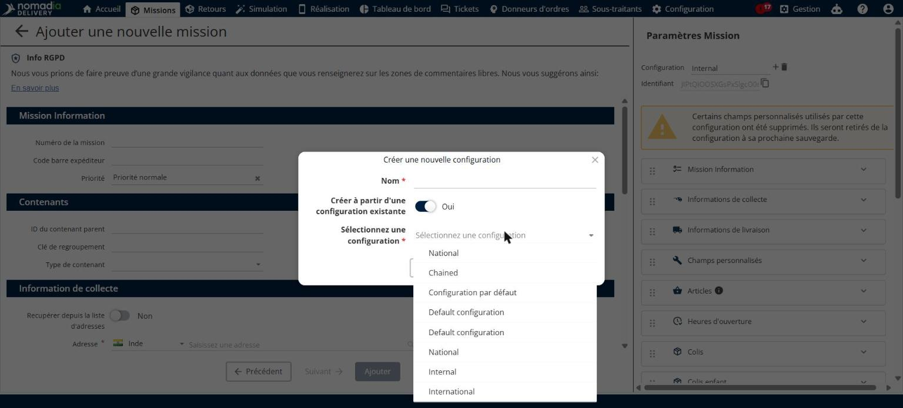
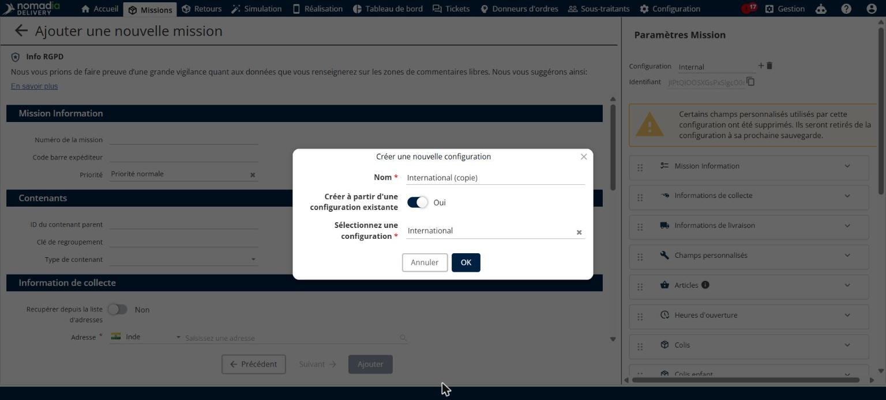

# Cloner une configuration de mission

**Cloner une configuration de mission** vous permet de créer une nouvelle configuration du créateur ou de l’éditeur de mission à partir d’une configuration existante. Jusqu’à présent, créer une nouvelle configuration signifiait partir d’une page vierge et activer ou désactiver plus d’une centaine de champs, un par un. Vous copiez désormais une configuration proche de ce dont vous avez besoin, et vous ne modifiez que ce qui diffère.

## Avant de commencer

* Connectez-vous à **Nomadia Delivery** avec un profil utilisateur autorisé à créer, modifier et supprimer les configurations de création, d’édition et de modification en masse des missions.
* Sachez comment fonctionnent les configurations de mission. Pour en savoir plus, voir [Configuration de la création des missions](mission-creation-configuration.md).

## Présentation de la fonctionnalité

* **Types de configuration** : vous pouvez cloner les quatre types de configurations de mission : création web, création mobile, édition et modification en masse.
* **Créer une nouvelle configuration** : lorsque vous cliquez sur **+** à côté de **Configuration**, une fenêtre s’ouvre avec un champ **Nom** et un bouton **Créer à partir d’une configuration existante**.
  * **Oui** : la nouvelle configuration est une copie d’une configuration existante.
  * **Non** : la nouvelle configuration démarre vierge, comme auparavant.
* **Sélectionnez une configuration** : une liste avec recherche affiche toutes les configurations du même type de votre compte. **OK** reste désactivé tant que vous n’avez pas sélectionné de source. S’il n’existe aucune configuration de ce type, la liste l’indique.
* **Nom automatique** : lorsque vous sélectionnez une source, le champ **Nom** est rempli avec le nom de la source suivi de **(copie)**. Vous pouvez modifier le nom avant d’enregistrer. Chaque nom de configuration doit être unique.
* **Ce qui est copié** : la nouvelle configuration hérite de tout ce qui définit sa source : états d’activation des champs, sections, ordre, options, type de mission, champs standard, champs personnalisés et paramètres d’affichage.
* **Ce qui n’est pas copié** : les affectations restent sur la source. Les liens vers les profils utilisateur, les donneurs d’ordres et les sous-traitants ne sont pas copiés : la nouvelle configuration démarre sans affectation.
* **Copies indépendantes** : après la création, la copie et la source sont totalement indépendantes. Une modification de l’une n’affecte jamais l’autre.

## Cloner une configuration de mission

1. Accédez à **Missions**, cliquez sur **Actions** > **Ajouter**, saisissez le **Type de mission** et l’**Agence**, puis cliquez sur **Suivant**.
2. Cliquez sur l’icône **Crayon** en haut à droite. Le panneau **Paramètres Mission** s’ouvre avec la **Configuration** actuelle.

3. Cliquez sur **+** à côté de **Configuration**. La fenêtre **Créer une nouvelle configuration** s’ouvre.

4. Activez **Créer à partir d’une configuration existante**.
5. Dans **Sélectionnez une configuration**, recherchez et sélectionnez la configuration à copier, par exemple **International**.

6. Vérifiez le nom rempli automatiquement, par exemple **International (copie)**, et modifiez-le si nécessaire.

7. Cliquez sur **OK**.
8. Modifiez uniquement les champs, sections et options qui doivent différer de la source.
9. Cliquez sur **Enregistrer**.

### Résultat

La nouvelle configuration est créée avec tous les paramètres de sa source et les modifications que vous avez apportées. Elle démarre sans affectation : affectez-la aux profils utilisateur, donneurs d’ordres ou sous-traitants qui doivent l’utiliser.

## Créer une configuration vierge

1. Dans le panneau **Paramètres Mission**, cliquez sur **+** à côté de **Configuration**.
2. Saisissez un **Nom**.
3. Laissez **Créer à partir d’une configuration existante** sur **Non**.
4. Cliquez sur **OK**.

### Résultat

La nouvelle configuration démarre vierge, et vous définissez chaque champ vous-même.

## Conseils


**Partez de la configuration la plus proche** : choisissez la source qui demande le moins de modifications, par exemple la configuration du même type de mission, afin de n’ajuster que les différences.



**Renommez la copie** : remplacez **(copie)** par un nom explicite, par exemple l’équipe ou la plage horaire qui utilise la configuration, afin que les utilisateurs la retrouvent facilement.



**Affectez la nouvelle configuration** : les affectations ne sont pas copiées. Tant que vous ne liez pas la nouvelle configuration à des profils utilisateur, des donneurs d’ordres ou des sous-traitants, personne ne l’utilise.


## Rubriques connexes

* [Missions](README.md)
* [Configuration de la création des missions](mission-creation-configuration.md)
* [Personnaliser les libellés des blocs de mission](customizemissionblocklabels.md)
* [Modifier en masse les données de mission](bulk-edit-mission-data.md)
