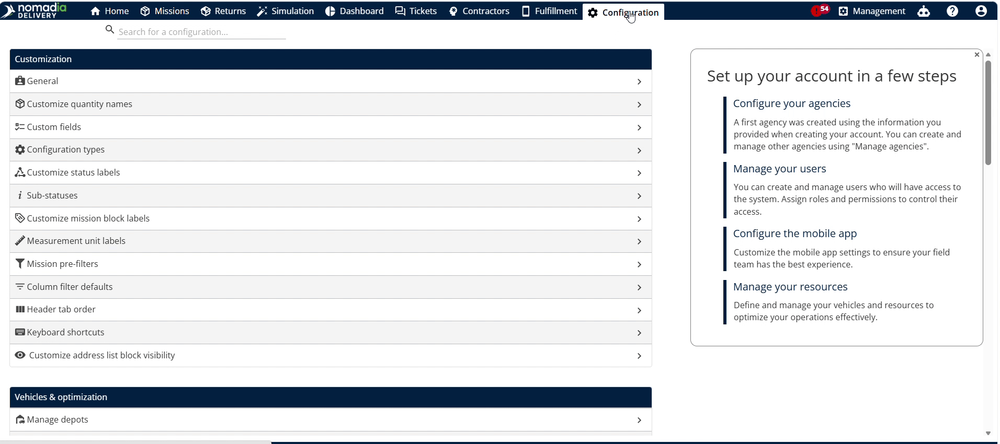
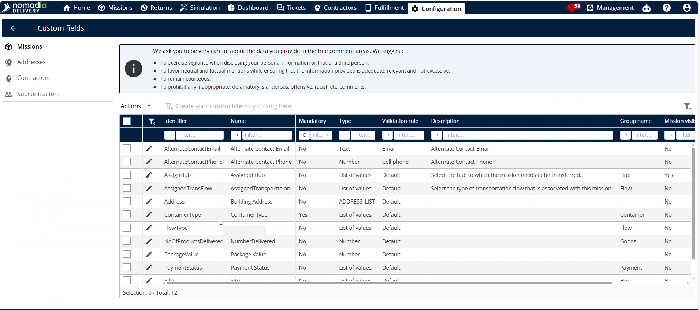
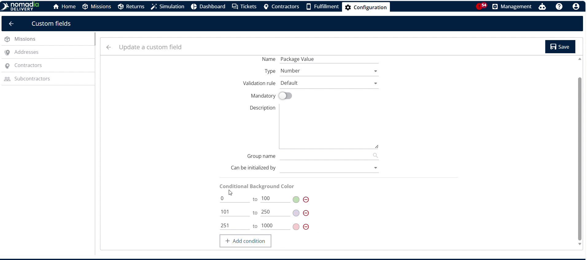
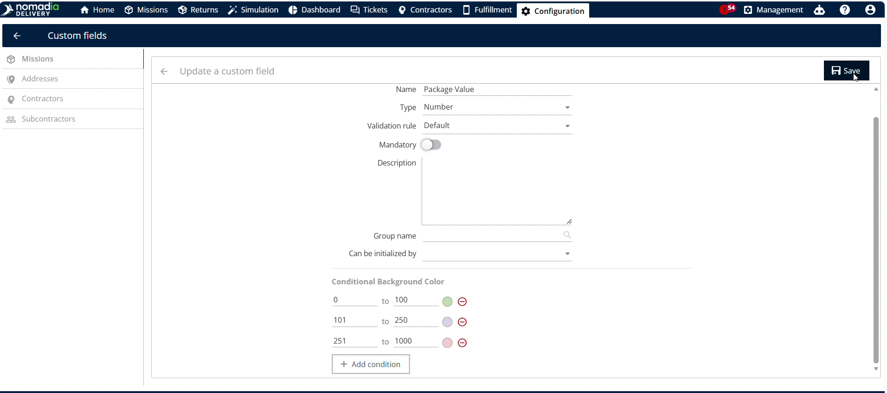
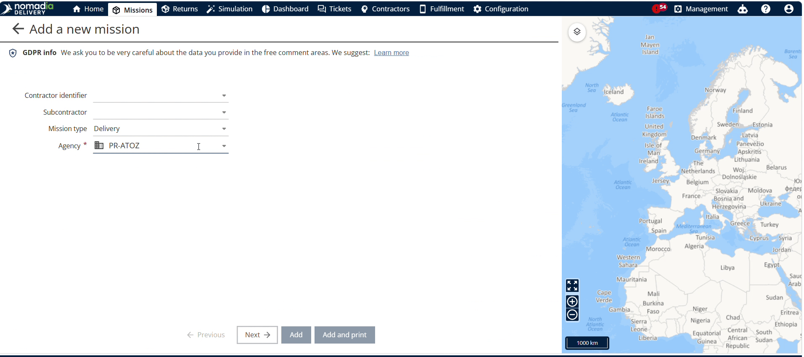
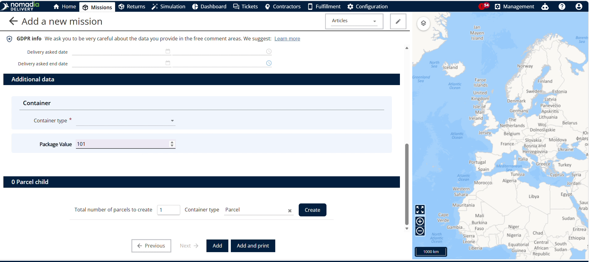
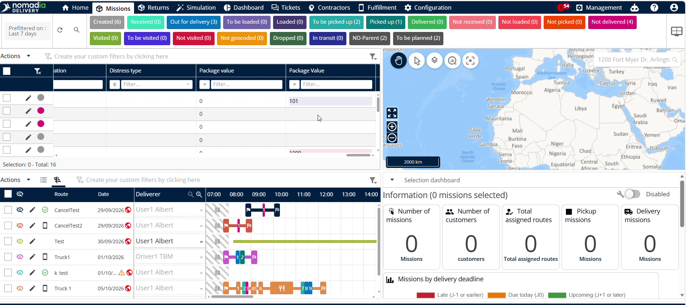
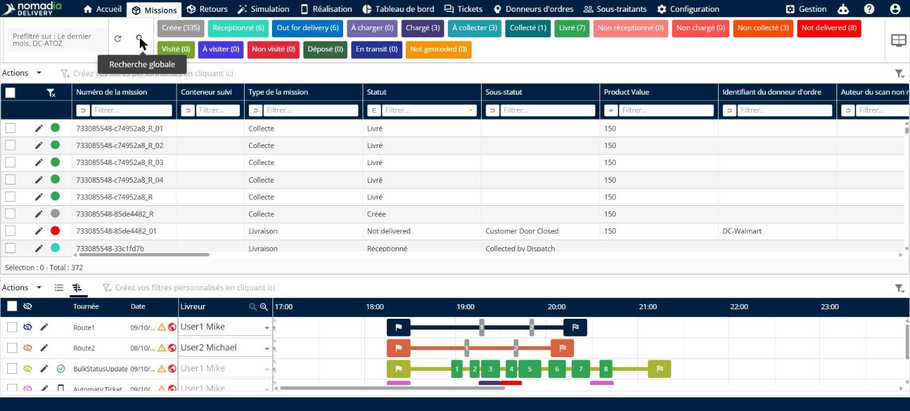
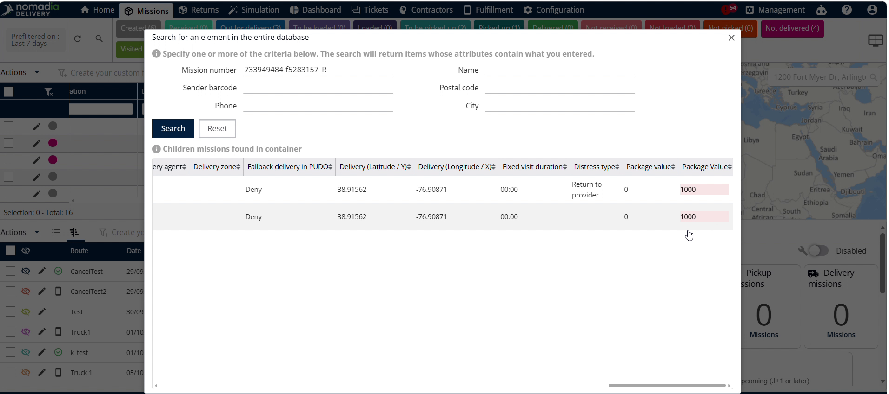

# Codage couleur des champs personnalisés

Le codage couleur des champs personnalisés dans **Nomadia Delivery** met visuellement en évidence les données clés selon des plages de valeurs. Utilisez cette fonctionnalité pour repérer rapidement les indicateurs opérationnels critiques et prendre des décisions plus rapidement. Définissez des règles personnalisées pour appliquer automatiquement un codage couleur aux valeurs dans l’ensemble de vos flux de travail.

## Avant de commencer

Prérequis :

* Compte actif dans **Nomadia Delivery** avec un accès administrateur.
* Paramètres de champs personnalisés préexistants configurés dans le système.

Étapes de configuration initiale :

1. Ouvrez la page **Configuration** et sélectionnez **Champ personnalisé**.

## Présentation de la fonctionnalité

* **Configuration** : accède aux paramètres d’administration du système pour localiser les paramètres personnalisés.
* **Champ personnalisé** : ouvre la liste de gestion des champs personnalisés de l’ensemble du système.
* **Valeur du colis** : représente l’attribut de champ personnalisé numérique spécifique affecté aux actifs.
* **Bouton Modifier** : ouvre les options de configuration de l’attribut de champ personnalisé sélectionné.
* **Couleur d’arrière-plan conditionnelle** : définit les plages de seuils numériques et les couleurs d’arrière-plan correspondantes.
* **Bouton Rechercher** : filtre les enregistrements de missions par numéro de mission afin de vérifier les couleurs des attributs.

## Configurer les règles de codage couleur

1. Ouvrez la page **Configuration**.

2. Cliquez sur **Champ personnalisé** dans le menu de configuration.

3. Repérez le champ cible et cliquez sur le bouton **Modifier** à côté de **Valeur du colis**.

4. Faites défiler jusqu’à la section **Couleur d’arrière-plan conditionnelle**.

5. Saisissez les plages de valeurs numériques et affectez les couleurs d’arrière-plan.

6. Cliquez sur **Enregistrer** pour appliquer les règles de couleur.

## Vérifier le codage couleur lors de la saisie d’une mission

1. Cliquez sur **Mission** dans le menu de navigation principal.
2. Cliquez sur **Ajouter** pour créer une nouvelle mission.

3. Sélectionnez le **Type de mission** et l’**Agence**, puis cliquez sur **Suivant**.

4. Saisissez une valeur numérique dans **Valeur du colis** pour déclencher la mise en évidence conditionnelle par couleur.

5. Cliquez sur **Ajouter** pour terminer l’enregistrement de la mission.

## Vérifier le codage couleur dans le tableau des missions

1. Revenez à l’écran de présentation principal.
2. Repérez la vue **Tableau des missions** à l’écran.

3. Examinez la colonne **Valeur du colis** pour confirmer la coloration automatique de l’arrière-plan.

## Vérifier le codage couleur via la recherche de missions

1. Cliquez sur le bouton **Rechercher** dans l’interface supérieure.

2. Recherchez la mission cible à l’aide du **Numéro de mission**.

3. Faites défiler vers la droite le tableau de recherche à l’aide de la barre de défilement horizontale.

4. Vérifiez la mise en évidence par couleur appliquée sous l’en-tête **Valeur du colis**.

## Conseils


**Vérification à plusieurs endroits** : vérifiez le codage couleur des champs personnalisés lors de la création des missions, dans les tableaux du système et dans les vues de recherche.



**Accès par défilement horizontal** : utilisez la barre de défilement horizontale des tableaux de recherche pour repérer les couleurs de valeur du colis masquées.



**Règles de configuration non enregistrées** : cliquez sur **Enregistrer** après avoir modifié les plages de couleurs, sinon vos règles d’arrière-plan personnalisées ne seront pas appliquées.


## Rubriques connexes

* [Champs personnalisés](custom-fields/README.md)
* [Regroupement de champs personnalisés](custom-fields/grouping-custom-field.md)
* [Configuration de la visibilité des missions](custom-fields/configuring-mission-visibility.md)
