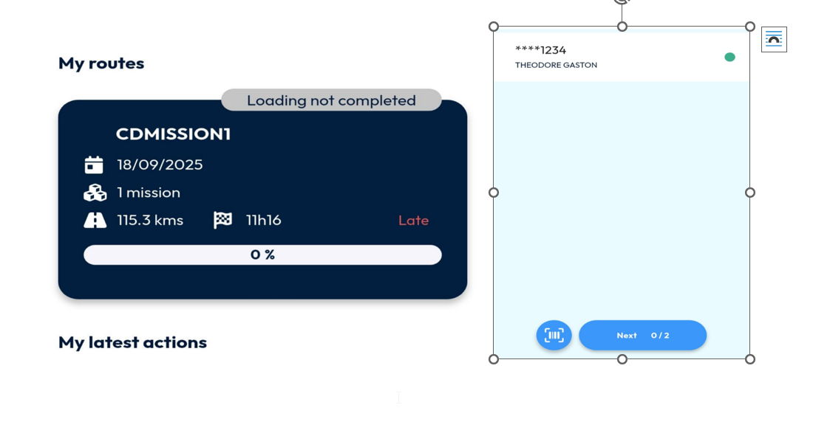

# Missions de cross-docking

Les missions de cross-docking améliorent l’efficacité et garantissent une traçabilité complète sur la logistique du mid-mile et du last mile. Le même ID de mission (code-barres) est conservé tout au long du processus, permettant aux transporteurs de gérer de manière fluide les mouvements des colis, du point de retrait jusqu’à la livraison finale.

## Avant de commencer

* Connectez-vous à **Nomadia Delivery** avec un profil utilisateur ayant accès à l’onglet **Missions**.
* Identifiez le sous-traitant lié à la mission de cross-docking.
* Identifiez l’agence à partir de laquelle les livreurs partent pour l’Étape 1 | Tournée de collecte Mid-Mile.
* Préparez l’adresse de livraison du client final.

## Présentation de la fonctionnalité

Une mission de cross-docking est divisée en deux étapes principales.

**Étape 1 – Tournée de collecte Mid-Mile**

* **Planifier la tournée de collecte** : organisez et affectez les missions pour l’itinéraire de collecte, en partant de l’agence.
* **Collecter les colis** : les livreurs récupèrent les colis directement dans l’entrepôt du sous-traitant ou à l’emplacement désigné.
* **Retour à l’agence** : tous les colis collectés sont ramenés à l’agence pour tri et traitement.

**Étape 2 – Tournée de livraison Last-Mile**

* **Planifier la tournée de livraison** : après le tri des colis à l’agence, préparez et affectez l’itinéraire de livraison final.
* **Charger pour la livraison** : les livreurs récupèrent les colis triés à l’agence.
* **Livrer aux clients** : les colis sont livrés aux destinataires finaux, avec le même ID de mission (code-barres), garantissant un suivi et une traçabilité cohérents.

## Configurer une mission de cross-docking

1. Ouvrez l’application Nomadia Delivery et accédez à l’**onglet Missions**.

<figure><figcaption></figcaption></figure>

2. Cliquez sur le menu **Actions** et sélectionnez **Ajouter**.

<figure><figcaption></figcaption></figure>

3. Dans la liste déroulante du type de mission, sélectionnez **Cross-docking** pour créer une mission de cross-docking.

<figure><figcaption></figcaption></figure>

4. Dans la liste déroulante de l’identifiant du sous-traitant, choisissez le **sous-traitant** lié à la mission de cross-docking.

<figure><figcaption></figcaption></figure>

5. Sélectionnez l’**Agence** à partir de laquelle les livreurs partiront pour l’Étape 1 | Tournée de collecte Mid-Mile.

<figure><figcaption></figcaption></figure>

6. Cliquez sur **Suivant** pour continuer.

<figure><figcaption></figcaption></figure>

7. Par défaut, l’adresse du sous-traitant est utilisée comme adresse de retrait. Si nécessaire, sélectionnez une autre adresse de retrait pour l’Étape 1 | Tournée de collecte Mid-Mile en cliquant sur le bouton Modifier à côté du champ d’adresse.

<figure><figcaption></figcaption></figure>

8. Saisissez l’**adresse de livraison** du client final dans la section adresse pour terminer la configuration de la mission de cross-docking.

<figure><figcaption></figcaption></figure>

9. Cliquez sur **Ajouter** pour créer la mission de cross-docking.

<figure><figcaption></figcaption></figure>

### Résultat

Une nouvelle mission de type Cross-docking est ajoutée au système de gestion des livraisons.

<figure><figcaption></figcaption></figure>

## Créer l’Étape 1 | Tournée de collecte Mid-Mile

1. Sélectionnez la **mission créée**, ouvrez le menu Actions et choisissez Affecter. Affectez la mission à un livreur.

<figure><figcaption></figcaption></figure>

2. Saisissez un nom pour l’itinéraire, sélectionnez le **livreur** et précisez la date et l’heure de la mission de retrait – Étape 1 | Tournée de collecte Mid-Mile. Cliquez sur **OK** pour créer la tournée.

<figure><figcaption></figcaption></figure>

3. Vérifiez que l’itinéraire de l’Étape 1 | Tournée de collecte Mid-Mile est créé dans le système de gestion des livraisons et qu’il est prêt à être publié dans l’application mobile du livreur.

<figure><figcaption></figcaption></figure>

4. Ouvrez à nouveau le menu **Actions** et sélectionnez **Publier** sur l’application mobile.

<figure><figcaption></figcaption></figure>

5. Cliquez sur **OK** pour confirmer et transférer les détails de la tournée vers l’application mobile.

<figure><figcaption></figcaption></figure>

6. Vérifiez que l’Étape 1 | Tournée de collecte Mid-Mile est disponible sur l’application mobile du livreur.

<figure><figcaption></figcaption></figure>

7. Faites effectuer le retrait en temps réel par le livreur pour terminer l’Étape 1 | Tournée de collecte Mid-Mile.

<figure><figcaption></figcaption></figure>

8. Consultez le diagramme de Gantt pour voir la confirmation de la tournée terminée, affichée avec une coche verte.

<figure><figcaption></figcaption></figure>

### Résultat

Les missions de l’Étape 2 | Tournée de livraison Last-Mile ne peuvent être planifiées qu’une fois les marchandises retournées au dépôt.

<figure><figcaption></figcaption></figure>

## Créer l’Étape 2 | Tournée de livraison Last-Mile

1. Sélectionnez la mission Retourné au dépôt, ouvrez le menu **Actions** et choisissez **Affecter**. Affectez la **mission** à un livreur.

<figure><figcaption></figcaption></figure>

2. Saisissez un nom pour l’itinéraire, sélectionnez le livreur et définissez la date et l’heure de la mission de livraison – Étape 2 | Tournée de livraison Last-Mile. Cliquez sur **OK** pour créer la tournée.
3. Vérifiez que l’itinéraire de l’Étape 2 | Tournée de livraison Last-Mile est créé dans le système de gestion des livraisons et qu’il est prêt à être publié dans l’application mobile du livreur.

<figure><figcaption></figcaption></figure>

4. Dans le menu Actions, sélectionnez **Publier** sur l’application mobile.

<figure><figcaption></figcaption></figure>

5. Cliquez sur **OK** pour confirmer et transférer les détails de la tournée vers l’application mobile.

<figure><figcaption></figcaption></figure>

6. Vérifiez que l’Étape 2 | Tournée de livraison Last-Mile est publiée sur l’application mobile du livreur.

<figure><figcaption></figcaption></figure>

7. Faites effectuer les livraisons en temps réel par le livreur pour terminer l’Étape 2 | Tournée de livraison Last-Mile.

<figure><figcaption></figcaption></figure>

8. Consultez le diagramme de Gantt pour voir la confirmation de la tournée, affichée avec une coche verte.

<figure><figcaption></figcaption></figure>

## Conseils


**Adresse du sous-traitant** : pour les missions de cross-docking, si le sous-traitant est associé, son adresse enregistrée est automatiquement utilisée comme adresse de retrait par défaut pour l’Étape 1 | Tournée de collecte Mid-Mile. Cette adresse est récupérée depuis la configuration du sous-traitant.


## Rubriques connexes

* [Missions](README.md)
* [Missions de drop shipping](drop-shipping-missions.md)
