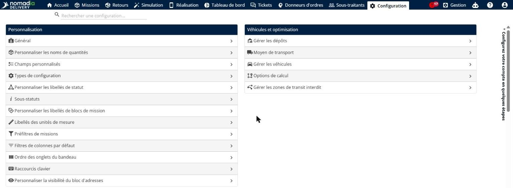
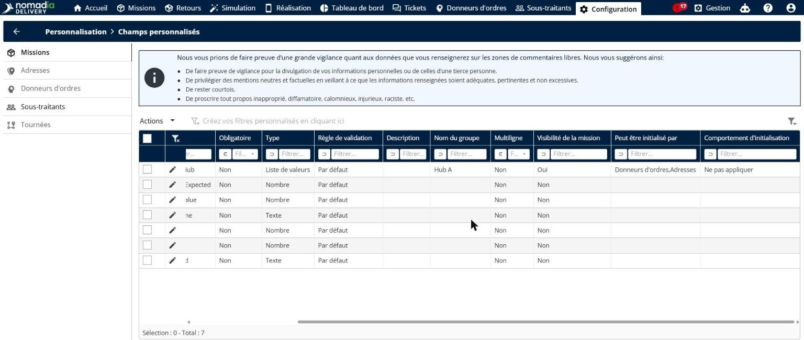
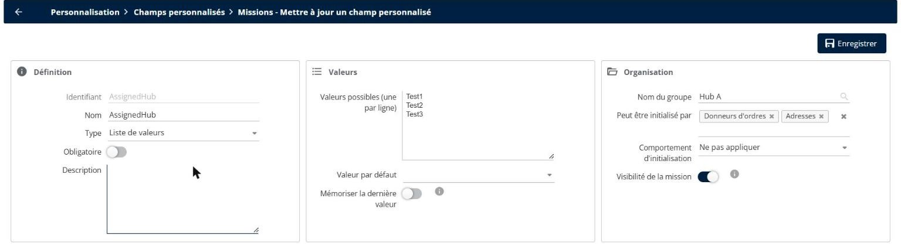
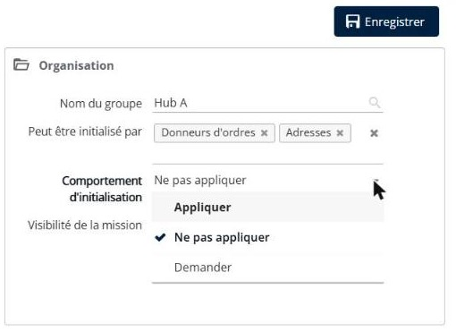

# Comportement d’écrasement des champs personnalisés

Le **Comportement d’initialisation** définit ce qui arrive à un champ personnalisé de mission déjà renseigné lorsque vous sélectionnez une adresse ou un donneur d’ordres. Jusqu’à présent, la valeur de l’adresse ou du donneur d’ordres remplaçait toujours la valeur que vous aviez saisie. Par exemple, si vous saisissiez d’abord un code d’accès puis choisissiez l’adresse, le code d’accès de l’adresse remplaçait le vôtre sans avertissement. Vous choisissez désormais, pour chaque champ personnalisé, de remplacer la valeur, de la conserver ou de demander d’abord à l’utilisateur.

## Avant de commencer

* Connectez-vous à **Nomadia Delivery** avec un profil utilisateur ayant accès à l’onglet **Configuration**.
* Vérifiez que le champ personnalisé de mission est initialisé depuis un donneur d’ordres ou une adresse. Pour en savoir plus, voir [Hériter des données de mission depuis la liste des sous-traitants et des adresses](inherit-mission-data-from-contractor-and-address-list.md).

## Présentation de la fonctionnalité

* **Comportement d’initialisation** : le paramètre d’un champ personnalisé de mission qui détermine ce qui se passe lorsque le champ est déjà renseigné et qu’une adresse ou un donneur d’ordres est sélectionné. Il n’apparaît que si **Peut être initialisé par** contient au moins une source, comme **Donneurs d’ordres** ou **Adresses**.
* **Appliquer** : la valeur de l’adresse ou du donneur d’ordres remplace la valeur du champ, sans message. C’est le comportement que vous aviez auparavant, et la valeur par défaut de tous les champs personnalisés existants et nouveaux.
* **Ne pas appliquer** : le champ conserve sa valeur. Les champs vides sont toujours remplis automatiquement.
* **Demander** : avant toute modification, une seule fenêtre liste tous les champs qui vont être remplacés. Une seule réponse s’applique à tous les champs listés.
* **Champs vides** : un champ vide est toujours rempli depuis l’adresse ou le donneur d’ordres, quel que soit le comportement.
* **Éditeur de mission** : la sélection d’un donneur d’ordres dans l’éditeur de mission initialise désormais aussi les champs personnalisés de la mission, avec le même comportement par champ que l’assistant de création de mission.

## Définir le comportement d’initialisation d’un champ personnalisé

1. Accédez à l’onglet **Configuration**, puis cliquez sur **Champs personnalisés**.

2. Sélectionnez l’onglet **Missions**. La colonne **Comportement d’initialisation** indique le comportement actuel de chaque champ.

3. Cliquez sur l’icône **Crayon** du champ personnalisé, par exemple **AssignedHub**.
4. Dans la section **Organisation**, vérifiez que **Peut être initialisé par** contient au moins une source, par exemple **Donneurs d’ordres** et **Adresses**.

5. Dans **Comportement d’initialisation**, sélectionnez **Appliquer**, **Ne pas appliquer** ou **Demander**.

6. Cliquez sur **Enregistrer**.

### Résultat

La prochaine fois qu’un utilisateur sélectionne une adresse ou un donneur d’ordres dans une mission, le champ suit le comportement que vous avez choisi.

## Ce qui se passe lorsque vous sélectionnez une adresse ou un donneur d’ordres

Prenons une mission dans laquelle l’utilisateur a déjà saisi un code d’accès et des instructions de livraison, et où le quai de déchargement est encore vide. L’utilisateur sélectionne ensuite une adresse qui possède son propre code d’accès, ses propres instructions de livraison et son propre quai de déchargement.

* **Appliquer** : le code d’accès et les instructions de livraison sont remplacés par les valeurs de l’adresse, sans message. Le quai de déchargement est rempli.
* **Ne pas appliquer** : le code d’accès et les instructions de livraison conservent les valeurs saisies par l’utilisateur. Le quai de déchargement est rempli.
* **Demander** : une fenêtre s’ouvre avec le message « Cette action va remplacer les informations des champs suivants. Voulez-vous les remplacer ? » et liste le code d’accès et les instructions de livraison.
  * Cliquez sur **Oui** pour remplacer toutes les valeurs listées.
  * Cliquez sur **Non** ou fermez la fenêtre pour conserver toutes les valeurs listées. Le reste de l’adresse est tout de même appliqué, et le quai de déchargement est tout de même rempli.

Lorsqu’aucun champ en **Demander** ne serait modifié, par exemple parce que tous les champs sont vides, aucune fenêtre n’apparaît.

## Initialiser les champs personnalisés depuis le donneur d’ordres dans l’éditeur de mission

1. Ouvrez une mission existante dans l’éditeur de mission.
2. Sélectionnez un **Donneur d’ordres**.

### Résultat

Les champs personnalisés de la mission initialisés par **Donneurs d’ordres** sont remplis depuis le donneur d’ordres, en suivant le **Comportement d’initialisation** de chaque champ, exactement comme dans l’assistant de création de mission.

## Conseils


**Rien ne change tant que vous ne décidez pas** : tous les champs personnalisés existants et nouveaux démarrent sur **Appliquer**, le comportement que vous aviez auparavant. Ne modifiez que les champs que les utilisateurs saisissent souvent eux-mêmes.



**Remplissez les formulaires dans n’importe quel ordre** : choisissez **Ne pas appliquer** pour les champs que les utilisateurs saisissent à la main, comme un code d’accès, afin que la sélection de l’adresse ensuite n’efface jamais leur saisie.



**Utilisez Demander pour les champs sensibles** : avec **Demander**, l’utilisateur voit quels champs seraient remplacés avant de décider. Une seule réponse s’applique à tous les champs listés.


## Rubriques connexes

* [Champs personnalisés](README.md)
* [Hériter des données de mission depuis la liste des sous-traitants et des adresses](inherit-mission-data-from-contractor-and-address-list.md)
* [Regroupement de champs personnalisés](grouping-custom-field.md)
