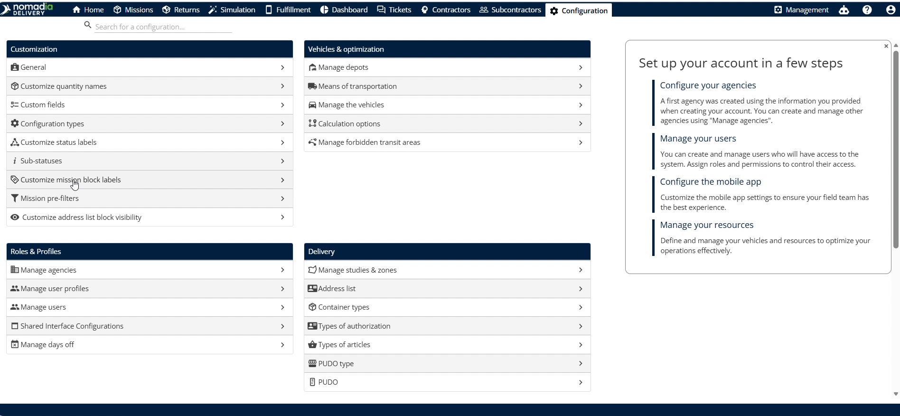
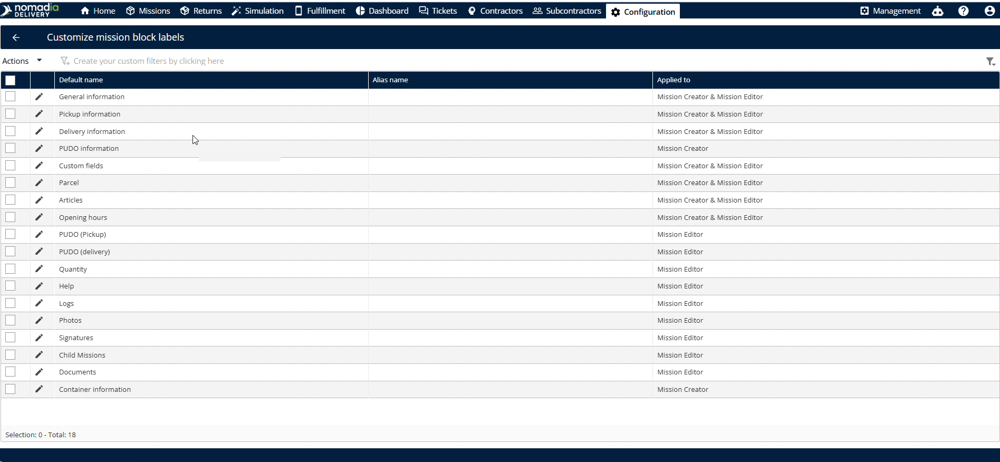
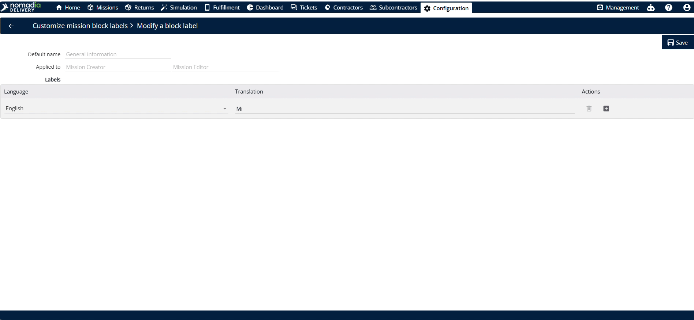
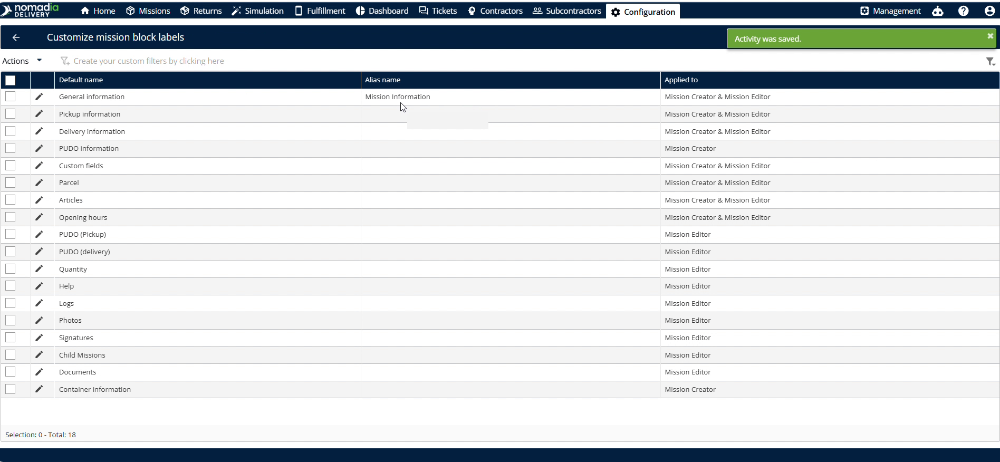
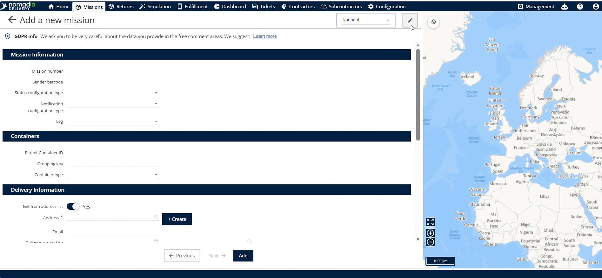
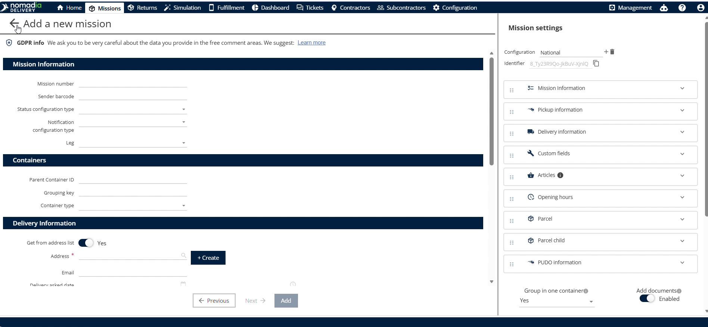

# Personnaliser les libellés des blocs de mission

Les **libellés personnalisés des blocs de mission** permettent aux répartiteurs de modifier les libellés de champs par défaut dans Nomadia Delivery. Personnalisez les noms de champs prédéfinis pour les adapter aux opérations et à la terminologie de votre flotte. Obtenez un format de libellés cohérent dans les interfaces de création et de modification des missions.

## Avant de commencer

**Étapes de configuration initiale**

1. Ouvrez la page **Configuration**.

2. Sélectionnez **Personnalisation** dans le menu d’options.
3. Cliquez sur **Libellés personnalisés des blocs de mission** pour ouvrir les paramètres des libellés.

## Vue d’ensemble de la fonctionnalité

* **Informations prédéfinies** : affiche les champs de libellés par défaut disponibles lors de la création ou de la modification d’une mission.
* **Informations générales** : permet aux utilisateurs de saisir des noms de libellés personnalisés pour les champs des blocs de mission.
* **Créateur de mission** : affiche les libellés personnalisés lors de l’ajout de nouvelles missions.
* **Éditeur de mission** : affiche les libellés personnalisés lors de la modification de missions existantes.

## Personnaliser et vérifier les libellés des blocs

**Personnaliser les libellés des blocs de mission**

1. Cliquez sur **Informations générales** dans le menu des libellés de blocs personnalisés.

2. Saisissez le nouveau texte dans les champs de libellés.
3. Cliquez sur **Enregistrer** pour appliquer vos modifications.

4. Vérifiez que les noms mis à jour apparaissent dans la liste.

**Vérifier les libellés dans le créateur de mission**

1. Cliquez sur **Mission** dans le menu principal.
2. Cliquez sur **Ajouter** pour ouvrir le créateur de mission.
3. Vérifiez que les libellés mis à jour apparaissent dans le formulaire.

**Vérifier les libellés dans l’éditeur de mission**

1. Sélectionnez une mission et cliquez sur **Modifier**.

2. Vérifiez que les libellés mis à jour apparaissent dans le formulaire de l’éditeur.

3. Cliquez de nouveau sur **Modifier** pour vérifier à nouveau les libellés personnalisés.

## Conseils


**Synchronisation automatique** : la mise à jour des informations prédéfinies synchronise automatiquement les modifications de libellés dans le créateur de mission et dans l’éditeur de mission.



**Portée variable des champs** : ne supposez pas que toutes les mises à jour de libellés apparaissent partout, car certaines modifications prédéfinies s’appliquent uniquement au créateur de mission.


## Rubriques connexes

* [Personnalisation des libellés de statut](customizing-status-labels.md)
* [Personnaliser la validation des champs du formulaire de mission](customizethevalidationofmissionformfields.md)
* [Configuration de la création des missions](mission-creation-configuration.md)
