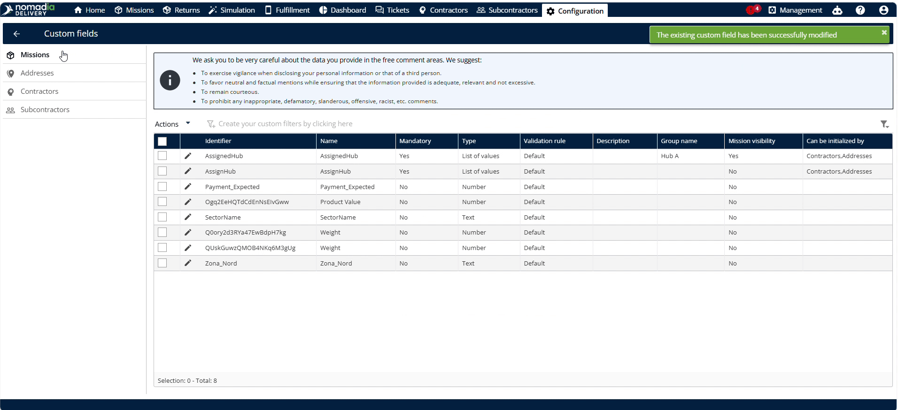
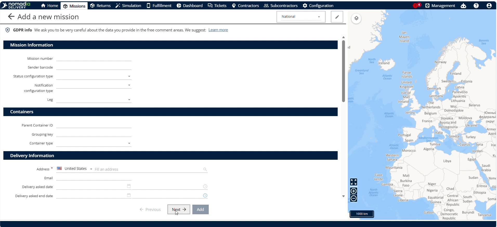
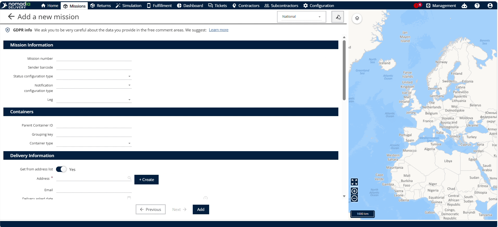
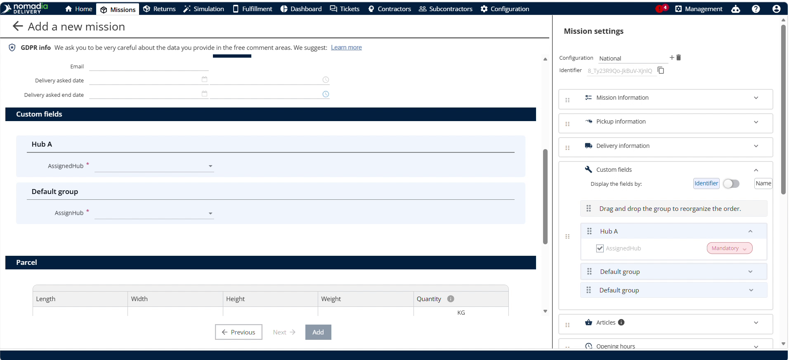

# Personnaliser la validation des champs du formulaire de mission

La personnalisation de la validation obligatoire impose la saisie de données requises dans les champs du formulaire de mission de **Nomadia Delivery**. Les répartiteurs ont besoin de champs obligatoires pour éviter l’envoi de formulaires de mission incomplets lors des opérations quotidiennes. Configurez les champs obligatoires pour garantir des rapports de terrain précis et la conformité complète des données.

## Avant de commencer

Prérequis administratifs et étapes de configuration :

* Un profil de formulaire de mission actif avec des identifiants de champs.

Étapes de configuration initiale :

1. Ouvrez la page **Configuration**.

2. Cliquez sur **Champs personnalisés** pour gérer les champs du formulaire.

## Vue d’ensemble de la fonctionnalité

Principaux éléments de l’interface utilisateur :

* **Configuration** : ouvre les préférences système globales et les options de personnalisation.
* **Champs personnalisés** : affiche les champs de formulaire personnalisables pour les profils de mission.
* **Identifiant** : représente un champ de mission précis sélectionné pour les paramètres de validation.
* **Obligatoire** : active ou désactive le statut de validation requise pour forcer la saisie des données avant l’enregistrement.
* **Assigner l’aide** : définit les consignes d’aide aux champs obligatoires pour les opérateurs de terrain.
* **Missions** : affiche la base de données des missions pour tester les validations de champs mises à jour.

## Configurer les règles de validation obligatoire

Configurez la validation obligatoire pour les champs du formulaire de mission :

1. Ouvrez la page **Configuration**.

2. Cliquez sur **Champs personnalisés**.

3. Sélectionnez un **Identifiant** quelconque.

4. Activez **Obligatoire** pour activer la validation de champ obligatoire.

5. Cliquez sur **Enregistrer**.

6. Sélectionnez **Assigner un hub** et rendez-le obligatoire.

7. Cliquez sur **Enregistrer**.

## Appliquer la validation aux enregistrements de mission

Appliquez les règles de validation obligatoire lors de la modification des profils de mission :

1. Accédez à **Missions**.

2. Cliquez sur **Actions**.

3. Cliquez sur **Ajouter**.
4. Cliquez sur **Agence**.

5. Cliquez sur **Suivant**.

6. Sélectionnez **Modifier**.

7. Cliquez sur **Champs personnalisés** et vérifiez si **Hub A** est obligatoire.

### Dépannage

Résolvez les erreurs d’envoi du formulaire :

* **Impossible d’enregistrer la mission** : les champs obligatoires non sélectionnés bloquent l’envoi. Sélectionnez **Assigner un hub** avant d’enregistrer.

## Conseils

Bonnes pratiques et avertissements opérationnels :


**Mises à jour automatiques des champs obligatoires** : activez ou désactivez la validation des champs obligatoires pour mettre à jour instantanément les règles obligatoires dans les formulaires de mission.



**Champs obligatoires non sélectionnés** : ne laissez pas de champs obligatoires non sélectionnés, sinon le système empêche l’enregistrement de la mission.


## Rubriques connexes

* [Ajout d'une mission](adding-a-mission.md)
* [Création d’une adresse ad hoc](adhocaddresscreation.md)
* [Déclarer un colis pour une mission de conteneur](declaringaparcelforacontainermission.md)
