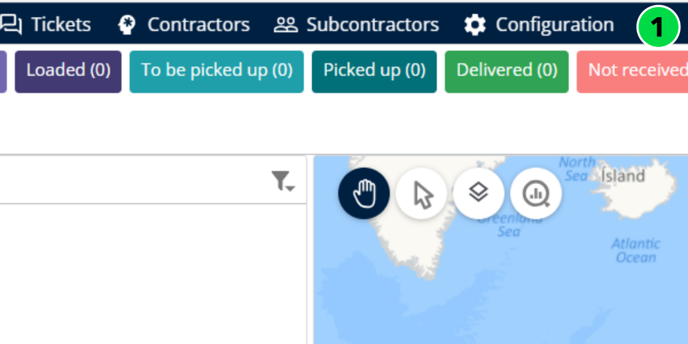
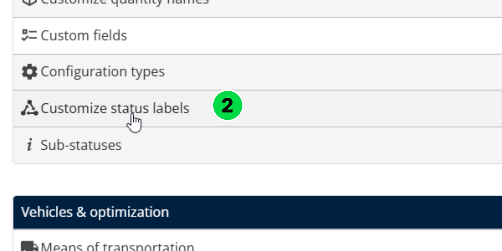
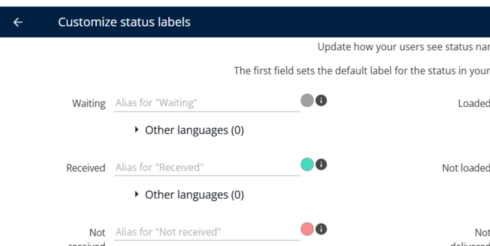
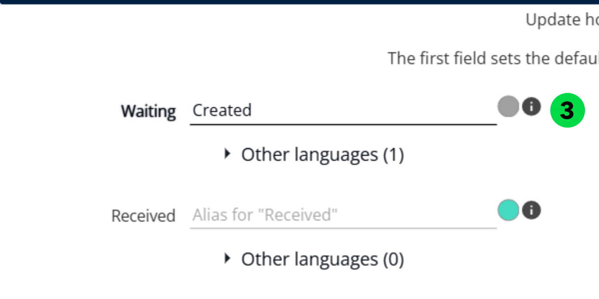
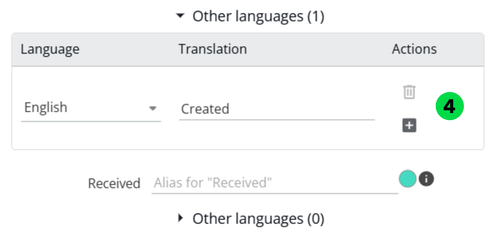
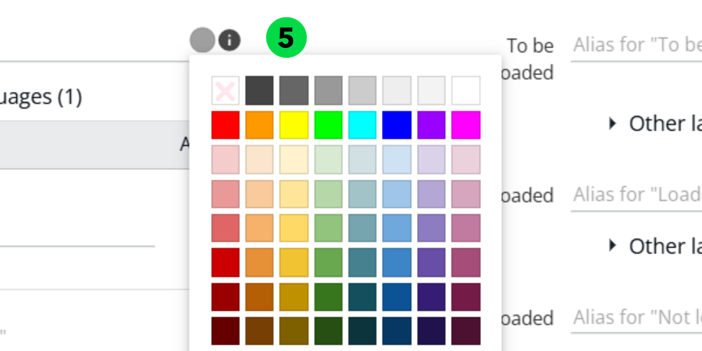
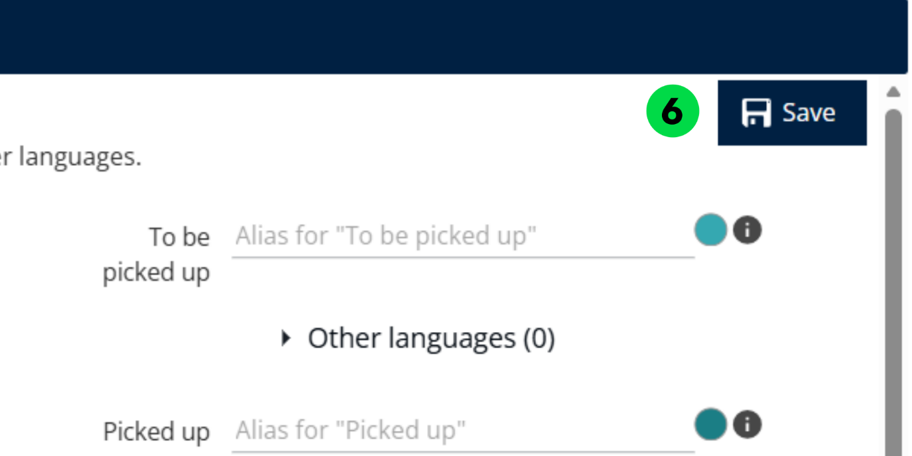
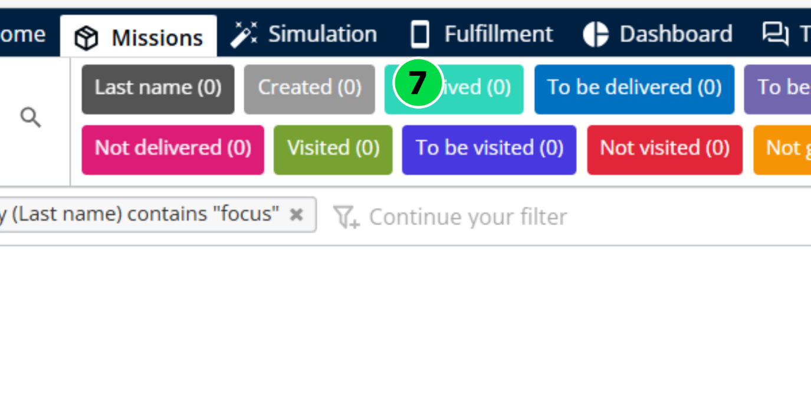

# Personnalisation des libellés de statut

Auparavant, les statuts dans Nomadia Delivery étaient statiques et ne pouvaient pas être personnalisés pour s’adapter aux flux de travail des clients. Les libellés de statut personnalisables améliorent désormais le suivi des missions en donnant aux utilisateurs un contrôle total pour configurer les libellés et les couleurs des statuts afin de les aligner sur leurs processus métier.

## Avant de commencer

* Connectez-vous à **Nomadia Delivery** avec un profil utilisateur ayant accès à l’onglet **Configuration**.
* Déterminez les libellés de statut, les langues et les couleurs que vous souhaitez modifier pour les adapter à votre flux de travail métier.

## Présentation de la fonctionnalité

* **Libellés de statut** – Description
* **En attente** : statut initial. Le colis est censé arriver à l’agence.
* **Reçu** : statut facultatif. Indique que le colis a été reçu par le livreur. L’emplacement exact dépend du contexte.
* **Non reçu** : statut facultatif. Indique que le colis était attendu mais n’a pas été reçu par le livreur. L’emplacement dépend du contexte.
* **À livrer** : le colis est prévu pour être livré par le transporteur ou le sous-traitant.
* **À charger** : statut facultatif. Le colis est prêt dans la zone de chargement, en attente d’être chargé dans le véhicule.
* **Chargé** : statut facultatif. Le colis a été chargé avec succès dans le camion par le livreur.
* **Non chargé** : statut facultatif. Le colis était attendu mais n’a pas été chargé dans le camion.
* **Non livré** : la tentative de livraison a échoué ; le colis n’a pas été remis au client.
* **Livré** : le colis a été livré au destinataire final.
* **À retirer** : le colis est prévu pour être retiré par le transporteur ou le sous-traitant.
* **Retiré** : le colis a été récupéré auprès du donneur d’ordre ou du client final.
* **Non retiré** : la tentative de retrait a échoué ; le colis n’a pas été récupéré.
* **À visiter** : la visite est prévue par le transporteur ou le sous-traitant.
* **Visité** : la visite a été effectuée par le livreur.
* **Non visité** : la visite était prévue mais n’a pas été effectuée.

## Personnaliser les libellés de statut

1. Ouvrez l’application Nomadia Delivery et accédez à l’onglet **Configuration**.

2. Sélectionnez **Personnaliser les libellés de statut** dans la liste.

Cette page affiche tous les statuts dans Nomadia Delivery.

3. Cliquez sur la **zone de texte** à côté du statut et mettez à jour le libellé pour qu’il corresponde à votre flux de travail métier.

4. Cliquez sur le **volet Autres langues** pour mettre à jour les libellés pour les utilisateurs dans différentes langues ou différents pays.

5. Cliquez sur le **Sélecteur de couleur** pour modifier la couleur d’arrière-plan d’un libellé de statut.

6. Après avoir effectué les modifications, cliquez sur **Enregistrer** pour appliquer les mises à jour du libellé et de la couleur à la fois sur les applications web et mobiles.

7. Après avoir enregistré les modifications, retournez à la page des missions pour voir les libellés et les couleurs mis à jour dans la zone de préfiltrage.

### Résultat

Cela offre une expérience fluide, alignée sur les besoins métier, aussi bien pour les planificateurs que pour les livreurs.

## Conseils


**Contraste des couleurs** : veillez à choisir une couleur contrastée qui préserve la lisibilité du texte dans l’interface.


## Rubriques connexes

* [Missions](README.md)
* [Personnaliser les libellés des blocs de mission](customizemissionblocklabels.md)
