# Déclarer un colis pour une mission de conteneur

La fonctionnalité de déclaration de colis permet aux répartiteurs de définir et d’affecter les dimensions des colis et les structures de conteneurs aux missions de conteneur dans Nomadia Delivery. Cela garantit une planification précise de la capacité et une exécution logistique fluide pendant les missions de conteneur. Les utilisateurs peuvent déclarer des colis lors de l’ajout d’une nouvelle mission, de la modification d’un conteneur existant, ou directement depuis le panneau d’actions.

## Avant de commencer

Prérequis et exigences :

* Accès au module **Mission** dans Nomadia Delivery.
* Une configuration de mission de conteneur active.
* Les dimensions du colis, notamment la longueur, la largeur, la hauteur et le poids.

Étapes de configuration :

1. Accédez au menu **Mission**.

2. Cliquez sur **Actions** pour ouvrir les paramètres de la mission.

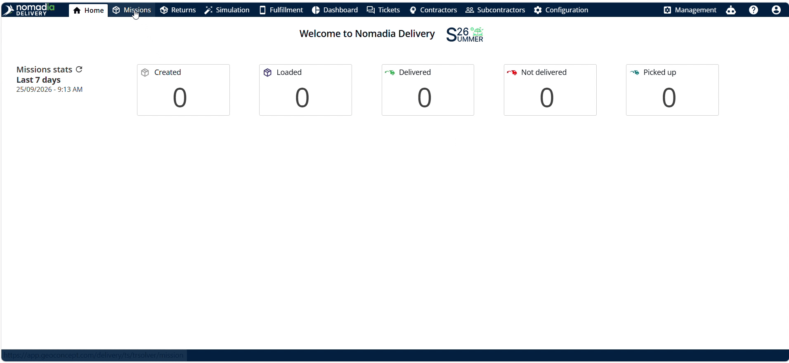

## Présentation de la fonctionnalité

* **Menu Actions** : affiche les outils de configuration des missions, dont la création de mission et la déclaration de colis.
* **Bouton Ajouter** : lance l’interface de création d’une nouvelle mission de conteneur.
* **Champ Agence** : définit l’unité organisationnelle gestionnaire de la mission.
* **Champ Type de mission** : indique la catégorie et le modèle opérationnel de la mission de conteneur.
* **Sélecteur de type de conteneur** : définit le format de conteneur pour la génération des colis.
* **Champ Adresse** : affecte le lieu opérationnel à la mission de conteneur.
* **Section Colis** : recueille les valeurs de longueur, de largeur, de hauteur et de poids des colis déclarés.
* **Section Taille du colis** : définit le nombre total de colis enfants à générer.
* **Bouton Modifier** : ouvre les paramètres de configuration des conteneurs existants.
* **Option Déclarer un colis** : ouvre directement l’outil de création de colis depuis le panneau d’actions.
* **Bouton Valider** : enregistre les configurations et génère les conteneurs demandés.

## Déclarer un colis lors de l’ajout d’une mission

1. Ouvrez le menu **Mission**.

2. Cliquez sur **Ajouter**.

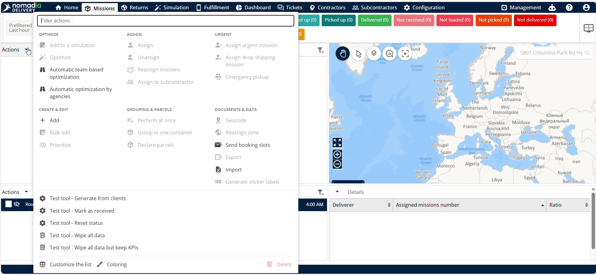

3. Sélectionnez l’**Agence** et le **Type de mission**.

4. Cliquez sur **Suivant**.

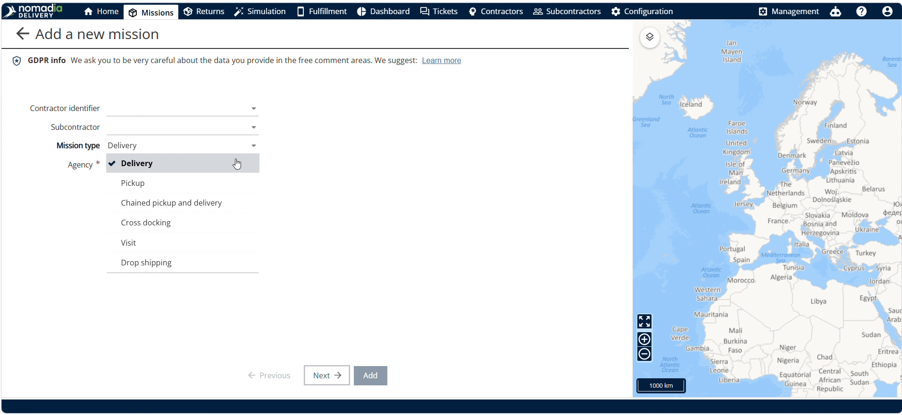

5. Sélectionnez le **Type de conteneur**.

6. Sélectionnez l’**Adresse**.

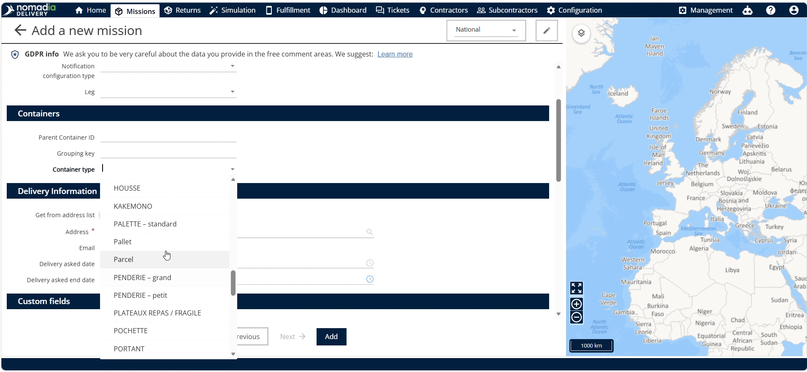

7. Sélectionnez les **Champs personnalisés** requis.

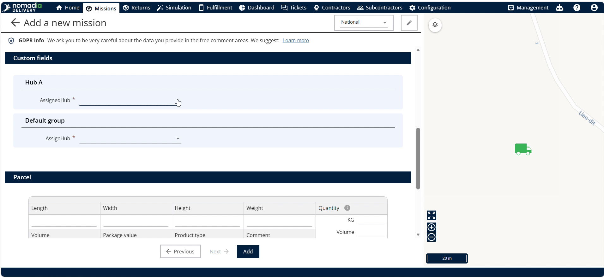

8. Saisissez la longueur, la largeur, la hauteur et le poids dans la **Section Colis**.

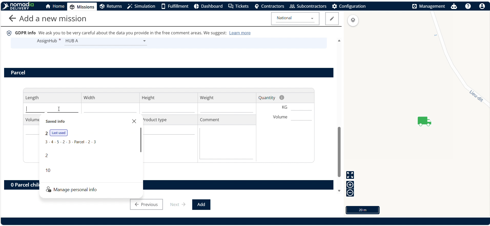

9. Sélectionnez le nombre total de colis à créer dans la **Section Taille du colis**.

10. Cliquez sur **Créer**.

11. Cliquez sur **Ajouter** pour terminer la création des conteneurs parent et enfants.

## Déclarer un colis lors de la modification d’un conteneur

1. Cliquez sur le **Bouton Modifier** du conteneur cible.

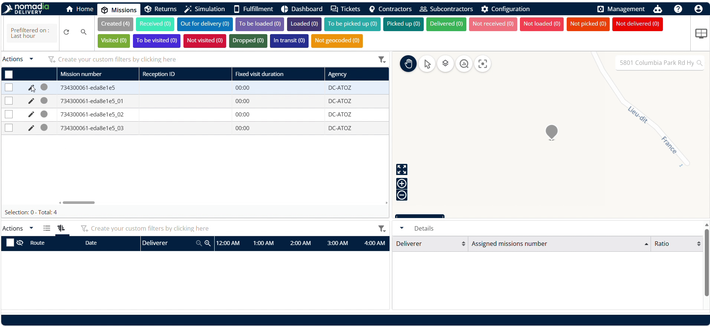

2. Cliquez sur la **Palette de types de conteneurs**.

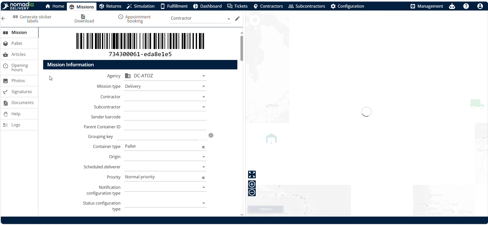

3. Définissez le nombre total de colis à créer.

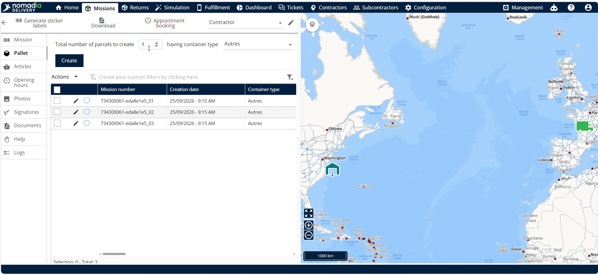

4. Cliquez sur **Créer**.

5. Cliquez sur **Valider** pour enregistrer les conteneurs déclarés.

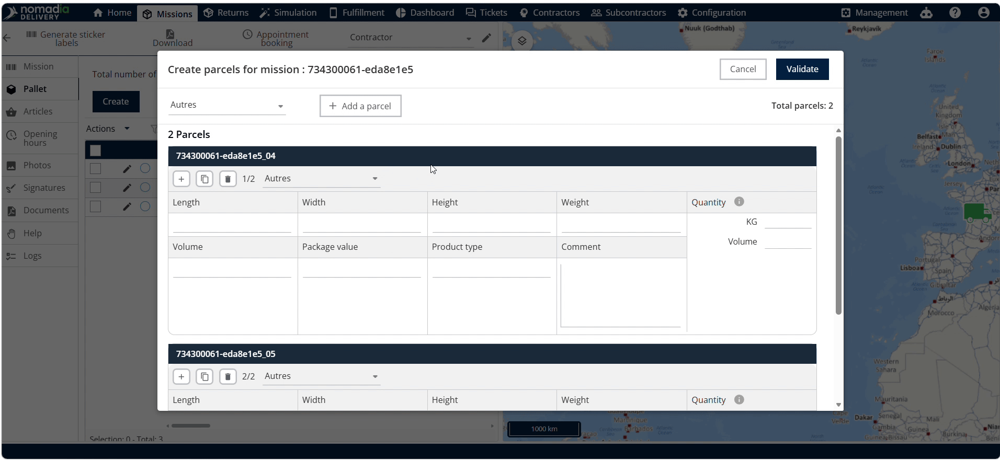

## Déclarer un colis depuis le panneau d’actions

1. Sélectionnez le conteneur parent et la mission, puis cliquez sur **Actions**.

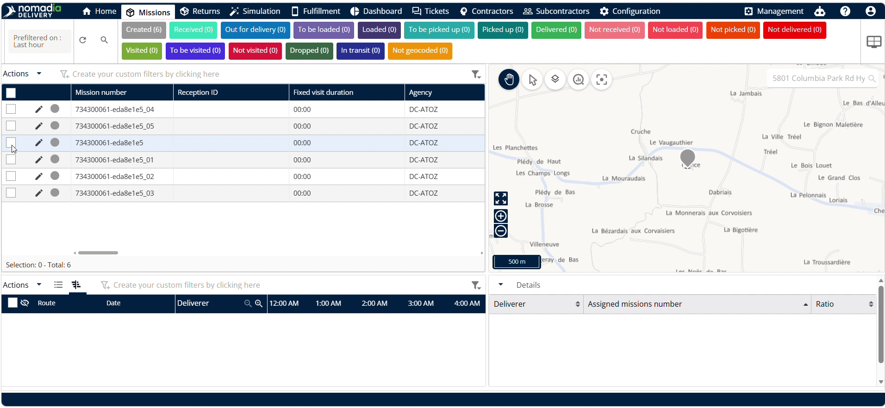

2. Cliquez sur **Déclarer un colis**.

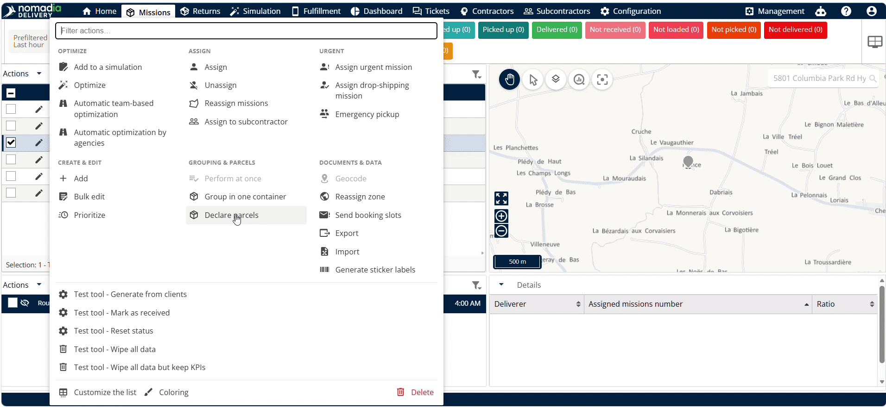

3. Choisissez le **Type de conteneur**.

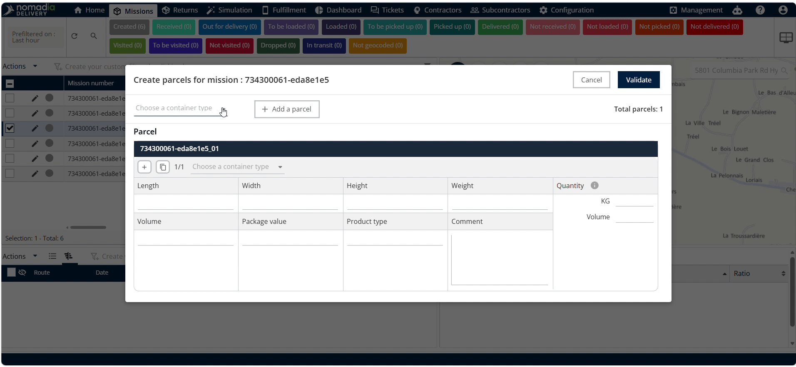

4. Cliquez sur **ajouter un colis**.

5. Cliquez sur **Valider** pour confirmer.

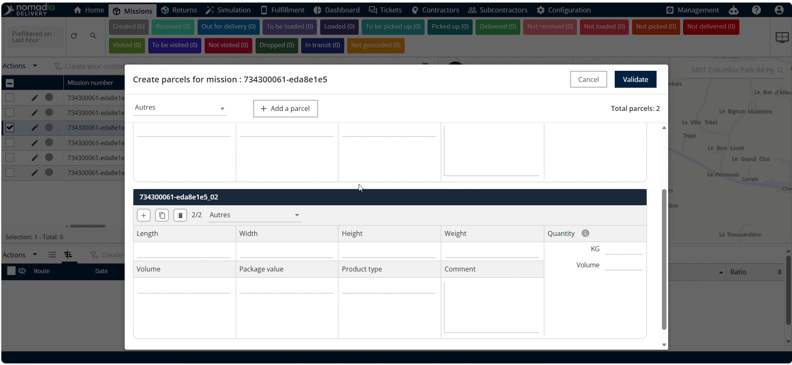

## Conseils


**Structure parent et enfant** : la génération de plusieurs colis relie automatiquement les conteneurs enfants à un conteneur parent, ce qui simplifie l’organisation des missions.



**Praticité du panneau d’actions** : ajoutez des colis supplémentaires directement depuis le panneau d’actions sans repasser par le flux de création de mission.


## Rubriques connexes

* [Missions enfants de conteneur](../manage-container-types/container-child-missions.md)
* [Héritage de l’enfant vers le parent](../manage-container-types/childtoparentinheritance.md)
* [Ajout d'une mission](adding-a-mission.md)
