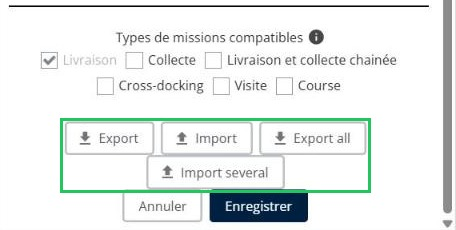
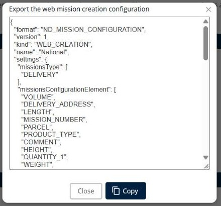
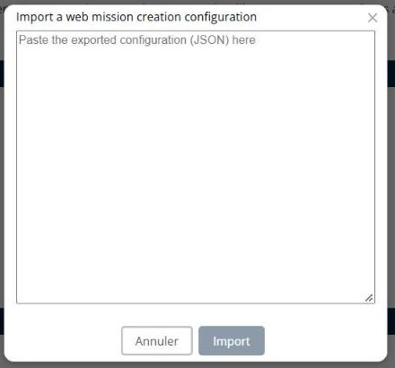
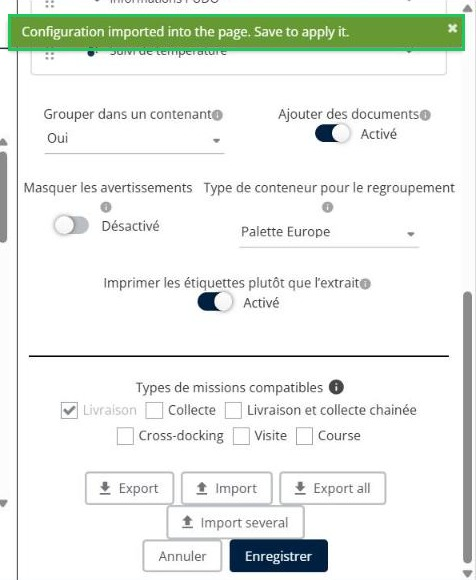
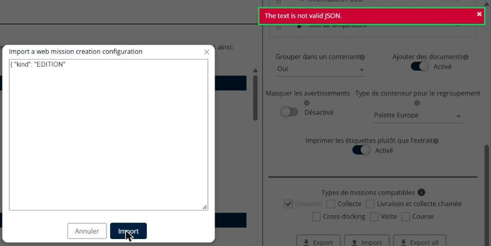

# Importer et exporter des configurations de mission en JSON

**L’import et l’export des configurations de mission en JSON** vous permettent de transférer des configurations du créateur et de l’éditeur de mission d’un compte à un autre, par exemple d’un environnement de test vers la production. Une configuration compte plus d’une centaine de paramètres, et la reconstruire champ par champ est long et source d’erreurs. Vous exportez désormais la configuration en JSON sur un compte, la collez sur l’autre, puis enregistrez.

## Avant de commencer

* Connectez-vous à **Nomadia Delivery** avec un profil utilisateur disposant des droits de bêta-testeur sur le compte. Les utilisateurs sans ces droits ne voient pas les boutons d’import et d’export.
* Enregistrez la configuration à exporter. Seule une configuration enregistrée peut être exportée.
* Ouvrez le créateur ou l’éditeur de mission, puis cliquez sur l’icône **Crayon** en haut à droite pour ouvrir **Paramètres Mission**. Pour en savoir plus, voir [Configuration de la création des missions](mission-creation-configuration.md).

## Présentation de la fonctionnalité

* **Export** : affiche la configuration actuelle en JSON, avec un bouton **Copy** pour la copier dans le presse-papiers.
* **Import** : ouvre une fenêtre dans laquelle vous collez une configuration exportée. La configuration remplace tous les paramètres de la page, mais rien n’est enregistré tant que vous ne cliquez pas sur **Enregistrer**.
* **Export all** : télécharge toutes les configurations du même type dans un seul fichier JSON.
* **Import several** : importe plusieurs configurations à la fois depuis un fichier exporté. Un récapitulatif liste les configurations qui seront remplacées ou créées, et vous confirmez l’import pour l’appliquer. Rien n’est enregistré avant la confirmation, et les configurations absentes du fichier restent inchangées.
* **Type de configuration** : le JSON indique son type, par exemple création de mission web, création de mission mobile, édition de mission ou modification en masse. Une configuration ne peut être importée que dans le même type.
* **Références manquantes** : si le JSON fait référence à des champs personnalisés ou à des types de contenants qui n’existent pas sur le compte, ils sont ignorés, et un avertissement les liste pour que vous les corrigiez à la main.
* **Validation** : si le texte n’est pas un JSON valide, n’est pas une configuration de mission exportée ou est d’un autre type, l’import est refusé avec un message, et la page reste inchangée.


Les boutons et les fenêtres d’import et d’export s’affichent en anglais dans l’application, même lorsque la langue est le français.


## Exporter une configuration de mission

1. Sur le compte source, ouvrez la configuration enregistrée dans **Paramètres Mission**, puis faites défiler le panneau jusqu’en bas.

2. Cliquez sur **Export**. La configuration s’affiche en JSON.

3. Cliquez sur **Copy** pour copier la configuration dans le presse-papiers, puis sur **Close**.

### Résultat

La configuration se trouve dans votre presse-papiers, prête à être collée sur l’autre compte.

## Importer une configuration de mission

1. Sur le compte cible, ouvrez la configuration à mettre à jour dans **Paramètres Mission**.
2. Cliquez sur **Import**.
3. Collez la configuration exportée dans **Paste the exported configuration (JSON) here**, puis cliquez sur **Import**.

4. Vérifiez les paramètres importés sur la page. Si un avertissement liste des champs personnalisés ou des types de contenants absents de ce compte, créez-les, puis paramétrez-les à la main.
5. Cliquez sur **Enregistrer** pour appliquer la configuration.

### Résultat

Un message confirme « Configuration imported into the page. Save to apply it. ». Après avoir cliqué sur **Enregistrer**, la configuration est appliquée sur ce compte.

Si le texte collé ne peut pas être importé, un message en indique la raison, par exemple « The text is not valid JSON. », et rien ne change sur la page.

## Conseils


**Exportez, collez, vérifiez et enregistrez** : l’import remplit uniquement la page. Vérifiez le résultat avant de cliquer sur **Enregistrer**, ou cliquez sur **Annuler** pour conserver la configuration actuelle.



**Transférez toutes les configurations d’un coup** : utilisez **Export all** et **Import several** pour transférer toutes les configurations d’un type en une seule étape, par exemple lors du déploiement d’un projet.



**Importez dans le même type** : une configuration de l’éditeur ne peut pas être importée dans une configuration du créateur, et inversement. L’import est refusé, et la page reste inchangée.


## Rubriques connexes

* [Missions](README.md)
* [Configuration de la création des missions](mission-creation-configuration.md)
* [Cloner une configuration de mission](clone-a-mission-configuration.md)
