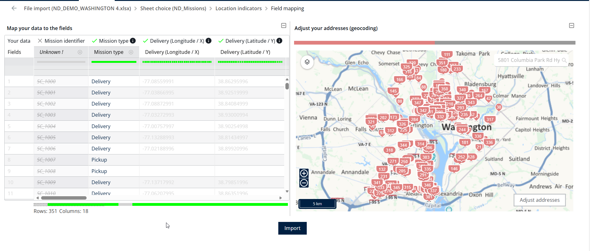
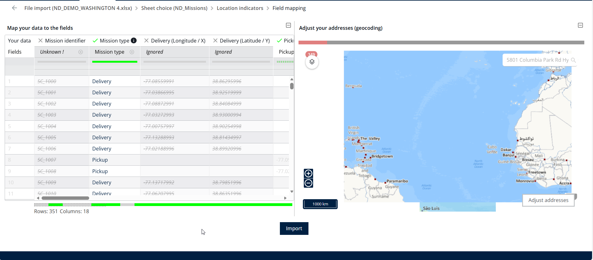

# Importer des missions

Importez des missions depuis un fichier Excel sur la page Missions pour créer de nombreuses missions en une seule fois.

## Avant de commencer

* Connectez-vous à **Nomadia Delivery** avec un profil utilisateur ayant accès à la page **Missions**.
* Disposez sur votre système local d’un fichier Excel contenant les missions à importer.
* Sachez si votre feuille fournit le champ d’adresse ou les champs de latitude et de longitude pour les emplacements de mission, car vous mappez l’un d’eux pendant l’importation.

## Présentation de la fonctionnalité

* **Actions** : ouvre le menu déroulant de la page Missions qui contient **Importer**.
* **Parcourir (Excel)** : vous permet de choisir le **fichier Excel souhaité** depuis votre système local.
* **Valider** : traite la feuille Excel et l’ensemble de données sélectionnés afin que vous puissiez consulter l’aperçu.
* **Vue en tableau et vue cartographique** : affichent l’aperçu des données avant l’importation.
* **Mappage des emplacements** : associe soit le champ d’adresse, soit les champs de latitude et de longitude pour les emplacements de mission.
* **Importer** : crée les missions à partir des données validées.

## Importer des missions depuis un fichier Excel

1. Depuis la page Missions, cliquez sur **Actions**.
2. Sélectionnez **Importer** dans le menu déroulant.

<figure><figcaption></figcaption></figure>

3. Cliquez sur **Parcourir (Excel)**.

<figure><figcaption></figcaption></figure>

4. Choisissez le **fichier Excel souhaité** depuis votre système local pour le téléverser et l’importer.

<figure><figcaption></figcaption></figure>

5. Consultez l’aperçu des feuilles Excel disponibles, sélectionnez l’ensemble de données requis et cliquez sur **Valider**.

<figure><figcaption></figcaption></figure>

6. Consultez l’aperçu des données, qui s’affiche à la fois dans la vue en tableau et dans la vue cartographique.

<figure><figcaption></figcaption></figure>

7. Associez soit le champ d’adresse, soit les champs de latitude et de longitude pour les emplacements de mission.

<figure><figcaption></figcaption></figure>

8. Cliquez sur **Importer**.

<figure><figcaption></figcaption></figure>

### Résultat

Les missions sont importées avec succès.

<figure><figcaption></figcaption></figure>

## Rubriques connexes

* [Améliorer le géocodage des adresses des missions](improve-the-missions-addresses-geocoding.md)
* [Création de champs personnalisés lors de l’importation](../custom-fields/creating-custom-fields-while-importing.md)
* [Missions](../README.md)
