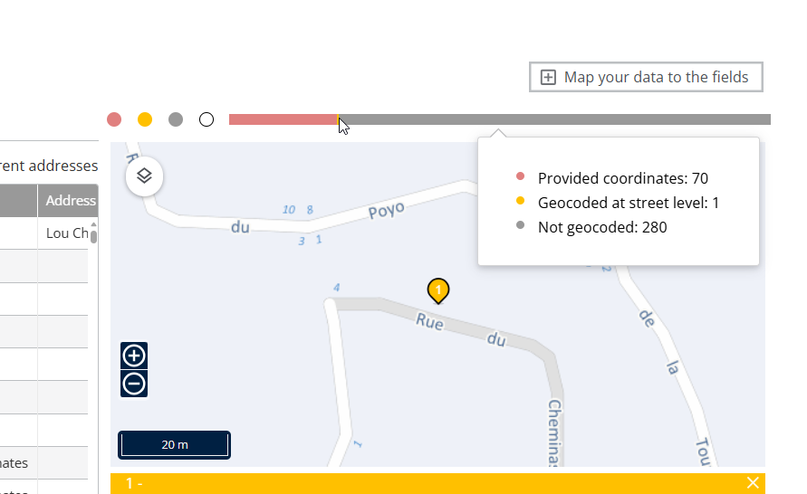
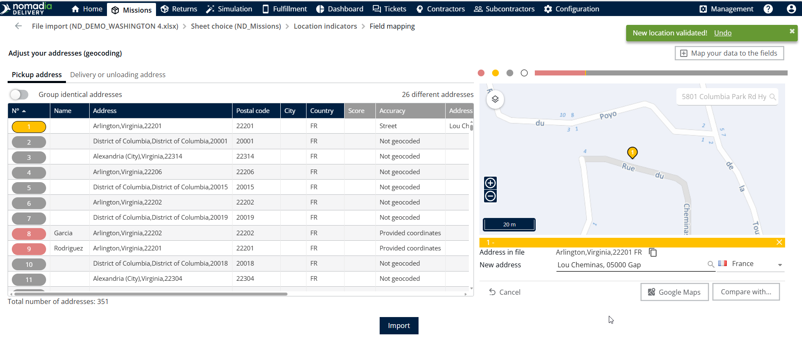

# Améliorer le géocodage des adresses des missions

Utilisez ce processus pour améliorer le géocodage des adresses des missions lors de l’importation. Il s’applique uniquement lorsque l’adresse de retrait ou l’adresse de livraison est sélectionnée pour importer les indicateurs de localisation au lieu de mapper les champs de latitude et de longitude.

## Avant de commencer

* Lancez une importation depuis la page Missions, comme décrit dans Importer des missions, et accédez à la section de mappage des indicateurs de localisation.
* Sélectionnez l’**adresse de retrait** ou l’**adresse de livraison** pour les indicateurs de localisation au lieu de mapper les champs de latitude et de longitude. Ce processus ne s’applique pas dans les autres cas.

## Présentation de la fonctionnalité

* **Adresse de retrait / Adresse de livraison** : les champs d’adresse que vous sélectionnez dans la section de mappage des indicateurs de localisation.
* **Valider** : traite les champs d’adresse sélectionnés et les géocode automatiquement.
* **Barre Statut de géocodage** : affiche les missions qui ont été géocodées à différents niveaux de géocodage.
* **Ajuster l’adresse** : ouvre les options de correction en bas de la carte pour les adresses qui ne sont pas géocodées correctement.
* **Missions géocodées au niveau de la ville / Missions non géocodées** : les groupes de missions que vous pouvez sélectionner pour les corriger.
* **Nouvelle adresse** : le champ dans lequel vous saisissez l’adresse mise à jour.
* **Importer** : importe les missions une fois la validation des adresses terminée.

## Améliorer le géocodage des adresses des missions

1. Sélectionnez l’**adresse de retrait** ou l’**adresse de livraison** dans la section de mappage des indicateurs de localisation.
2. Cliquez sur **Valider** pour traiter les champs d’adresse sélectionnés.

<figure><figcaption></figcaption></figure>

3. Vérifiez que Nomadia Delivery géocode automatiquement les adresses sélectionnées pendant le processus de validation. Les valeurs de latitude et de longitude générées sont utilisées comme coordonnées de localisation de la mission.
4. Consultez la barre **Statut de géocodage**, qui affiche les missions qui ont été géocodées à différents niveaux de géocodage.

<figure><figcaption></figcaption></figure>

5. Si certaines adresses de mission ne sont pas géocodées correctement, cliquez sur **Ajuster l’adresse** en bas de la carte.
6. Sélectionnez soit **Missions géocodées au niveau de la ville**, soit **Missions non géocodées**.
7. Saisissez l’adresse mise à jour dans le champ **Nouvelle adresse**. La localisation mise à jour est affichée sur la carte, et une fenêtre contextuelle de confirmation indiquant **Nouvelle localisation validée** s’affiche.
8. Une fois la validation de l’adresse terminée, cliquez sur **Importer** pour importer les missions.

<figure><figcaption></figcaption></figure>

## Conseils


**Consulter la barre Statut de géocodage** : après avoir cliqué sur **Valider**, vérifiez la barre pour voir quelles missions sont géocodées et à quel niveau, puis corrigez les autres avec **Ajuster l’adresse**.


## Rubriques connexes

* [Importer des missions](README.md)
* [Mapper les champs d’adresse depuis la liste globale d’adresses](../map-the-addresses-fields-from-the-global-address-list.md)
