# Comprendre la page des missions

Une mission désigne une tâche qui doit être exécutée, impliquant généralement un lieu de retrait et une adresse de livraison. Chaque mission passe par une séquence de statuts qui reflètent son étape actuelle. Comprendre ces statuts est essentiel pour suivre la progression et gérer les éventuelles exceptions pouvant survenir au cours du processus.

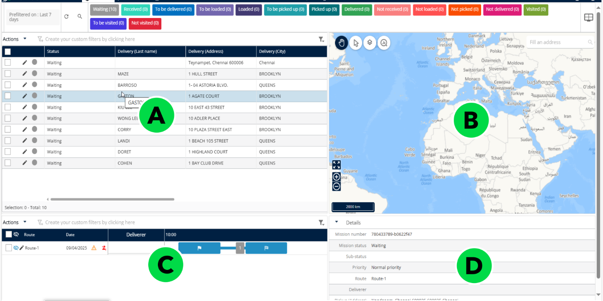

<table data-header-hidden><thead><tr><th valign="top"></th><th valign="top"></th><th valign="top"></th></tr></thead><tbody><tr><td valign="top">ID de la section</td><td valign="top">Section</td><td valign="top">Description</td></tr><tr><td valign="top">A</td><td valign="top">Tableau des missions</td><td valign="top">Affiche les missions en cours sous forme de tableau. Prend en charge jusqu’à 10 000 entrées à la fois. Inclut des options de tri et de filtrage pour un accès facile aux données.</td></tr><tr><td valign="top">B</td><td valign="top">Carte</td><td valign="top">Carte interactive montrant les emplacements des missions et les tracés des itinéraires. Aide à visualiser la répartition géographique et le suivi spatial en temps réel des statuts des missions.</td></tr><tr><td valign="top">C</td><td valign="top">Tableau des itinéraires</td><td valign="top">Vue de type Gantt des itinéraires, montrant la planification et la durée. Utile pour comprendre la charge de travail et la séquence des missions. Elle présente l’agenda de l’utilisateur mobile désigné.</td></tr><tr><td valign="top">D</td><td valign="top">Détails</td><td valign="top">Affiche des informations détaillées pour les missions ou itinéraires sélectionnés, telles que le nom du livreur, les créneaux horaires et le statut. Aide à l’examen et à la prise de décisions éclairées.</td></tr></tbody></table>

## Tableau de bord de sélection

Le tableau de bord de sélection vous donne un résumé rapide des missions que vous avez sélectionnées. Son en-tête indique le nombre de missions actuellement sélectionnées, et chaque widget situé en dessous affiche un compteur ou un statut pour cette sélection.

Dans les captures d’écran ci-dessous, aucune mission n’est sélectionnée, donc tous les compteurs affichent 0. Lorsque vous sélectionnez des missions, le tableau de bord reflète votre sélection.

### Avant de commencer

* Sélectionnez les missions que vous souhaitez examiner sur la page **Missions**. Le tableau de bord reflète votre sélection.

### Fonctionnalités

* [Lire l’en-tête du tableau de bord](#lire-len-tête-du-tableau-de-bord)
* [Utiliser les commandes du tableau de bord](#utiliser-les-commandes-du-tableau-de-bord)
* [Lire les widgets récapitulatifs](#lire-les-widgets-récapitulatifs)
* [Vérifier les missions par échéance de livraison](#vérifier-les-missions-par-échéance-de-livraison)
* [Vérifier les widgets par type de mission](#vérifier-les-widgets-par-type-de-mission)
* [Consulter la liste des problèmes](#consulter-la-liste-des-problèmes)
* [Vérifier le rayon de sélection](#vérifier-le-rayon-de-sélection)
* [Faire défiler pour voir tous les widgets](#faire-défiler-pour-voir-tous-les-widgets)
* [Supprimer un widget](#supprimer-un-widget)

### Lire l’en-tête du tableau de bord

1. Regardez la barre de titre du tableau de bord. Elle s’intitule Tableau de bord de sélection. Utilisez la petite flèche à gauche pour développer ou réduire le panneau.
2. Lisez l’intitulé Informations (0 mission sélectionnée). Le nombre entre parenthèses correspond au nombre de missions que vous avez sélectionnées.

<figure>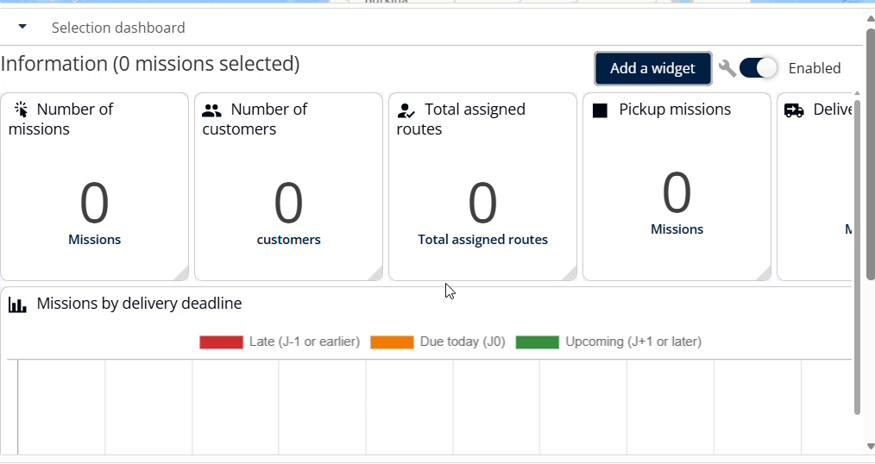<figcaption></figcaption></figure>

Le tableau de bord de sélection avec l’intitulé Informations

### Utiliser les commandes du tableau de bord

Dans le coin supérieur droit du tableau de bord, repérez les trois commandes visibles sur la capture d’écran :

* **Ajouter un widget** : le bouton qui permet d’ajouter des widgets au tableau de bord.
* **Icône de clé à molette** : l’icône des paramètres du tableau de bord.
* **Interrupteur Activé** : indique que le tableau de bord est activé.

<figure>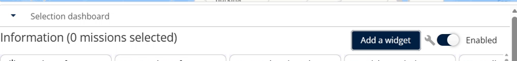<figcaption></figcaption></figure>

Le bouton Ajouter un widget, l’icône de clé à molette et l’interrupteur Activé

### Lire les widgets récapitulatifs

1. Regardez la première rangée de widgets, directement sous l’en-tête. Chaque widget affiche un nombre pour votre sélection :

<table data-header-hidden><thead><tr><th valign="bottom"></th><th valign="bottom"></th></tr></thead><tbody><tr><td valign="bottom">Widget</td><td valign="bottom">Ce qu’il affiche</td></tr><tr><td valign="bottom">Nombre de missions</td><td valign="bottom">Le nombre total de missions sélectionnées.</td></tr><tr><td valign="bottom">Nombre de clients</td><td valign="bottom">Le nombre de clients concernés par les missions sélectionnées.</td></tr><tr><td valign="bottom">Total des itinéraires affectés</td><td valign="bottom">Le nombre d’itinéraires auxquels les missions sélectionnées sont affectées.</td></tr><tr><td valign="bottom">Missions de retrait</td><td valign="bottom">Le nombre de missions de retrait sélectionnées.</td></tr><tr><td valign="bottom">Missions de livraison</td><td valign="bottom">Le nombre de missions de livraison sélectionnées.</td></tr></tbody></table>

<figure>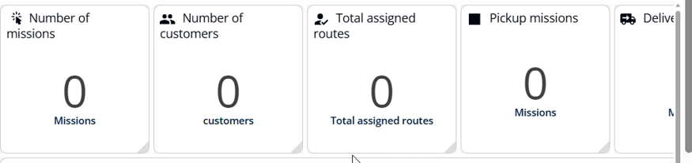<figcaption></figcaption></figure>

La première rangée de widgets récapitulatifs

2. Si le dernier widget est coupé, faites défiler le panneau vers la droite pour voir Missions de livraison.

<figure>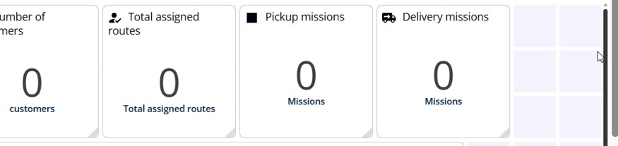<figcaption></figcaption></figure>

Le widget Missions de livraison visible après un défilement vers la droite

### Vérifier les missions par échéance de livraison

1. Repérez le graphique Missions par échéance de livraison sous la première rangée de widgets.
2. Utilisez la légende des couleurs située au-dessus du graphique pour le lire :

<table data-header-hidden><thead><tr><th valign="bottom"></th><th valign="bottom"></th></tr></thead><tbody><tr><td valign="bottom">Couleur</td><td valign="bottom">Signification</td></tr><tr><td valign="bottom">Rouge</td><td valign="bottom">En retard (J-1 ou avant) : l’échéance de livraison était hier ou plus tôt.</td></tr><tr><td valign="bottom">Orange</td><td valign="bottom">À livrer aujourd’hui (J0) : l’échéance de livraison est aujourd’hui.</td></tr><tr><td valign="bottom">Vert</td><td valign="bottom">À venir (J+1 ou après) : l’échéance de livraison est demain ou plus tard.</td></tr></tbody></table>

<figure>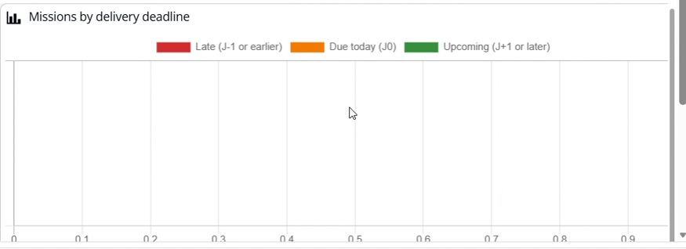<figcaption></figcaption></figure>

Le graphique Missions par échéance de livraison et sa légende

### Vérifier les widgets par type de mission

1. Faites défiler vers le bas jusqu’à la rangée de widgets suivante. Chaque widget compte les missions sélectionnées d’un même type :

<table data-header-hidden><thead><tr><th valign="bottom"></th><th valign="bottom"></th></tr></thead><tbody><tr><td valign="bottom">Widget</td><td valign="bottom">Ce qu’il affiche</td></tr><tr><td valign="bottom">Missions de cross-docking</td><td valign="bottom">Le nombre de missions de cross-docking sélectionnées.</td></tr><tr><td valign="bottom">Missions de drop shipping</td><td valign="bottom">Le nombre de missions de drop shipping sélectionnées.</td></tr><tr><td valign="bottom">Missions chaînées de retrait &#x26; livraison</td><td valign="bottom">Le nombre de missions sélectionnées dans lesquelles un retrait est chaîné à une livraison.</td></tr><tr><td valign="bottom">Missions de visite</td><td valign="bottom">Le nombre de missions de visite sélectionnées.</td></tr></tbody></table>

<figure>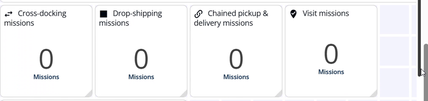<figcaption></figcaption></figure>

La rangée de widgets par type de mission

### Consulter la liste des problèmes

1. Faites défiler vers le bas jusqu’au widget Liste des problèmes.
2. Lisez la colonne Problèmes. Elle répertorie les contrôles effectués par le tableau de bord sur votre sélection : « Même adresse de départ » et « Mission déjà affectée (0) ».
3. Lisez la colonne Oui / Non. Chaque contrôle possède un indicateur d’état. Sur la capture d’écran, les deux contrôles affichent un indicateur vert.

<figure>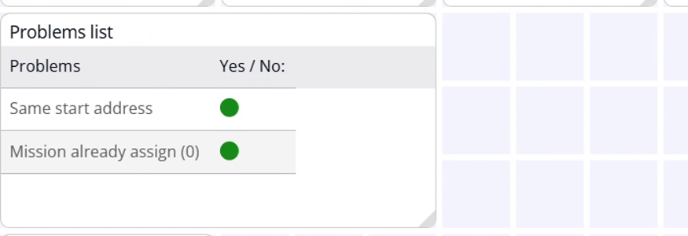<figcaption></figcaption></figure>

Le widget Liste des problèmes avec deux contrôles

### Vérifier le rayon de sélection

1. Faites défiler vers le bas jusqu’au widget Rayon de sélection (à vol d’oiseau).
2. Lisez la valeur. Elle est exprimée en kilomètres (Km) et mesurée en ligne droite, et non par la route.

<figure>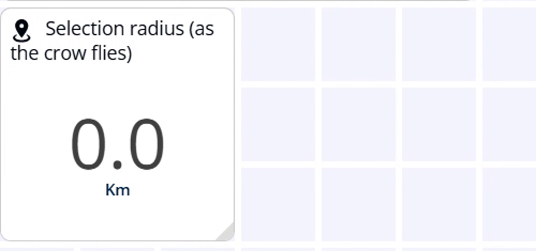<figcaption></figcaption></figure>

Le widget Rayon de sélection affichant 0,0 Km

### Faire défiler pour voir tous les widgets

1. Utilisez la barre de défilement verticale à droite du tableau de bord pour monter et descendre dans les widgets.
2. Utilisez la barre de défilement horizontale en bas du tableau de bord pour vous déplacer vers la gauche et vers la droite lorsqu’un widget ou un graphique est plus large que le panneau.

<figure>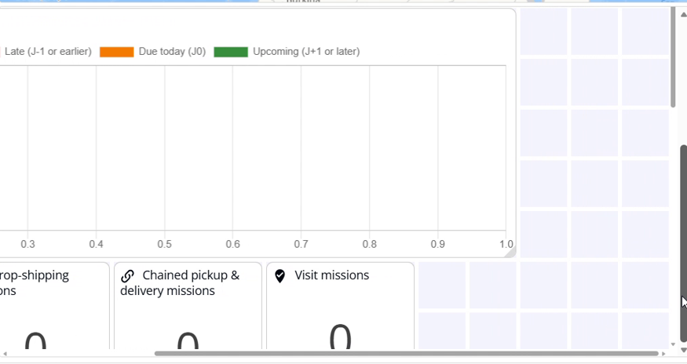<figcaption></figcaption></figure>

Le tableau de bord défilé vers la droite

### Supprimer un widget

1. Pointez le titre d’un widget. Une icône de corbeille apparaît à côté du titre, comme indiqué sur la capture d’écran.
2. Sélectionnez l’icône de corbeille pour supprimer le widget du tableau de bord.

<figure>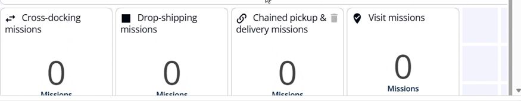<figcaption></figcaption></figure>

L’icône de corbeille sur le titre d’un widget

## Widgets du tableau de bord de sélection

La fenêtre **Configuration des widgets** vous permet de choisir les widgets qui apparaissent sur le tableau de bord de sélection. La fenêtre comporte deux listes :

* **Widgets disponibles** : widgets qui ne sont pas actuellement affichés sur le tableau de bord.
* **Widgets affichés** : widgets qui sont actuellement affichés sur le tableau de bord.

### Avant de commencer

* Ouvrez le **Tableau de bord de sélection**. Consultez [Tableau de bord de sélection](#tableau-de-bord-de-sélection).

### Fonctionnalités

* [Widgets disponibles](#widgets-disponibles)
* [Widgets affichés](#widgets-affichés)
* [Ajouter ou supprimer un widget](#ajouter-ou-supprimer-un-widget)
* [Statuts de livraison par défaut](#statuts-de-livraison-par-défaut)

### Widgets disponibles

Les widgets suivants peuvent être ajoutés au tableau de bord.

| Widget                              | Description                                                                              |
| ----------------------------------- | ---------------------------------------------------------------------------------------- |
| Missions de livraison               | Affiche le nombre de missions de livraison.                                              |
| Missions par échéance de livraison  | Affiche la répartition des missions selon leur échéance de livraison.                    |
| Nombre d’itinéraires                | Affiche le nombre total d’itinéraires.                                                   |
| Missions de retrait                 | Affiche le nombre de missions de retrait.                                                |

### Widgets affichés

Les widgets suivants sont actuellement affichés sur le tableau de bord.

| Widget                                  | Description                                                                                                                                                                  |
| --------------------------------------- | ---------------------------------------------------------------------------------------------------------------------------------------------------------------------------- |
| Missions chaînées de retrait & livraison | Affiche le nombre de missions dans lesquelles un retrait est chaîné à une livraison.                                                                                         |
| Missions de cross-docking               | Affiche le nombre de missions de cross-docking, où les marchandises sont transférées du transport entrant au transport sortant via un hub, sans stockage de longue durée.   |
| Missions de drop shipping               | Affiche le nombre de missions de drop shipping, où les marchandises sont expédiées directement du fournisseur au client.                                                     |
| Nombre de clients                       | Affiche le nombre de clients concernés.                                                                                                                                      |
| Nombre de missions                      | Affiche le nombre total de missions.                                                                                                                                         |
| Liste des problèmes                     | Répertorie les problèmes détectés.                                                                                                                                           |
| Rayon de sélection (à vol d’oiseau)     | Affiche le rayon de la sélection, mesuré en ligne droite.                                                                                                                    |
| Total des itinéraires affectés          | Affiche le nombre d’itinéraires auxquels des missions sont affectées.                                                                                                        |
| Volume total                            | Affiche le volume total des missions.                                                                                                                                        |
| Poids total                             | Affiche le poids total des missions.                                                                                                                                         |
| Missions de visite                      | Affiche le nombre de missions de visite.                                                                                                                                     |

### Ajouter ou supprimer un widget

1. Dans la fenêtre **Configuration des widgets**, sélectionnez un ou plusieurs widgets dans une liste.
2. Utilisez les boutons fléchés situés entre les deux listes :
   * Sélectionnez la **flèche droite** pour déplacer les widgets sélectionnés vers **Widgets affichés**.
   * Sélectionnez la **flèche gauche** pour renvoyer les widgets sélectionnés vers **Widgets disponibles**.
3. Sélectionnez **Enregistrer** pour appliquer vos modifications, ou **Annuler** pour fermer la fenêtre sans enregistrer.

<figure>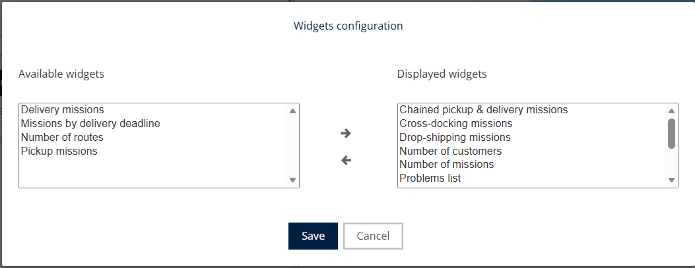<figcaption></figcaption></figure>

### Statuts de livraison par défaut

Voici un aperçu des statuts de mission et de leur signification :

<table data-header-hidden><thead><tr><th valign="top"></th><th valign="top"></th></tr></thead><tbody><tr><td valign="top">Statut</td><td valign="top">Description</td></tr><tr><td valign="top">En attente</td><td valign="top">La mission est attendue mais pas encore reçue.</td></tr><tr><td valign="top">Reçue</td><td valign="top">La mission a été reçue avec succès.</td></tr><tr><td valign="top">À livrer</td><td valign="top">La mission est préparée pour la livraison.</td></tr><tr><td valign="top">À charger</td><td valign="top">La mission attend d’être chargée.</td></tr><tr><td valign="top">Chargée</td><td valign="top">Le colis est maintenant chargé et en transit.</td></tr><tr><td valign="top">À retirer</td><td valign="top">La mission est planifiée et en attente de retrait.</td></tr><tr><td valign="top">Retirée</td><td valign="top">L’article a été collecté à l’origine.</td></tr><tr><td valign="top">Livrée</td><td valign="top">La livraison est terminée avec succès.</td></tr><tr><td valign="top">Non reçue</td><td valign="top">Indique qu’une mission était attendue mais n’a pas pu être reçue</td></tr><tr><td valign="top">Non chargée</td><td valign="top">La mission n’a pas pu être chargée comme prévu</td></tr><tr><td valign="top">Non retirée</td><td valign="top">Le retrait planifié a été manqué ou a échoué.</td></tr><tr><td valign="top">Non livrée</td><td valign="top">La livraison a échoué.</td></tr><tr><td valign="top">Visitée</td><td valign="top">La destination a été visitée avec succès.</td></tr><tr><td valign="top">À visiter</td><td valign="top">La destination est planifiée pour une visite.</td></tr><tr><td valign="top">Non visitée</td><td valign="top">La visite planifiée a été manquée ou n’a pas abouti.</td></tr></tbody></table>

<figure>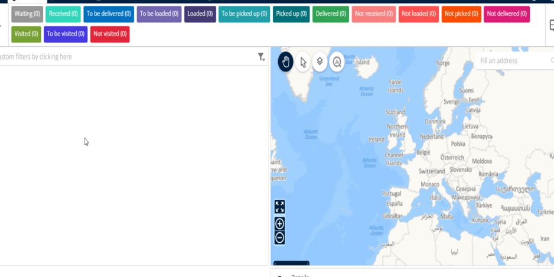<figcaption></figcaption></figure>

## Rubriques connexes

* Pré-filtres
* [Filtrer le tableau à l’aide de critères](filter-the-table-using-criteria.md)
* [Rechercher une mission](search-for-a-mission.md)
* [Afficher les informations d’une mission](view-a-mission-information.md)
* [Gérer le tableau des missions](../manage-missions-table.md)
