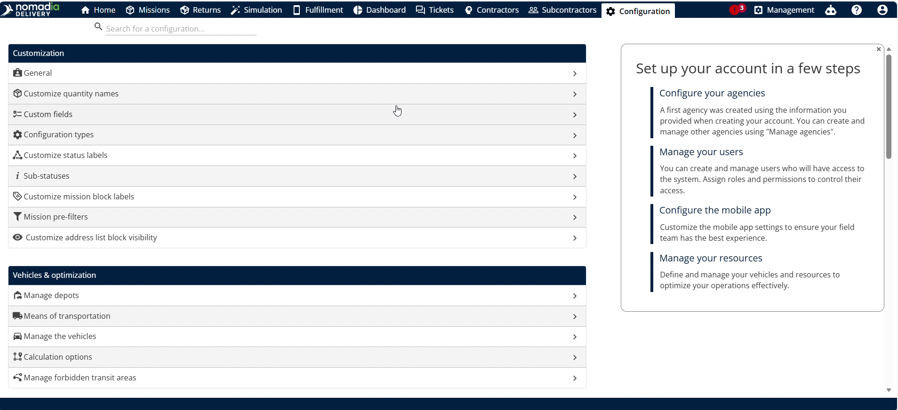
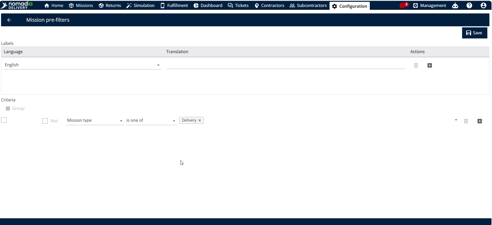
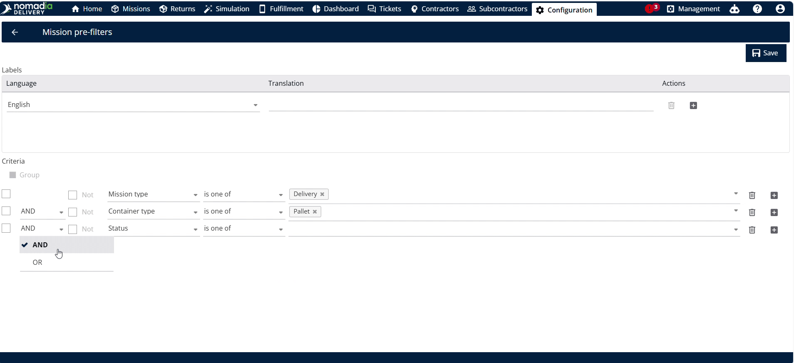
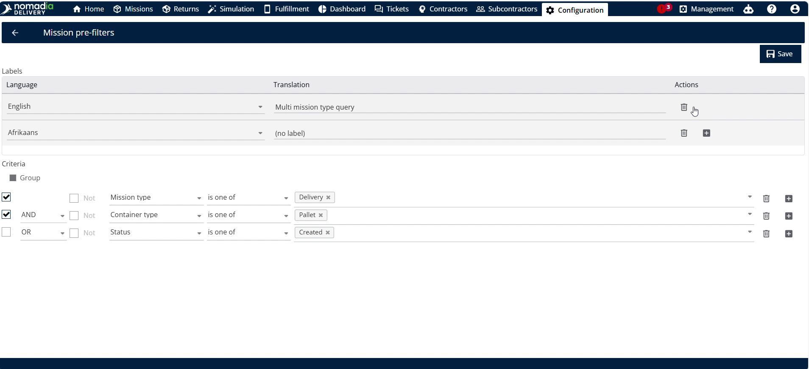
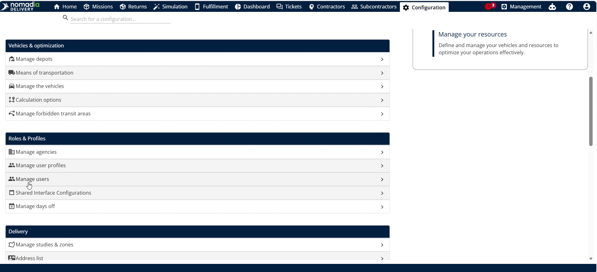
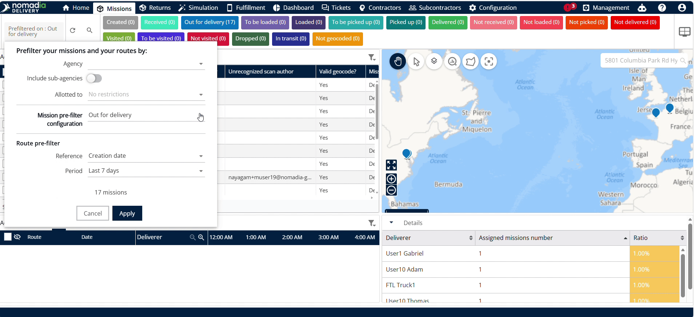
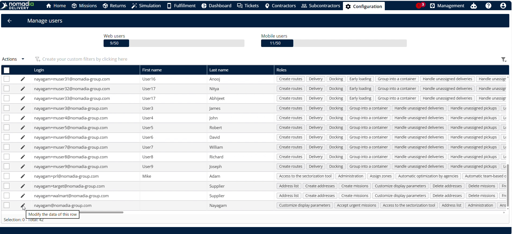
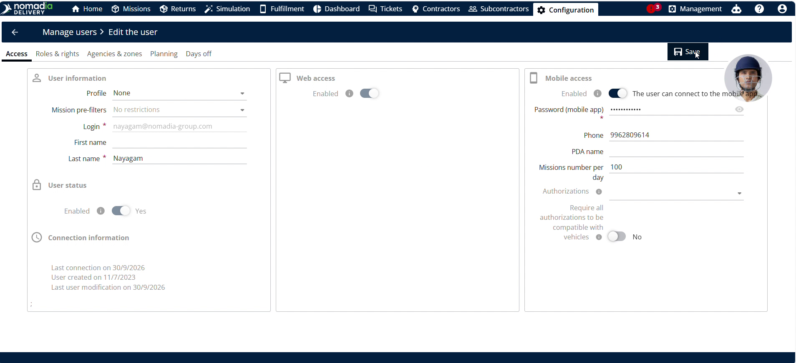
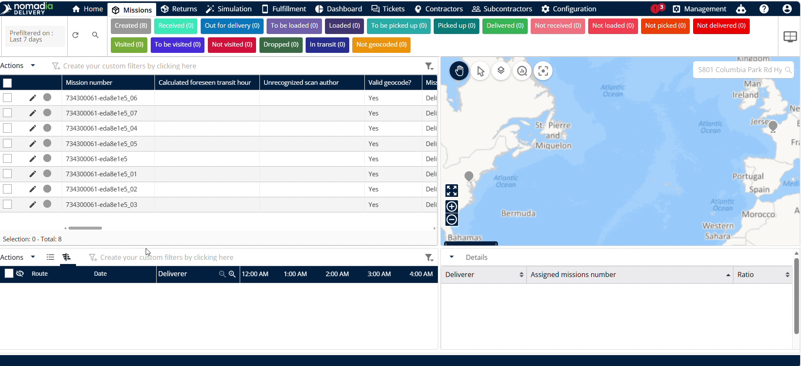

# Configurer les pré-filtres de mission

La fonctionnalité **Configurer les pré-filtres de missions gérées** permet de créer des règles de filtrage personnalisées basées sur le statut et le type de mission dans **Nomadia Delivery**. Vous avez besoin de cette fonctionnalité pour contrôler la visibilité de la flotte et centrer les flux de travail sur des tâches opérationnelles précises. En configurant des pré-filtres, vous simplifiez le suivi et optimisez la gestion des missions au sein de votre équipe.

## Avant de commencer

Prérequis et exigences :

* Accès à **Nomadia Delivery** avec des droits d’administrateur ou de répartiteur.
* Des enregistrements de missions actifs configurés dans le système.
* Un navigateur Web connecté à la plateforme SaaS.

Étapes de configuration initiale :

1. Ouvrez la page **Configuration**.
2. Sélectionnez **Pré-filtres de missions** dans la liste des paramètres.

3. Cliquez sur **Actions** et sélectionnez **Ajouter** pour ouvrir le générateur de configuration de filtre.

## Présentation de la fonctionnalité

* **Champ Statut** : sélectionne des statuts opérationnels de mission précis pour la requête. Il filtre la vue de la flotte afin d’afficher les statuts de mission pertinents.
* **Champ Type de mission** : indique les catégories de missions incluses dans le filtre. Il limite les résultats de la requête aux types de mission désignés.
* **Opérateur logique (ET/OU)** : bascule la logique conditionnelle entre les règles de filtre. Il détermine si toutes les conditions ou seulement l’une d’entre elles doivent être remplies.
* **Condition de groupe** : combine plusieurs instructions de filtre en un groupe logique. Elle permet une logique de filtrage imbriquée complexe.
* **Champ Nom de la requête** : accepte un libellé de texte personnalisé pour la requête de filtre. Il aide les utilisateurs à identifier facilement les configurations de filtre enregistrées.
* **Symbole plus de traduction** : ouvre des champs de saisie de traduction pour d’autres langues. Il permet la prise en charge multilingue pour les répartiteurs régionaux.
* **Bouton Supprimer la langue** : supprime une traduction de langue ajoutée. Il supprime de la requête les champs de langue inutiles.
* **Option Gérer l’utilisation** : ouvre les paramètres d’affectation d’accès utilisateur pour les pré-filtres. Elle détermine quels utilisateurs reçoivent des vues de missions restreintes.

## Créer et personnaliser un pré-filtre de mission

1. Ouvrez la page **Configuration** et cliquez sur **Pré-filtres de missions**.

2. Cliquez sur **Actions** et sélectionnez **Ajouter** pour lancer l’éditeur.

3. Choisissez les valeurs de statut requises dans le **Champ Statut**.

4. Choisissez les catégories de missions requises dans le **Champ Type de mission**.

5. Cliquez pour ajouter des conditions de statut supplémentaires si nécessaire.

6. Sélectionnez la logique **ET** ou **OU** pour relier vos conditions.

7. Regroupez les conditions si vous combinez plusieurs règles de filtre.

8. Saisissez un libellé clair et descriptif dans le **Champ Nom de la requête**.
9. Cliquez sur **Enregistrer** pour créer la requête de filtre.

## Ajouter des traductions à une requête de pré-filtre

1. Cliquez sur le **Symbole plus de traduction** à côté du champ de traduction.

2. Sélectionnez votre langue cible dans la liste déroulante.

3. Saisissez le nom de la requête dans la langue sélectionnée.

4. Cliquez sur le **Bouton Supprimer la langue** si vous souhaitez supprimer une langue.

5. Cliquez sur **Enregistrer** pour mettre à jour les traductions.

## Affecter une requête de pré-filtre à un utilisateur

1. Ouvrez la page **Configuration** et cliquez sur **Gérer les utilisateurs**.

2. Sélectionnez l’adresse e-mail de l’utilisateur cible.

3. Repérez la section **Pré-filtres de missions**.

4. Sélectionnez le nom de la requête à affecter, par exemple **En cours de livraison**.

5. Cliquez sur **Enregistrer** pour appliquer l’affectation.

6. Accédez à **Missions** dans le menu principal.
7. Cliquez sur **Appliquer** pour afficher uniquement les missions correspondant au statut affecté.

## Supprimer un pré-filtre affecté à un utilisateur

1. Ouvrez la page **Configuration** et sélectionnez **Gérer les utilisateurs**.
2. Cliquez sur l’adresse e-mail de l’utilisateur.
3. Effacez la requête affectée sous **Pré-filtres de missions**.

4. Cliquez sur **Enregistrer** pour mettre à jour les paramètres du profil utilisateur.

5. Accédez à **Missions** et effacez les sélections de filtres actives.

6. Cliquez sur **Appliquer** pour afficher à nouveau toutes les missions de la flotte.

## Conseils


**Adaptabilité multilingue** : l’ajout de traductions garantit que les membres d’équipes internationales voient les titres des requêtes de filtre dans leur langue préférée.



**Visibilité masquée de la flotte** : tant qu’un pré-filtre reste affecté, les répartiteurs ne peuvent pas voir l’ensemble de la flotte ; supprimez l’affectation pour y remédier.


## Rubriques connexes

* Pré-filtres
* Définir l’affichage des missions (préfiltre)
* [Comprendre la page des missions](README.md)
