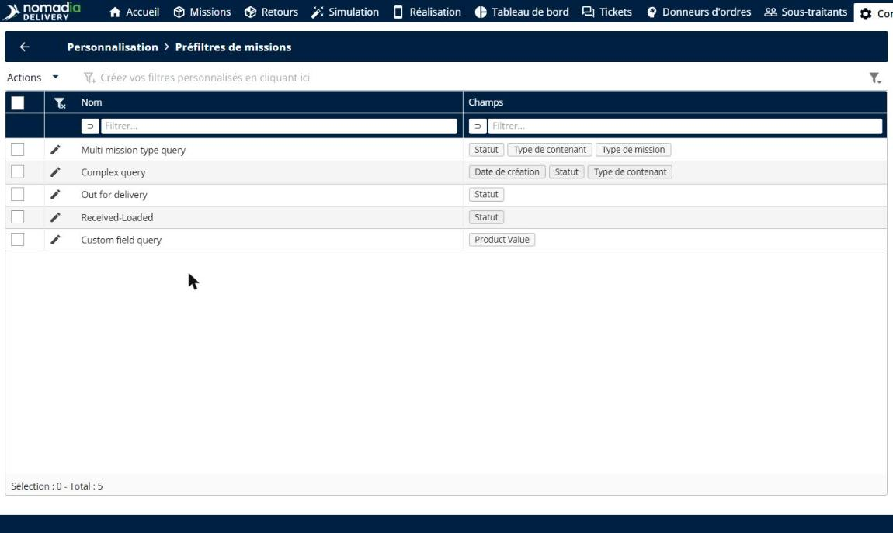
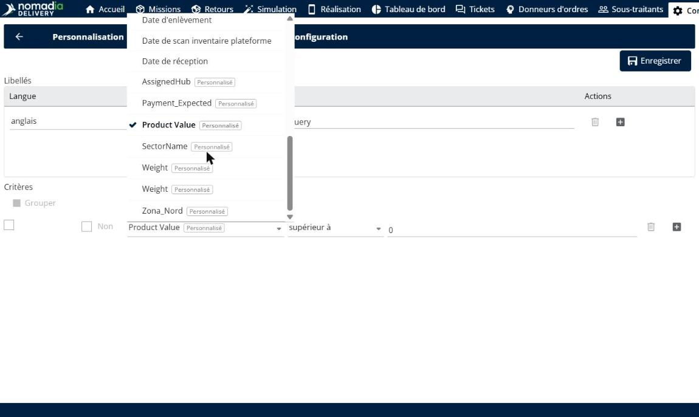
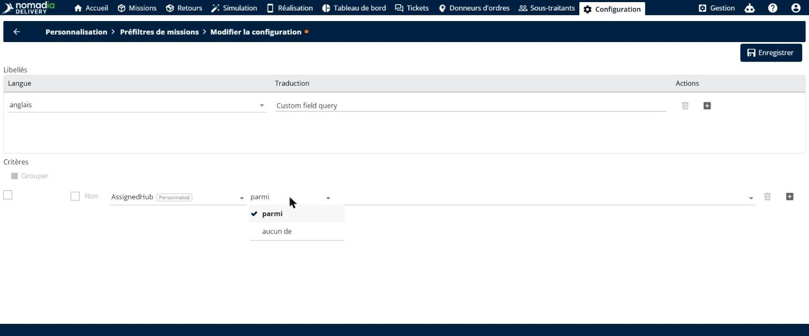
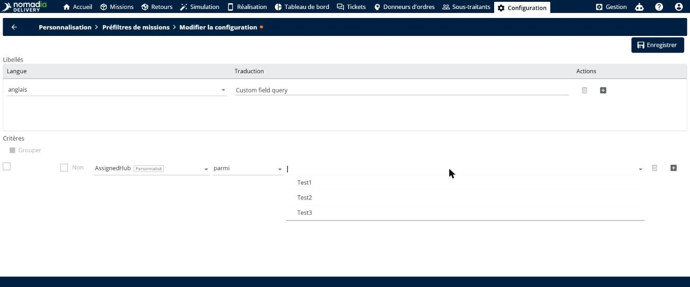
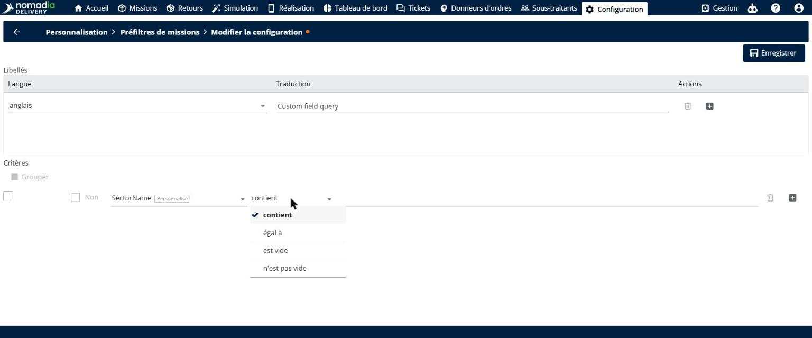
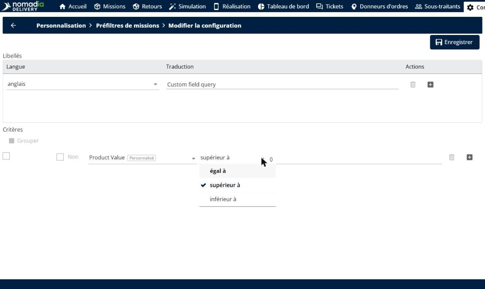
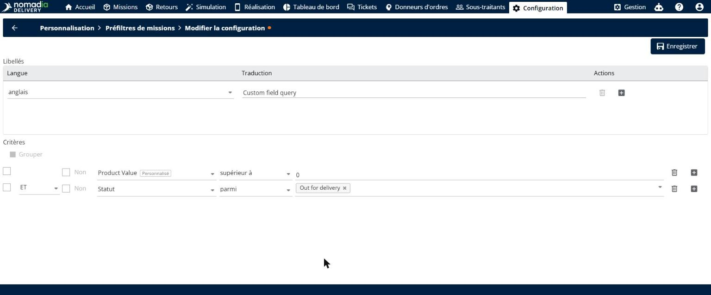

# Champs personnalisés dans les préfiltres de missions

Les champs personnalisés dans les préfiltres de missions vous permettent de filtrer la liste des missions selon les attributs qui comptent pour votre activité. Chaque champ personnalisé de mission est disponible dans les critères des préfiltres dès sa création, avec des comparaisons adaptées à son type. Vous pouvez combiner champs standard et champs personnalisés dans un même préfiltre, et choisir les préfiltres que chaque utilisateur peut voir.

## Avant de commencer

* Connectez-vous à **Nomadia Delivery** avec un profil utilisateur ayant accès à la page **Configuration**.
* Assurez-vous que les champs personnalisés de mission sur lesquels vous voulez filtrer existent. Voir [Champs personnalisés](../custom-fields/README.md).

## Présentation de la fonctionnalité

* **Préfiltres de missions** : page de **Configuration**, dans la section **Personnalisation**, qui répertorie vos préfiltres de missions et les champs qu’ils utilisent.
* **Étiquette Personnalisé** : étiquette affichée à côté de chaque champ personnalisé dans la liste des champs des critères, pour distinguer les champs personnalisés des champs standard.
* **Inclusion automatique** : les nouveaux champs personnalisés apparaissent instantanément dans la liste des champs des critères, sans configuration supplémentaire.
* **Comparaisons par type de champ** : les comparaisons proposées dépendent du type du champ. Par exemple, pour un nombre : **égal à**, **supérieur à** et **inférieur à**. Les listes de valeurs, les textes, les dates et les champs oui/non disposent de leurs propres comparaisons.
* **Pré-filtres de missions d’un utilisateur** : champ de l’onglet **Accès** d’un utilisateur qui définit les préfiltres que l’utilisateur peut voir.

## Ajouter un champ personnalisé à un préfiltre de missions

1. Vérifiez vos champs personnalisés de mission et leur type, par exemple liste de valeurs, nombre ou texte.

2. Accédez à **Configuration** > **Préfiltres de missions**, puis cliquez sur l’**icône crayon** à côté d’un préfiltre, ou cliquez sur **Actions** > **Ajouter** pour en créer un. Voir [Configurer les pré-filtres de mission](configuremissionprefilters.md).

3. Sous **Critères**, ouvrez la liste des champs d’une condition. Les champs personnalisés apparaissent avec l’étiquette **Personnalisé**. Sélectionnez un champ personnalisé.

4. Choisissez la comparaison. Les comparaisons dépendent du type du champ :

   * Pour une liste de valeurs, choisissez **parmi** ou **aucun de**, puis sélectionnez les valeurs directement dans la liste.

   * Pour un texte, choisissez **contient**, **égal à**, **est vide** ou **n’est pas vide**, puis saisissez le texte.

   * Pour un nombre, choisissez **égal à**, **supérieur à** ou **inférieur à**, puis saisissez le nombre.

5. Ajoutez d’autres conditions si nécessaire, avec des champs standard comme **Statut** et des champs personnalisés, et reliez-les par **ET** ou **OU**.

6. Cliquez sur **Enregistrer**.

## Choisir les préfiltres qu’un utilisateur peut voir

1. Accédez à **Configuration** > **Gérer les utilisateurs**, puis cliquez sur l’**icône crayon** à côté de l’utilisateur. L’onglet **Accès** s’ouvre.

2. Dans **Pré-filtres de missions**, sélectionnez les préfiltres que l’utilisateur peut voir.

3. Cliquez sur **Enregistrer**.

### Résultat

L’utilisateur ne voit que les préfiltres qui le concernent. Si aucun préfiltre n’est sélectionné, le champ affiche **Aucune restriction**.

## Appliquer un préfiltre dans la liste des missions

1. Sur la page **Missions**, cliquez sur la zone de préfiltre en haut à gauche de la page pour ouvrir le panneau **Préfiltrer vos missions et vos tournées par**.
2. Dans **Configuration de préfiltre de missions**, choisissez le préfiltre. Le panneau indique le nombre de missions correspondantes.

3. Cliquez sur **Appliquer**.

### Résultat

La liste des missions n’affiche que les missions qui correspondent au préfiltre, par exemple 22 missions sur 364.

## Conseils


**Un préfiltre, tous vos critères** : combinez champs standard et champs personnalisés dans un seul préfiltre plutôt que de créer plusieurs préfiltres.


## Rubriques connexes

* [Configurer les pré-filtres de mission](configuremissionprefilters.md)
* [Champs personnalisés](../custom-fields/README.md)
