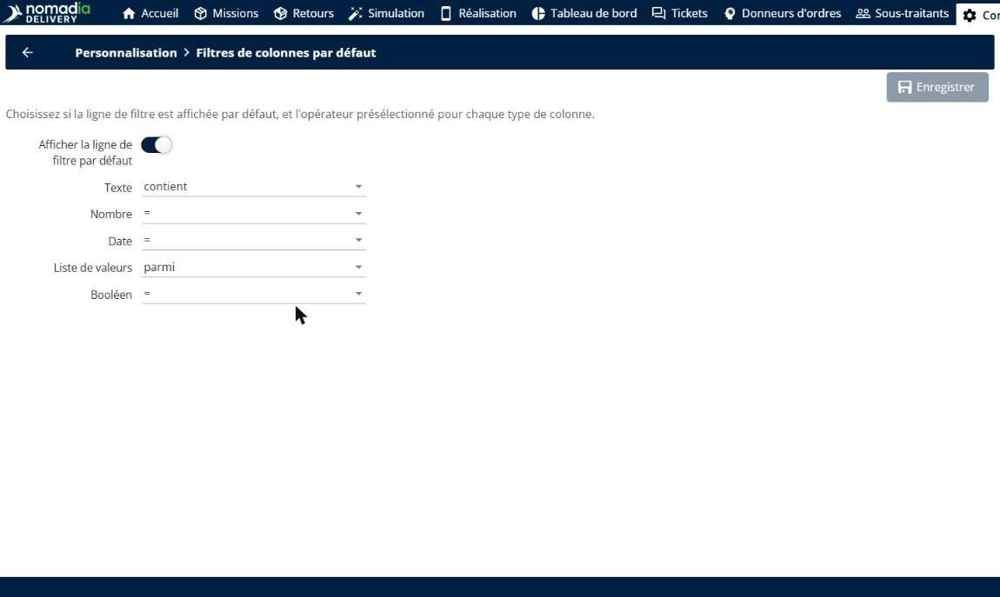
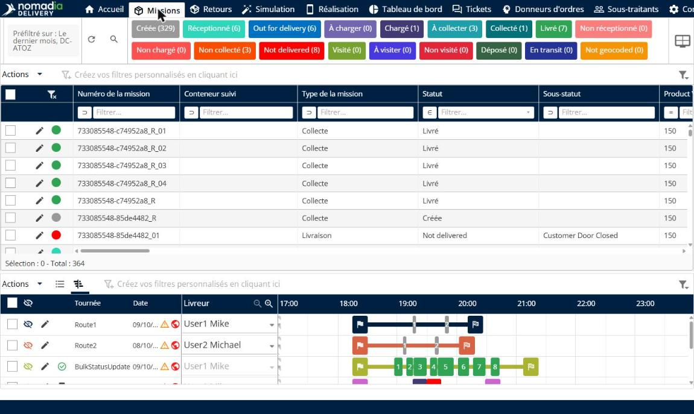
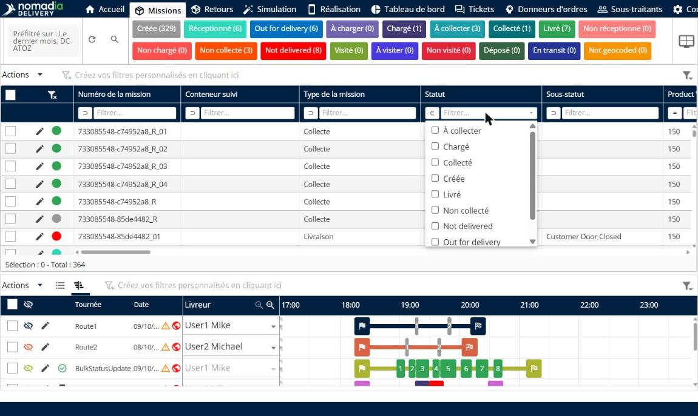
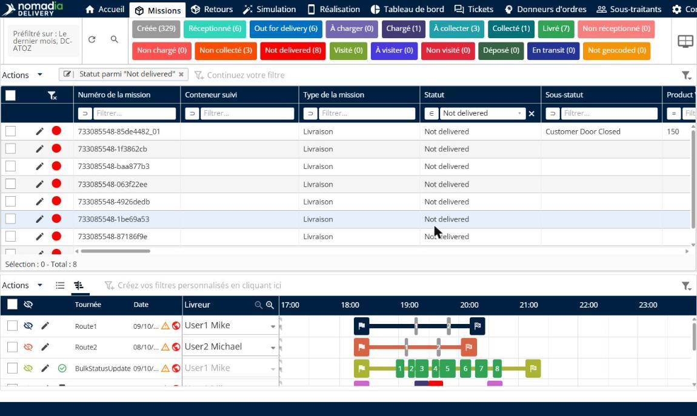
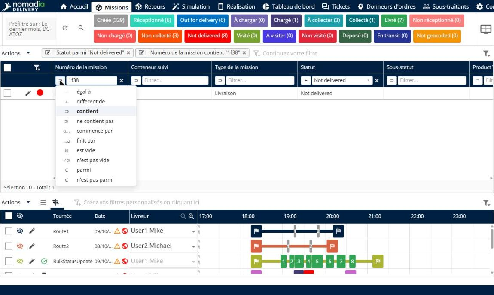
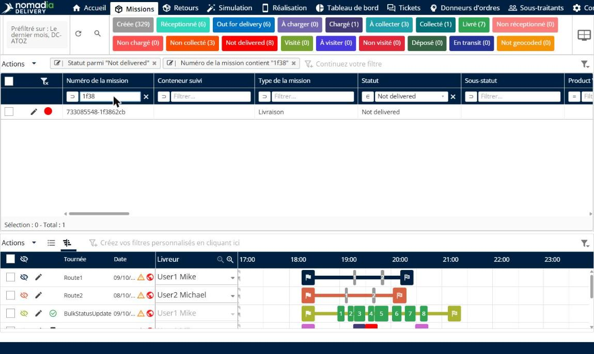
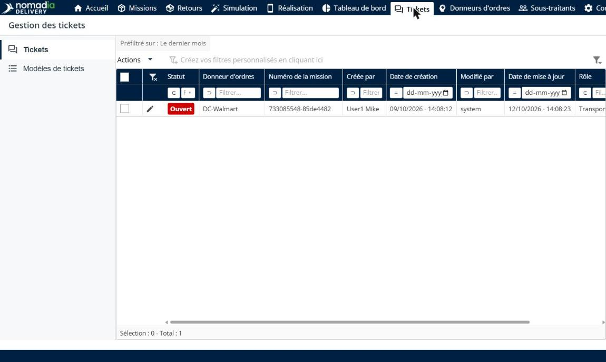

# Filtres de colonnes de type Excel

Les filtres de colonnes de type Excel vous permettent de filtrer n’importe quel tableau directement depuis les en-têtes de ses colonnes, comme dans un tableur. Une ligne de filtre sous les en-têtes offre pour chaque colonne une liste déroulante pour les valeurs prédéfinies ou une zone de texte pour le texte libre, et vous pouvez changer la comparaison en un clic. Les administrateurs choisissent si la ligne de filtre est affichée par défaut et quelle comparaison est présélectionnée pour chaque type de colonne.

## Avant de commencer

* Connectez-vous à **Nomadia Delivery** avec un profil utilisateur ayant accès aux tableaux que vous souhaitez filtrer, comme la page **Missions**.
* Pour définir les valeurs par défaut, vous devez avoir accès à la page **Configuration**.

## Présentation de la fonctionnalité

* **Filtres de colonnes par défaut** : page de **Configuration**, dans la section **Personnalisation**, où vous choisissez si la ligne de filtre est affichée par défaut et la comparaison présélectionnée pour chaque type de colonne.
* **Afficher la ligne de filtre par défaut** : interrupteur qui affiche la ligne de filtre sous les en-têtes de colonnes de chaque tableau par défaut.
* **Comparaison par défaut par type de colonne** : comparaison présélectionnée pour les colonnes **Texte** (par exemple **contient**), **Nombre** (**=**), **Date** (**=**), **Liste de valeurs** (**parmi**) et **Booléen** (**=**).
* **Ligne de filtre** : ligne située sous les en-têtes de colonnes. Les colonnes à valeurs prédéfinies affichent une liste déroulante, et les autres colonnes une zone de texte pour le texte libre.
* **Comparaison** : opérateur d’un filtre de colonne, tel que **égal à**, **différent de**, **contient**, **ne contient pas**, **commence par**, **finit par**, **est vide**, **n’est pas vide**, **parmi** et **n’est pas parmi**.
* **Interrupteur par tableau** : icône en haut à gauche d’un tableau qui affiche ou masque sa ligne de filtre.

## Définir les filtres de colonnes par défaut

1. Accédez à **Configuration** > **Filtres de colonnes par défaut**.
2. Activez **Afficher la ligne de filtre par défaut** pour afficher la ligne de filtre dans chaque tableau.
3. Pour chaque type de colonne, choisissez la comparaison à présélectionner : **Texte**, **Nombre**, **Date**, **Liste de valeurs** et **Booléen**.

4. Cliquez sur **Enregistrer**.

## Filtrer un tableau depuis les en-têtes de colonnes

1. Ouvrez un tableau, par exemple le tableau des missions de la page **Missions**. La ligne de filtre s’affiche sous les en-têtes de colonnes.

2. Pour une colonne à valeurs prédéfinies, comme **Statut**, ouvrez la liste déroulante de la ligne de filtre et cochez les valeurs à conserver.

Le tableau est filtré en un clic, et le filtre est ajouté à la barre de filtres au-dessus du tableau.

3. Pour une colonne en texte libre, comme **Numéro de la mission**, saisissez le texte dans la zone de texte de la ligne de filtre.
4. Pour changer la comparaison, cliquez sur l’icône d’opérateur à gauche du filtre, puis choisissez la comparaison, par exemple **commence par** ou **n’est pas vide**.

### Résultat

Le tableau n’affiche que les lignes qui correspondent à tous les filtres de colonnes. Les filtres restent synchronisés avec la barre de filtres au-dessus du tableau : vous pouvez donc aussi les modifier ou les supprimer depuis cette barre.

## Afficher ou masquer la ligne de filtre d’un tableau

1. Cliquez sur l’icône de ligne de filtre en haut à gauche du tableau pour afficher ou masquer sa ligne de filtre.

### Résultat

La ligne de filtre est affichée ou masquée pour ce tableau uniquement. Les autres tableaux, comme le tableau des tickets, conservent le même fonctionnement de la ligne de filtre.

## Conseils


**Combiner les filtres** : vous pouvez filtrer plusieurs colonnes en même temps. Le tableau n’affiche que les lignes qui correspondent à tous les filtres, et chaque filtre apparaît dans la barre de filtres.


## Rubriques connexes

* [Comprendre la page des missions](README.md)
* [Filtrer le tableau à l’aide de critères](filter-the-table-using-criteria.md)
* [Rechercher une mission](search-for-a-mission.md)
