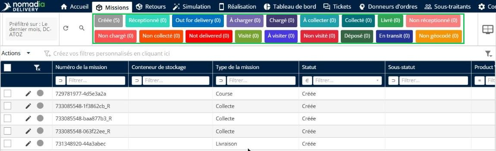

# Pré-filtres

Les pré-filtres de la page Missions sont des sections dynamiques qui vous donnent des informations détaillées et contextuelles selon votre sélection ou votre interaction en cours. Ils facilitent la navigation et améliorent la productivité en donnant un accès rapide aux données utiles, sans changer d’écran.

## Avant de commencer

* Connectez-vous à **Nomadia Delivery** avec un profil utilisateur ayant accès à la page **Missions**.

## Présentation de la fonctionnalité

* **Définir l’affichage des missions (préfiltre)** : permet de choisir des options de préfiltre sur la page Missions, comme l’agence, la référence et la période, puis de les appliquer pour définir l’affichage des missions.
* **Configurer les pré-filtres de mission** : crée des règles de filtre personnalisées selon le statut et le type de mission, que vous pouvez affecter aux utilisateurs pour contrôler les missions qu’ils voient.

## Fonctionnalités

* [Définir l’affichage des missions (préfiltre)](set-missions-display-prefilter.md)
* [Configurer les pré-filtres de mission](../configuremissionprefilters.md)

## Conseils


**Les pré-filtres affectés limitent la visibilité** : tant qu’un pré-filtre reste affecté, les répartiteurs ne peuvent pas voir l’ensemble de la flotte. Consultez Configurer les pré-filtres de mission pour plus de détails.


## Rubriques connexes

* [Comprendre la page des missions](../README.md)
