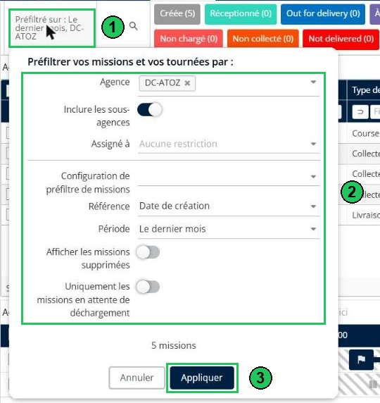
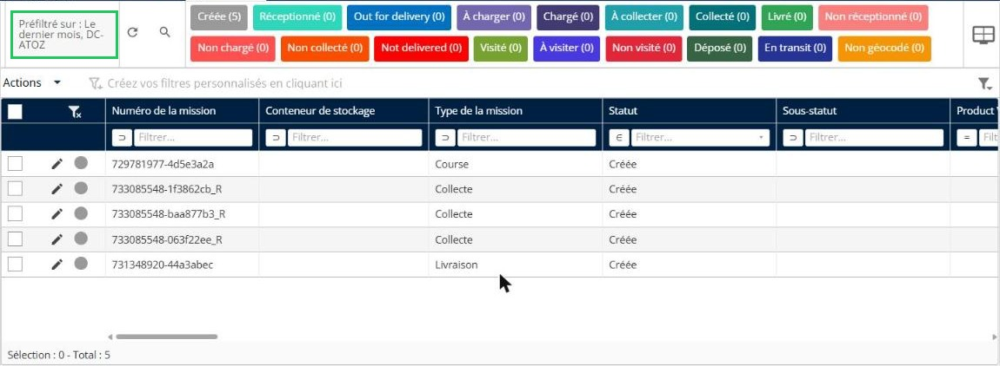

# Définir l’affichage des missions (préfiltre)

Définissez l’affichage des missions en choisissant des options de préfiltre sur la page Missions.

## Avant de commencer

* Connectez-vous à **Nomadia Delivery** avec un profil utilisateur ayant accès à la page **Missions**.
* Sachez quelles agences, quelle date de référence et quelle période vous souhaitez afficher.

## Présentation de la fonctionnalité

* **Agence** : sélectionnez une ou plusieurs agences.
* **Référence** : filtrez par date de création ou par date de modification.
* **Période** : choisissez parmi des options comme la dernière heure, les dernières 24 heures, les 7 derniers jours, ou définissez une plage de dates personnalisée.
* **Afficher les missions supprimées** : activez cette option pour inclure les missions supprimées.

## Définir l’affichage des missions

Depuis la page Missions :

1. Cliquez sur le bouton **Préfiltré sur** en haut à gauche. L’affichage de cette section peut varier selon la résolution de l’écran.
2. Choisissez vos filtres.
3. Cliquez sur **Appliquer**.

### Résultat

Les missions filtrées s’affichent sur votre page Missions.

## Rubriques connexes

* [Pré-filtres](README.md)
* [Configurer les pré-filtres de mission](../configuremissionprefilters.md)
* [Comprendre la page des missions](../README.md)
