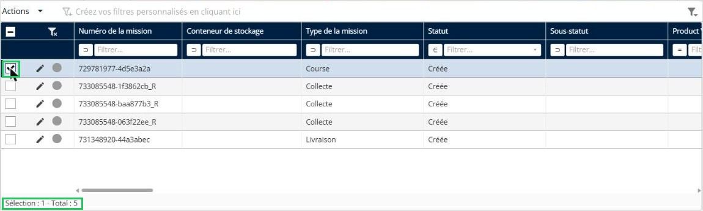
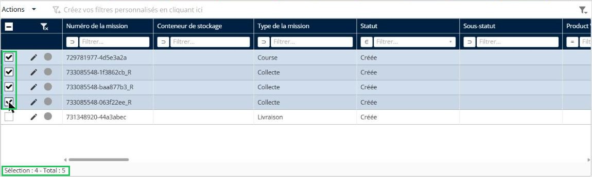

# Sélection d’une plage par Maj+clic

**La sélection d’une plage par Maj+clic** vous permet de sélectionner un bloc de lignes consécutives d’un tableau en deux clics, au lieu de cocher chaque case une par une. Vous cliquez sur la première ligne, maintenez la touche **Maj** enfoncée et cliquez sur la dernière ligne : toutes les lignes intermédiaires sont sélectionnées. Cela fonctionne comme dans un tableur ou un explorateur de fichiers.

## Avant de commencer

* Connectez-vous à **Nomadia Delivery** avec un profil utilisateur ayant accès au tableau concerné, par exemple l’onglet **Missions**.
* Triez ou filtrez d’abord le tableau si nécessaire, pour que les lignes à sélectionner se suivent.

## Présentation de la fonctionnalité

* **Ligne d’ancrage** : la dernière ligne que vous avez cochée ou décochée par un clic normal. La plage part toujours de cette ligne.
* **Maj+clic** : maintenir la touche **Maj** enfoncée en cliquant sur la case d’une ligne sélectionne toutes les lignes entre la ligne d’ancrage et la ligne cliquée, incluses.
* **Ordre d’affichage** : la plage suit les lignes telles qu’elles apparaissent à l’écran, avec le tri et les filtres en cours, et non l’ordre de création des missions.
* **Dans les deux sens** : vous pouvez sélectionner une plage vers le bas, d’une ligne vers une ligne située en dessous, ou vers le haut, d’une ligne vers une ligne située au-dessus.
* **Nouvelle plage depuis la même ancre** : chaque nouveau Maj+clic redessine la plage depuis la même ligne d’ancrage, pour étendre ou réduire la sélection sans recommencer.
* **Les sélections précédentes sont conservées** : les lignes cochées individuellement avant de définir l’ancre restent sélectionnées.
* **Comportement inchangé** : un clic normal coche ou décoche toujours une seule ligne, et la case de l’en-tête sélectionne ou désélectionne toujours toutes les lignes.
* **Tous les tableaux** : la fonctionnalité est intégrée au composant de tableau commun. Elle fonctionne donc dans les tableaux des missions, des tournées, des sous-traitants, des utilisateurs et dans les autres listes du back-office.

## Sélectionner une plage de lignes

1. Accédez au tableau, par exemple l’onglet **Missions**.
2. Cochez la case de la première ligne de la plage. Cette ligne devient la ligne d’ancrage.

3. Maintenez la touche **Maj** enfoncée et cochez la case de la dernière ligne de la plage.

### Résultat

Toutes les lignes entre la ligne d’ancrage et la ligne cliquée sont sélectionnées. Le compteur sous le tableau, par exemple **Sélection : 4 - Total : 5**, indique le nombre de lignes sélectionnées. Vous pouvez maintenant utiliser le menu **Actions** sur toute la sélection.

## Modifier la plage

1. Conservez la même ligne d’ancrage.
2. Maintenez la touche **Maj** enfoncée et cliquez sur une autre ligne, au-dessus ou en dessous de l’ancre.

### Résultat

La plage est redessinée de la ligne d’ancrage jusqu’à la nouvelle ligne. Pour démarrer une plage depuis une autre ligne, cliquez d’abord sur cette ligne sans la touche **Maj**.

## Conseils


**Triez d’abord, puis sélectionnez** : triez ou filtrez le tableau pour regrouper les missions dont vous avez besoin, par exemple toutes les missions d’un même code postal. Sélectionnez-les ensuite par un seul Maj+clic.



**Combinez avec des clics simples** : sélectionnez un bloc par Maj+clic, puis cliquez sur des lignes individuelles pour les ajouter à la sélection ou les en retirer.



**Vérifiez le compteur avant d’agir** : avant de lancer une action en masse, vérifiez le compteur **Sélection** sous le tableau pour vous assurer que seules les lignes voulues sont sélectionnées.


## Rubriques connexes

* [Comprendre la page des missions](README.md)
* [Filtres de colonnes de type Excel](excel-style-column-filters.md)
* [Gérer le tableau des missions](../manage-missions-table.md)
* [Modifier en masse les données de mission](../bulk-edit-mission-data.md)
