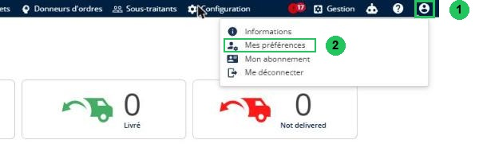
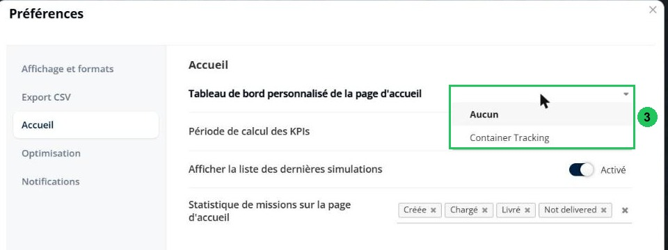
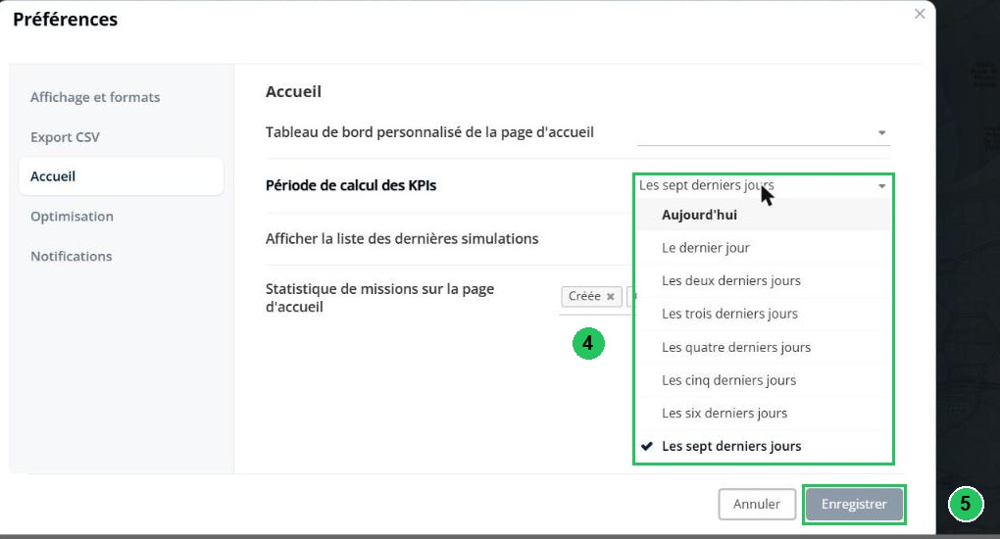
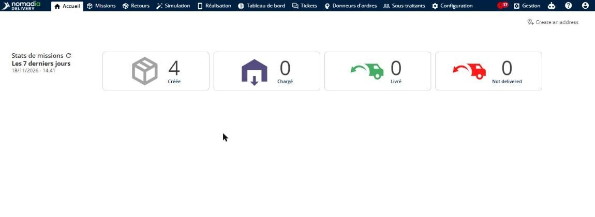

# Configurer l’affichage de mes KPI

Vous pouvez personnaliser votre écran d’accueil en sélectionnant les KPI les plus pertinents pour vos opérations. Nomadia Delivery vous permet d’afficher le tableau de bord de la page d’accueil configuré, ainsi qu’une période de calcul paramétrable allant du dernier jour aux sept derniers jours. Cela vous aide à rester concentré sur les indicateurs qui comptent le plus.

## Avant de commencer

* Connectez-vous à **Nomadia Delivery** et ouvrez la **page d’accueil**.
* Assurez-vous qu’un tableau de bord personnalisé de la page d’accueil est disponible à la sélection.

## Présentation de la fonctionnalité

* **Icône de compte** : située dans le coin supérieur droit de l’écran ; ouvre le menu déroulant.
* **Mes préférences** : l’option dans laquelle vous choisissez le tableau de bord et la période.
* **Tableau de bord** : le tableau de bord personnalisé de la page d’accueil affiché sur votre page d’accueil.
* **Période** : la période de calcul, allant du dernier jour aux sept derniers jours.

## Configurer l’affichage de mes KPI

1. Depuis la **page d’accueil**, cliquez sur l’**icône de compte** située dans le coin supérieur droit de l’écran.
2. Sélectionnez **Mes préférences** dans le menu déroulant.

3. Choisissez le **Tableau de bord** parmi les tableaux de bord personnalisés de la page d’accueil.

4. Sélectionnez une période allant du dernier jour aux sept derniers jours selon votre préférence.
5. Cliquez sur **Enregistrer**.

### Résultat

Votre page d’accueil affiche le tableau de bord choisi.

## Conseils


**Concentrez-vous sur les indicateurs clés** : sélectionnez les KPI les plus pertinents pour vos opérations afin de rester concentré sur les indicateurs qui comptent le plus.


## Rubriques connexes

* [Page d’accueil](README.md)
* [Comprendre l’écran d’accueil](comprendre-lecran-daccueil.md)
* [Configurer l’affichage des statuts des missions](configurer-laffichage-des-statuts-des-missions.md)
* [Actualiser la date des KPI et les statuts des missions](actualiser-la-date-des-kpi-et-les-statuts-des-missions.md)
