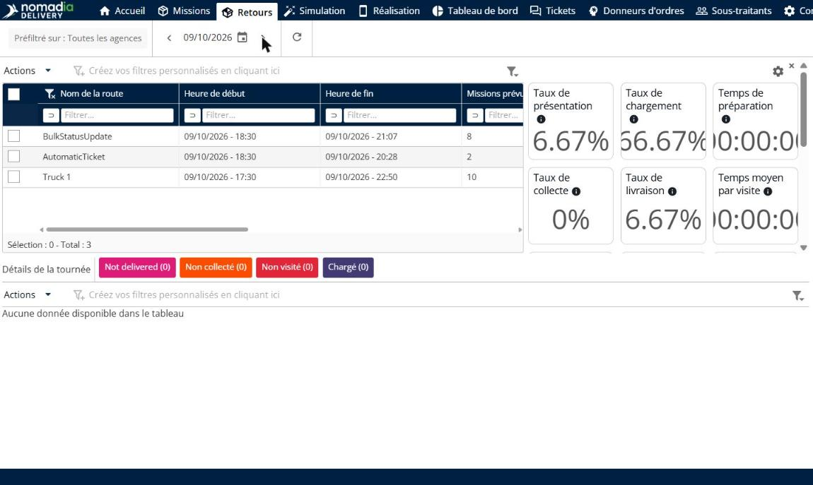
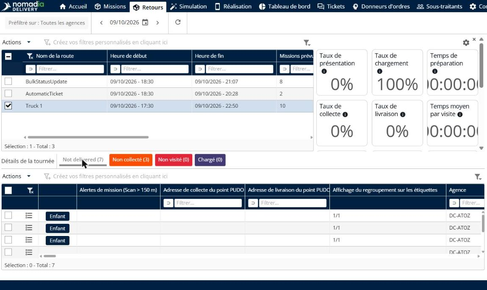
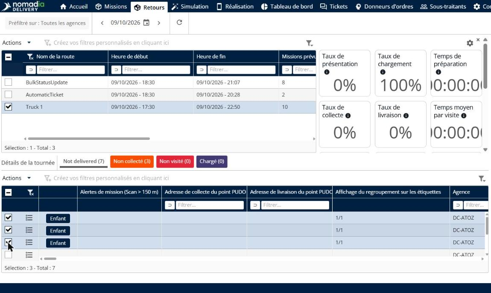
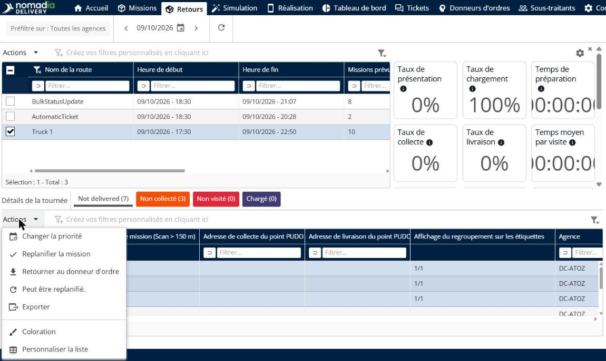
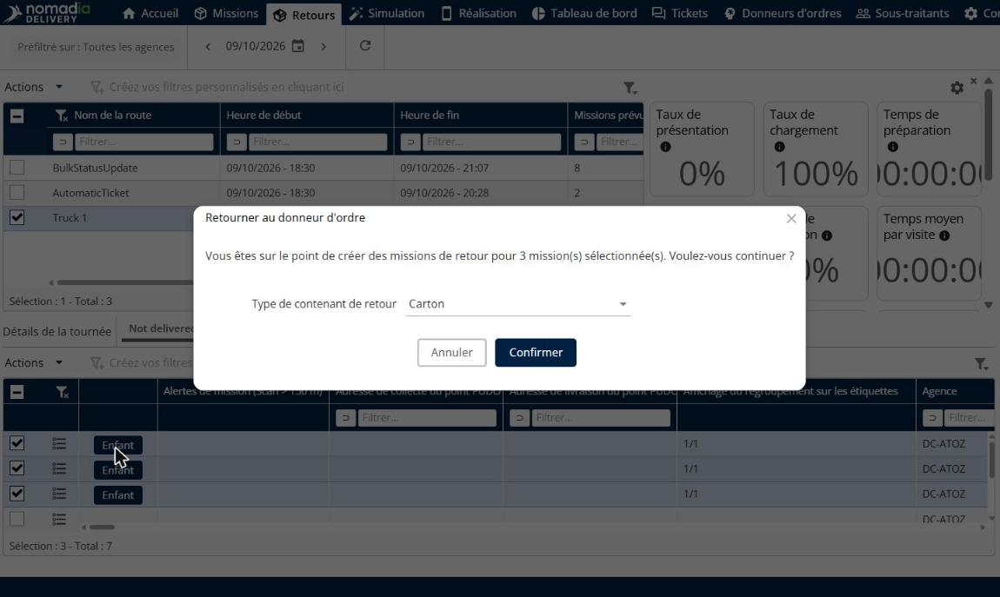
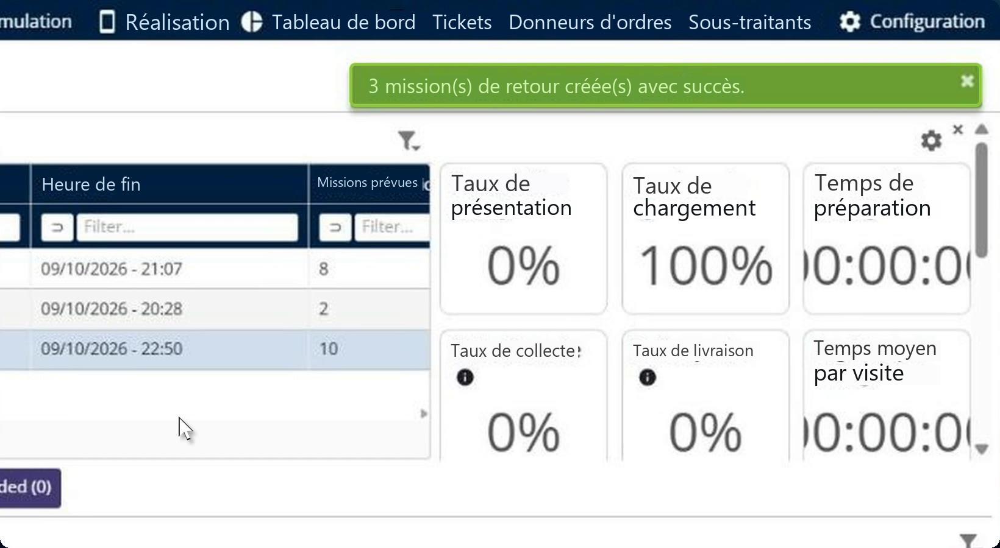
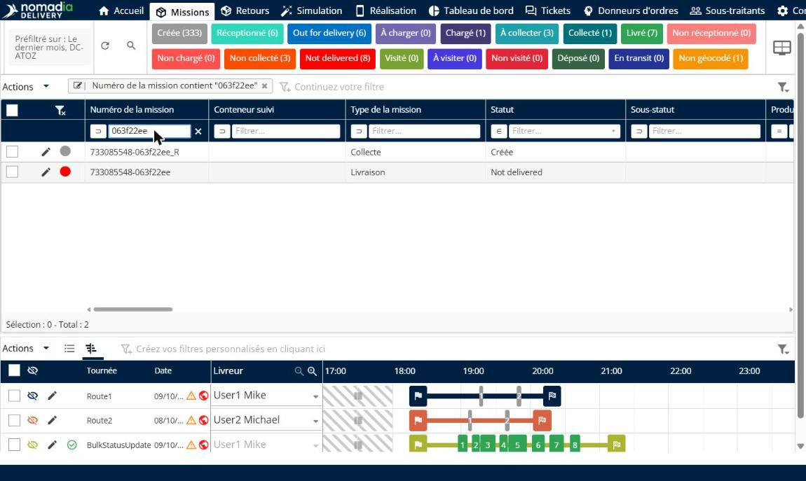
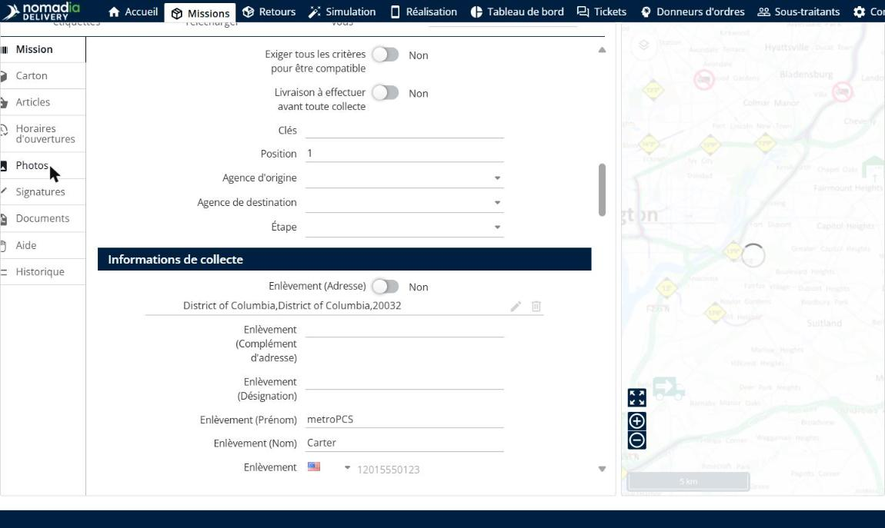
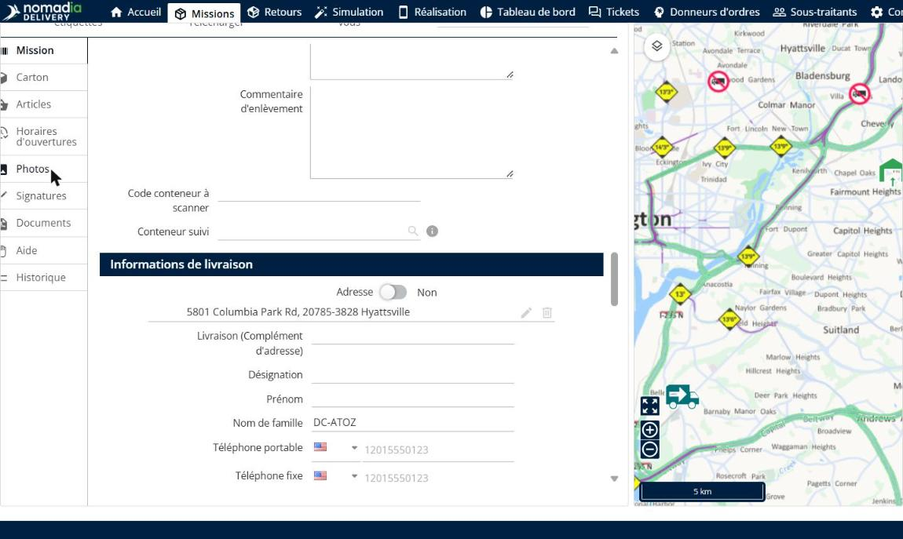

# Retour au donneur d’ordres

Le retour au donneur d’ordres crée en une seule action les missions de retour des colis qui n’ont pas pu être livrés. Depuis la page **Retours**, vous sélectionnez les éléments non livrés ou déposés d’une tournée et vous les renvoyez au donneur d’ordres. Nomadia Delivery crée une mission de retour par élément, avec les adresses d’enlèvement et de livraison inversées, et affiche un récapitulatif des retours réussis et de ceux qui ont échoué.

## Avant de commencer

* Connectez-vous à **Nomadia Delivery** avec un profil utilisateur ayant accès à la page **Retours**.
* Assurez-vous que la tournée comporte des missions au statut **Non livré** ou **Déposé**.

## Présentation de la fonctionnalité

* **Page Retours** : page de l’en-tête principal qui liste les tournées du jour sélectionné, avec leurs indicateurs de livraison et, sous **Détails de la tournée**, les missions regroupées par résultat : **Not delivered**, **Non collecté**, **Non visité** et **Chargé**.
* **Retourner au donneur d’ordre** : action du menu **Actions** de la liste des missions qui crée les missions de retour des éléments sélectionnés. Elle s’applique aux missions **Non livrées** ou **Déposées**, qu’il s’agisse de contenants ou d’articles individuels.
* **Type de contenant de retour** : type de contenant utilisé pour les missions de retour, par exemple **Carton**. Vous le choisissez dans la fenêtre de confirmation.
* **Mission de retour** : nouvelle mission créée pour chaque élément. Son numéro est celui de la mission d’origine suivi de **\_R**, son type de mission est **Collecte** et son statut est **Créée**.
* **Adresses inversées** : dans la mission de retour, l’adresse d’enlèvement est l’adresse du client où la livraison a échoué, et l’adresse de livraison est l’adresse du donneur d’ordres.

## Créer des missions de retour

1. Dans l’en-tête principal, cliquez sur **Retours**, puis sélectionnez la tournée qui comporte des éléments non livrés, par exemple **Truck 1**.

2. Sous **Détails de la tournée**, cliquez sur **Not delivered** pour lister les missions non livrées de cette tournée.

3. Sélectionnez les missions à retourner. Vous pouvez sélectionner des articles individuels, ou cliquer sur la case à cocher de l’en-tête du tableau pour tous les sélectionner. Le compteur de sélection sous le tableau indique le nombre de missions sélectionnées.

4. Cliquez sur **Actions**, puis sur **Retourner au donneur d’ordre**.

5. Dans la fenêtre **Retourner au donneur d’ordre**, lisez le message, qui indique le nombre de missions de retour qui seront créées. Choisissez le **Type de contenant de retour**, puis cliquez sur **Confirmer**.

### Résultat

Une notification confirme le nombre de missions de retour créées, par exemple **3 mission(s) de retour créée(s) avec succès.** Si un retour ne peut pas être créé, il est listé avec le motif, ce qui vous permet d’intervenir immédiatement.

## Vérifier une mission de retour

1. Sur la page **Missions**, filtrez la colonne **Numéro de la mission** sur le numéro de la mission d’origine. La mission de retour apparaît à côté, avec le même numéro suivi de **\_R**, le type de mission **Collecte** et le statut **Créée**.

2. Ouvrez la mission de retour. Dans **Informations de collecte**, l’adresse d’enlèvement (**Enlèvement (Adresse)**) est l’adresse du client où la livraison a échoué.

3. Dans **Informations de livraison**, l’adresse de livraison est l’adresse du donneur d’ordres.

## Conseils


**Retournez plusieurs éléments à la fois** : vous pouvez sélectionner toutes les missions non livrées d’une tournée et créer toutes les missions de retour en une seule action, au lieu de les créer une par une.



**Retrouvez rapidement les missions de retour** : chaque mission de retour se termine par **\_R**. Filtrez la colonne **Numéro de la mission** sur **\_R** pour lister tous les retours.


## Rubriques connexes

* [Missions](missions/README.md)
* [Donneurs d’ordres](contractors/README.md)
* [Mettre à jour le statut des missions en masse](missions/bulk-update-mission-status.md)
