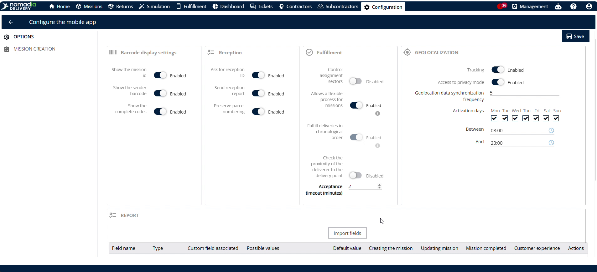

# Affecter des missions de retrait et de livraison

La fonctionnalité **Affecter des missions de retrait et de livraison** permet aux répartiteurs d’affecter des itinéraires de retrait et de livraison aux livreurs et aux véhicules. Vous en avez besoin pour optimiser le placement dans les itinéraires et gérer les affectations des livreurs en temps réel. Grâce à cette fonctionnalité, vous obtiendrez des livraisons plus rapides et gérerez les délais d’acceptation des livreurs.

## Avant de commencer

Prérequis :

* Informations du livreur et du véhicule affectés.
* Autorisations du livreur pour les compétences requises.
* Délai d’acceptation de l’application mobile (en minutes) configuré.

Étapes de configuration initiale :

1. Ouvrez la page **Configuration**.
2. Cliquez sur **Configurer l’application mobile**.
3. Saisissez les minutes dans **Délai d’acceptation (minutes)**.
4. Cliquez sur **Enregistrer**.

## Présentation de la fonctionnalité

* **Nom du livreur et Nom du véhicule** : affiche les informations du livreur et du véhicule pour suivre les unités actives.
* **Missions disponibles** : liste les missions non affectées prêtes pour l’affectation à un itinéraire.
* **Autorisations** : indique les compétences et les droits du livreur pour garantir la compatibilité avec la tâche.
* **Missions affectées** : liste les missions actuellement liées au livreur sélectionné.
* **Kilomètres de l’itinéraire en cours** : suit le kilométrage total de l’itinéraire actif du livreur.
* **Position** : indique la position du livreur par rapport à l’agence.
* **Affecter de manière optimale** : ajuste les itinéraires existants non démarrés pour livrer plus rapidement les affectations en cours.
* **Affecter après l’état actuel** : insère la tâche directement après la tâche en cours du livreur.
* **Affecter à la fin** : ajoute la tâche à la fin de l’itinéraire planifié du livreur.
* **Statut d’acceptation** : indique si le livreur a accepté ou refusé l’itinéraire affecté.
* **Délai d’acceptation (minutes)** : définit le nombre de minutes dont dispose le livreur pour accepter ou refuser l’itinéraire.

## Affecter une mission de retrait et de livraison

1. Accédez à **Missions**.
2. Sélectionnez **Missions de retrait et de livraison**.

3. Cliquez sur **Actions**.
4. Cliquez sur **Affecter une mission de retrait et de livraison**.

5. Passez en revue la page d’affectation :
   * La page d’affectation affiche tous les itinéraires planifiés pour la journée. Vous pouvez choisir l’un de ces itinéraires pour y insérer la demande de mission de retrait et de livraison.
   * Vous pouvez également afficher les itinéraires et leurs arrêts de mission sur la carte, afin de décider en connaissance de cause où insérer la nouvelle mission de retrait et de livraison.
6. Cliquez sur **Affecter** et choisissez l’une des options d’affectation :
   * **Affecter de manière optimale** : utilisez cette option pour insérer les étapes de retrait et de livraison aux positions optimales au sein d’un itinéraire existant.
   * **Affecter après** : utilisez cette option lorsque la mission est une urgence et doit être exécutée immédiatement après la mission en cours.
   * **Affecter à la fin** : utilisez cette option lorsque la mission n’est pas une priorité immédiate et peut être réalisée à tout moment avant la fin de l’itinéraire.
7. Cliquez sur **Confirmer**.

### Résultat

Une fois que l’utilisateur du Backoffice a confirmé l’affectation, la demande est envoyée à l’application mobile du livreur pour acceptation.

* Le livreur peut accepter la mission jusqu’à l’expiration du délai d’acceptation.
* Le statut d’acceptation peut être suivi à deux endroits, avec les valeurs **En attente** / **Acceptée** / **Non acceptée** :
  * **Tableau des missions** : la colonne **Statut d’acceptation**.
  * **Journal de la mission** : développez l’entrée du journal pour afficher le statut d’acceptation.
* Une mission au statut **Non acceptée** peut être réaffectée depuis la colonne **Statut d’acceptation**.
* Si la mission n’est pas acceptée avant l’expiration du délai, elle est automatiquement retirée de l’itinéraire. Elle peut ensuite être réaffectée au même livreur ou à un autre livreur.

## Conseils


**Séquencement optimal de l’itinéraire** : sélectionnez **Affecter de manière optimale** pour réordonner les itinéraires non démarrés et accélérer les plannings de livraison.



**Limites de réponse du livreur** : définissez le **Délai d’acceptation (minutes)** pour imposer des délais de réponse lors de l’acceptation d’un itinéraire par le livreur.



**Option Réorganiser** : l’option Réorganiser est désactivée pour les itinéraires qui contiennent des emplacements de retrait et de livraison dynamiques, car cette fonctionnalité n’est pas compatible avec ce mode.


## Rubriques connexes

* [Missions de drop shipping](../missions/drop-shipping-missions.md)
* [Création manuelle d’un itinéraire](manualroutecreation.md)
* [Éditeur d’itinéraires](routeeditor.md)
