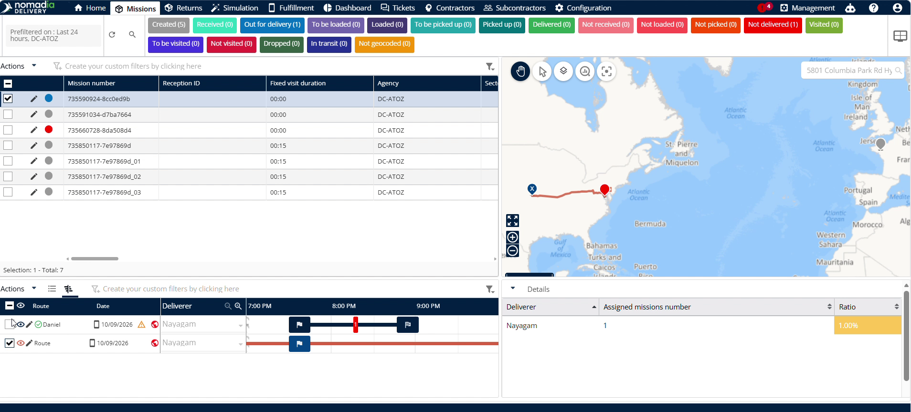
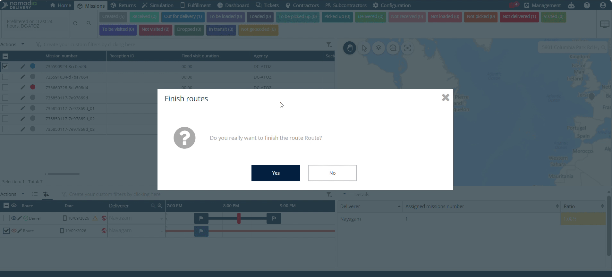

# Terminer l’itinéraire

La fonctionnalité **Terminer l’itinéraire** permet aux répartiteurs de clôturer des itinéraires de livraison depuis le Backoffice. Utilisez-la lorsqu’un livreur oublie de terminer son itinéraire après le chargement. Vous obtiendrez des statuts d’itinéraire précis en temps réel pour l’ensemble de votre flotte.

## Avant de commencer

* **Accès au Backoffice** : compte actif dans le Backoffice de Nomadia Delivery.
* **Itinéraire affecté** : itinéraire affecté et publié à un livreur.

1. Connectez-vous au système **Backoffice**.

2. Vérifiez que le livreur a terminé le chargement de l’itinéraire qui lui est affecté.

## Présentation de la fonctionnalité

* **Livreur** : sélectionne le profil du livreur cible depuis le tableau de bord du Backoffice.
* **Actions** : ouvre les options d’administration pour le livreur sélectionné.
* **Terminer l’itinéraire** : lance la clôture manuelle de l’itinéraire depuis le Backoffice.

## Terminer un itinéraire

1. Sélectionnez le **Livreur** dans le menu de navigation du Backoffice.

2. Cliquez sur **Actions** à côté du livreur sélectionné.

3. Cliquez sur **Terminer l’itinéraire** dans la liste déroulante.

4. Cliquez sur **Oui** dans la fenêtre contextuelle qui demande « Voulez-vous vraiment terminer l’itinéraire ? »

### Résultat

L’itinéraire a été terminé avec succès.

<figure><figcaption></figcaption></figure>

Lorsque vous terminez l’itinéraire, les missions qui n’ont pas été achevées sont mises à jour automatiquement, vous n’avez donc pas besoin de les modifier manuellement :

* Les missions encore au statut **Chargée** passent automatiquement au statut **Non livré**.
* Les missions encore au statut **À retirer** passent automatiquement au statut **Non récupéré**.

Cela garantit qu’aucune mission inachevée ne reste ouverte une fois l’itinéraire clôturé.

## Conseils


**Clôture d’itinéraire à distance** : terminez les itinéraires ouverts directement depuis le Backoffice lorsque les livreurs oublient de les achever après le chargement.



**Itinéraires non clôturés** : évitez de laisser des itinéraires terminés ouverts dans le système afin de ne pas fausser le suivi des statuts d’itinéraire.


## Rubriques connexes

* [Création manuelle d’un itinéraire](manualroutecreation.md)
* [Éditeur d’itinéraires](routeeditor.md)
* [Affecter des missions de retrait et de livraison](assignpickupanddelivery.md)
