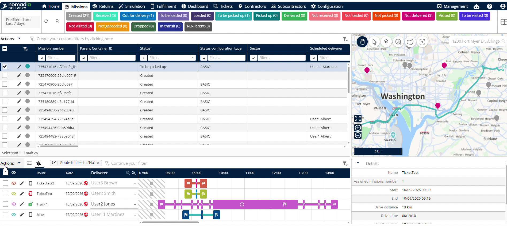
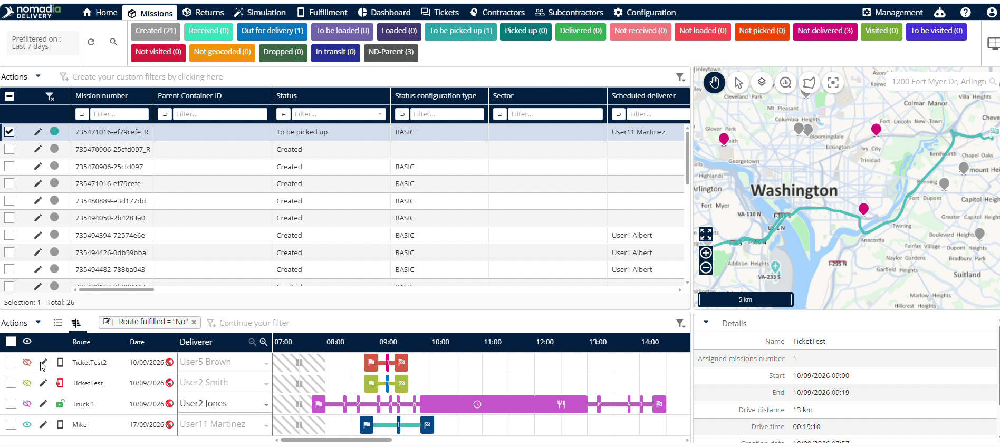
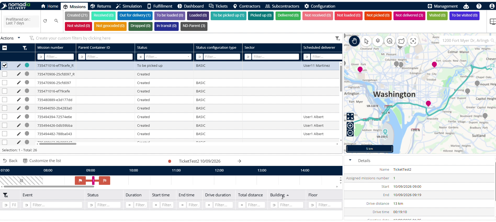
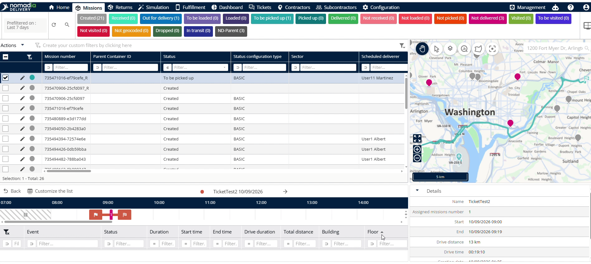

# Vue Gantt

La **vue Gantt** affiche les informations complètes des itinéraires dans Nomadia Delivery. Accédez à cette fonctionnalité pour gérer les plannings des livreurs et suivre efficacement les livraisons en cours. Utilisez cette interface pour examiner l’avancement des itinéraires et consulter les trajets de livraison affectés.

## Avant de commencer

Prérequis :

* Compte utilisateur actif pour **Nomadia Delivery**.
* Droits système pour accéder à la section **Missions**.

Étapes de configuration initiale :

1. Connectez-vous à **Nomadia Delivery**.
2. Accédez à la section **Missions**.
3. Faites défiler jusqu’à la section **Itinéraire**.

## Présentation de la fonctionnalité

* **Sélecteur d’itinéraire** : permet de sélectionner un itinéraire spécifique pour exécuter des actions de gestion.
* **Icône Œil** : ouvre la vue carte pour afficher géographiquement l’itinéraire sélectionné.
* **Icône Modifier** : ouvre l’éditeur d’itinéraires pour modifier les paramètres d’un itinéraire existant.
* **Symbole Publié** : indique que l’itinéraire sélectionné est publié.
* **Symbole Bloqué** : s’affiche à côté du symbole Publié lorsqu’un itinéraire publié est bloqué.
* **Symbole Bouton vert** : s’affiche sous forme de bouton vert lorsqu’un itinéraire est accordé.
* **Nom de l’itinéraire** : affiche le nom désigné de l’itinéraire.
* **Date de l’itinéraire** : affiche la date planifiée d’exécution de l’itinéraire.
* **Nom du livreur** : affiche le nom du livreur affecté à l’itinéraire.
* **Heure de début et de fin** : indique l’heure de début et l’heure de fin planifiées de l’itinéraire.
* **Type d’itinéraire** : identifie le type de classification spécifique de l’itinéraire.

## Afficher un itinéraire sur la carte

1. Sélectionnez l’itinéraire souhaité dans la liste **Itinéraire**.

2. Cliquez sur l’**Icône Œil** à côté de l’itinéraire.

3. Consultez le tracé complet de l’itinéraire sur la carte.

## Modifier un itinéraire

1. Sélectionnez l’itinéraire cible dans la section **Itinéraire**.

2. Cliquez sur l’**Icône Modifier**.
3. Modifiez les détails nécessaires de l’itinéraire.

## Examiner les détails d’un itinéraire

1. Cliquez sur l’entrée de l’itinéraire concerné.

2. Passez en revue le statut de l’événement, la durée, l’heure de début, l’heure de fin, la durée de conduite, la distance totale, le bâtiment et les détails de l’étage.

3. Cliquez sur le **Bouton Retour** pour revenir à la liste des itinéraires.

## Conseils


**Identification d’un itinéraire accordé** : repérez le symbole du bouton vert pour vérifier instantanément qu’un itinéraire a été accordé.



**Avertissement sur les itinéraires bloqués** : évitez de répartir les itinéraires qui affichent un symbole Bloqué à côté du symbole Publié.


## Rubriques connexes

* [Vue tableau](tableview.md)
* [Éditeur d’itinéraires](routeeditor.md)
* [Création manuelle d’un itinéraire](manualroutecreation.md)
