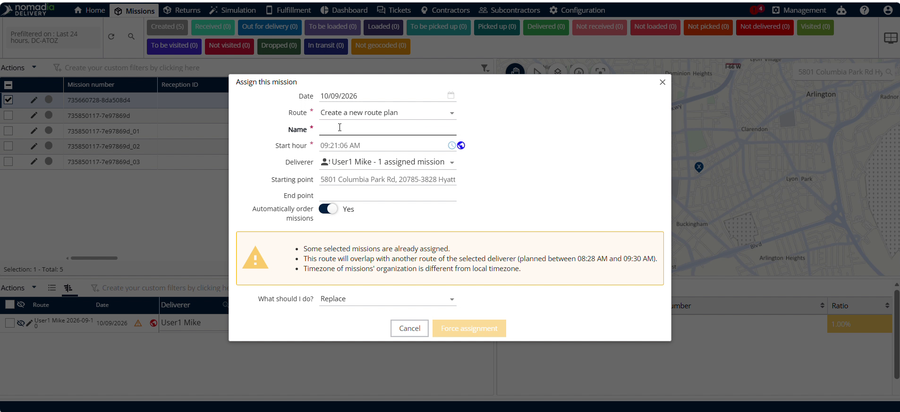
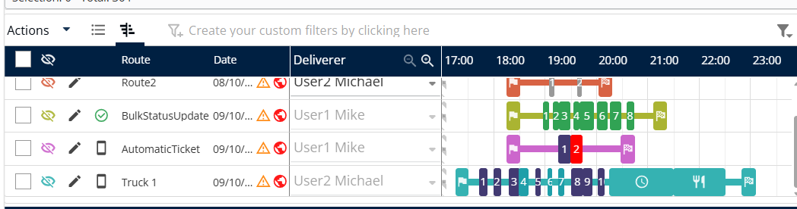

# Création manuelle d’un itinéraire

La création manuelle d’un itinéraire dans **Nomadia Delivery** permet aux répartiteurs de construire et d’affecter des itinéraires de livraison personnalisés. Utilisez cette fonctionnalité pour définir les dates de planification, affecter des livreurs et définir manuellement les points de départ et d’arrivée de l’itinéraire. En créant les itinéraires manuellement, vous gardez un contrôle précis sur les opérations de transport.

## Avant de commencer

Prérequis :

* Compte actif dans **Nomadia Delivery**.
* Droits d’accès à la gestion des missions et des itinéraires.

Étapes de configuration initiale :

1. Ouvrez le tableau de bord de gestion des missions.
2. Sélectionnez la **Mission** cible dans la liste.
3. Cliquez sur **Actions** pour afficher les options disponibles.
4. Sélectionnez **Affecter** pour lancer la création manuelle d’itinéraire.

## Présentation de la fonctionnalité

* **Mission** : missions sélectionnées destinées à l’affectation à un itinéraire.
* **Actions** : menu déroulant contenant les commandes opérationnelles pour les missions.
* **Affecter** : bouton qui lance le formulaire de configuration manuelle de l’itinéraire.
* **Icône Calendrier** : outil de sélection de date utilisé pour définir la date de planification de l’itinéraire.
* **Champ Itinéraire** : champ de saisie permettant de sélectionner un itinéraire nouveau ou existant.
* **Champ Nom de l’itinéraire** : champ de texte pour saisir l’identifiant de l’itinéraire.
* **Icône Horloge** : outil de sélection de l’heure utilisé pour définir l’horaire de l’itinéraire.
* **Livreur** : liste déroulante de sélection pour affecter un livreur spécifique.
* **Point de départ et Point d’arrivée** : champs de localisation définissant les limites de l’itinéraire.
* **Forcer l’affectation** : bouton de confirmation validant l’affectation finale de l’itinéraire. L’affectation forcée fonctionne même en cas de conflits.

## Créer et affecter un itinéraire manuellement

1. Sélectionnez la **Mission** cible dans la liste.
2. Cliquez sur **Actions**.
3. Cliquez sur **Affecter**.

4. Cliquez sur l’**Icône Calendrier**.
5. Sélectionnez une date quelconque pour l’itinéraire.

6. Cliquez sur le **Champ Itinéraire**.
7. Choisissez de créer un nouvel itinéraire ou sélectionnez un itinéraire existant.
8. Saisissez le nom de l’itinéraire dans le **Champ Nom de l’itinéraire**.

9. Cliquez sur l’**Icône Horloge** pour sélectionner l’heure.
10. Sélectionnez le **Livreur** à affecter à l’itinéraire.

11. Sélectionnez le **Point de départ** et le **Point d’arrivée**.
12. Activez **Ordonner automatiquement les missions** si nécessaire.
13. Sélectionnez **Ignorer** ou **Remplacer** pour la gestion des conflits.

14. Cliquez sur **Forcer l’affectation** pour finaliser l’affectation de l’itinéraire.

### Résultat

L’itinéraire a été créé avec succès.

<figure><figcaption></figcaption></figure>

## Conseils


**Ordonnancement automatique des missions** : activez l’ordonnancement automatique des missions pour organiser automatiquement les missions le long de l’itinéraire.



**Paramètres de gestion des conflits** : choisissez d’ignorer ou de remplacer les conflits avant de cliquer sur **Forcer l’affectation** afin d’éviter les écrasements d’itinéraire inattendus.


## Rubriques connexes

* [Affecter des missions de retrait et de livraison](assignpickupanddelivery.md)
* [Éditeur d’itinéraires](routeeditor.md)
* [Vue Gantt](ganttview.md)
* [Vue tableau](tableview.md)
