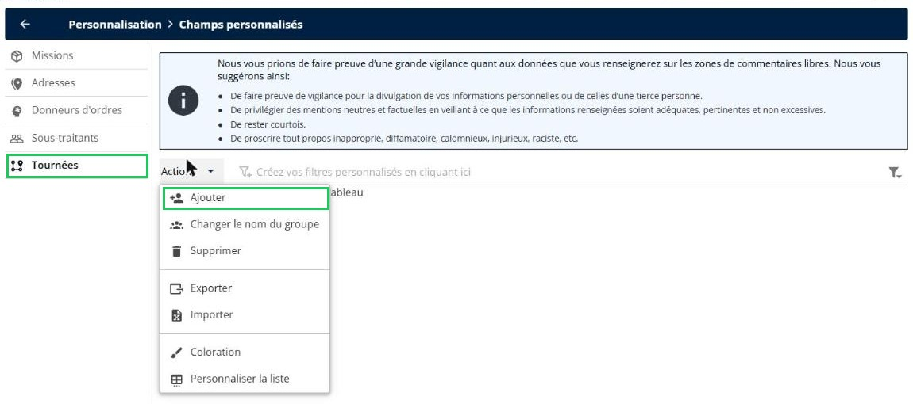
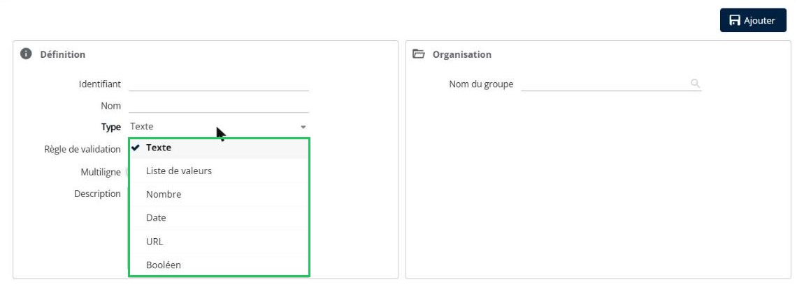
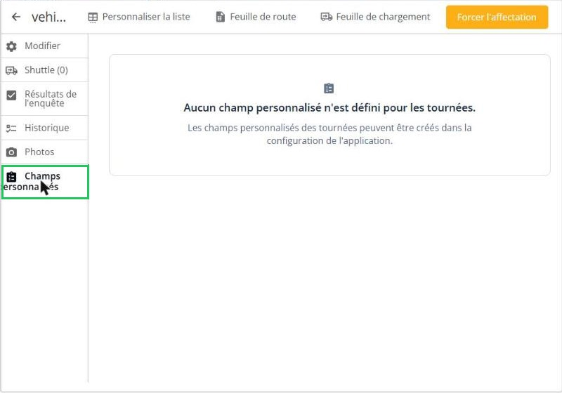

# Champs personnalisés des tournées

**Les champs personnalisés des tournées** permettent aux administrateurs de choisir les données à collecter au niveau de la tournée, comme la plaque d’immatriculation ou les relevés du compteur kilométrique. Les livreurs remplissent les champs dans l’application mobile, et les planificateurs consultent les valeurs dans les écrans du back-office, dans les documents et dans les intégrations. Les informations qui restaient sur papier, ou dans des solutions de contournement difficiles à retrouver et faciles à perdre, sont désormais saisies numériquement sur la tournée.

## Avant de commencer

* Connectez-vous à **Nomadia Delivery** avec un profil utilisateur ayant accès à l’onglet **Configuration**.
* Sachez quelles données de tournée les livreurs doivent saisir, par exemple la plaque d’immatriculation, le kilométrage de départ ou le niveau de carburant.

## Présentation de la fonctionnalité

* **Onglet Tournées** : la page de configuration **Champs personnalisés** dispose d’un onglet **Tournées** dédié. Vous ajoutez, renommez le groupe, supprimez, exportez et importez les champs de tournée avec les mêmes **Actions** que pour les missions et les donneurs d’ordres.
* **Types de champs** : **Texte**, **Liste de valeurs**, **Nombre**, **Date**, **URL** et **Booléen**.
* **Nom du groupe** : chaque champ peut appartenir à un groupe, par exemple **Début de tournée** ou **Fin de tournée**, pour afficher ensemble les champs liés.
* **Questionnaires mobiles** : les livreurs remplissent les champs de tournée dans les questionnaires de début et de fin de tournée de l’application mobile, y compris la plaque d’immatriculation de la tournée. Les réponses sont enregistrées automatiquement sur la tournée.
* **Onglet Champs personnalisés de l’éditeur de tournée** : affiche toutes les valeurs saisies par le livreur, regroupées par nom de groupe. Les planificateurs peuvent encore modifier les valeurs après le démarrage de la tournée.
* **Plaque d’immatriculation** : affichée en lecture seule dans l’onglet **Modifier** de l’éditeur de tournée, et affichée comme colonne par défaut dans le tableau des tournées.
* **Colonnes du tableau des tournées** : chaque champ personnalisé de tournée est disponible comme colonne facultative du tableau des tournées, avec les mêmes conditions de tri, de filtre et de coloration des nombres que les autres colonnes.
* **API, webhooks et documents** : les champs personnalisés des tournées peuvent être lus et écrits via l’API publique, sont inclus dans les données des webhooks de tournée, et peuvent être utilisés comme variables de modèle dans les feuilles de route et les documents eCMR.

## Créer un champ personnalisé de tournée

1. Accédez à l’onglet **Configuration**. Sous **Personnalisation**, cliquez sur **Champs personnalisés**.
2. Cliquez sur l’onglet **Tournées**, puis sur **Actions** > **Ajouter**.

3. Saisissez un **Identifiant** et un **Nom**, par exemple **Plaque d’immatriculation**.
4. Sélectionnez le **Type** du champ.

5. Si nécessaire, saisissez un **Nom du groupe**, par exemple **Début de tournée**.
6. Cliquez sur **Ajouter**.

### Résultat

Le champ apparaît dans l’onglet **Tournées**. Les livreurs peuvent le remplir depuis les questionnaires de tournée de l’application mobile.

## Consulter et modifier les champs personnalisés d’une tournée

1. Sur la page **Missions**, cliquez sur l’icône **Crayon** d’une tournée pour ouvrir l’éditeur de tournée.
2. Cliquez sur l’onglet **Champs personnalisés**.

3. Vérifiez les valeurs saisies par le livreur et modifiez-les si nécessaire.

### Résultat

Les valeurs sont enregistrées sur la tournée. Elles apparaissent dans les colonnes du tableau des tournées, dans les feuilles de route et les documents eCMR qui les utilisent, ainsi que dans l’API et les webhooks.


Si aucun champ personnalisé de tournée n’est défini, l’onglet affiche **Aucun champ personnalisé n’est défini pour les tournées**. Créez d’abord les champs dans l’onglet **Tournées** de la page **Champs personnalisés**.


## Conseils


**Regroupez par moment** : utilisez des noms de groupe comme **Début de tournée** et **Fin de tournée**, pour que livreurs et planificateurs trouvent les champs dans l’ordre de la journée.



**Utilisez des champs typés** : choisissez **Nombre** pour les relevés kilométriques et **Liste de valeurs** pour les niveaux comme le niveau de carburant, afin de pouvoir trier, filtrer et colorer le tableau des tournées sur ces champs.



**Supprimer un champ supprime ses données** : avant de supprimer un champ personnalisé de tournée, vérifiez qu’il n’est pas utilisé dans une feuille de route, un modèle eCMR ou une intégration.


## Rubriques connexes

* [Champs personnalisés](../missions/custom-fields/README.md)
* [Éditeur d’itinéraire](routeeditor.md)
* [Vue tableau](tableview.md)
* [Configuration de sondages personnalisés](../configuring-customized-surveys.md)
* [Accès à eCMR](../manage-document-templates/accessing-ecmr.md)
