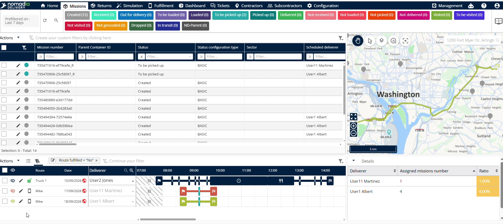
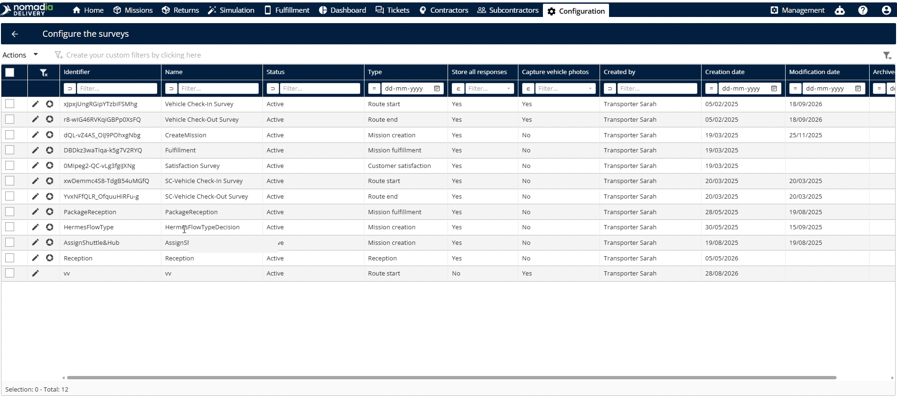
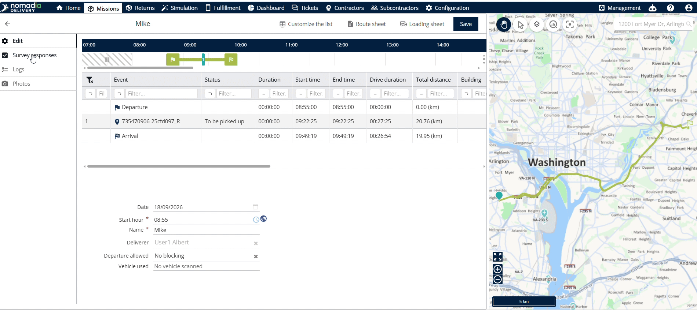
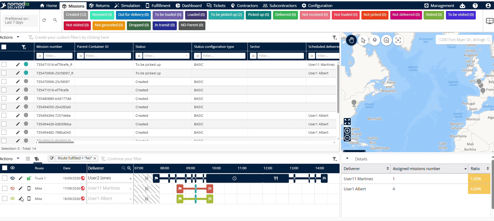
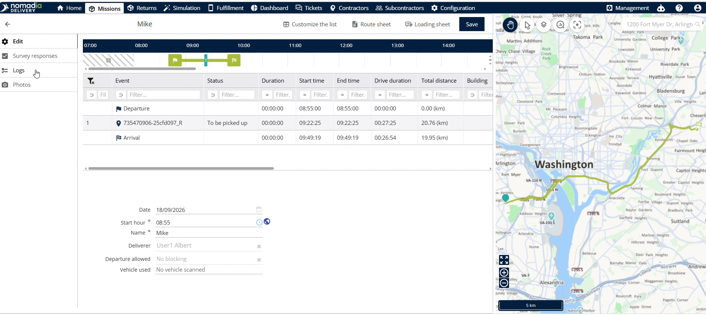
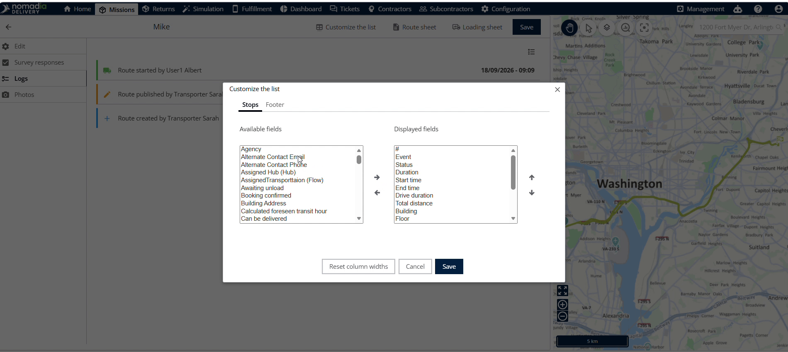
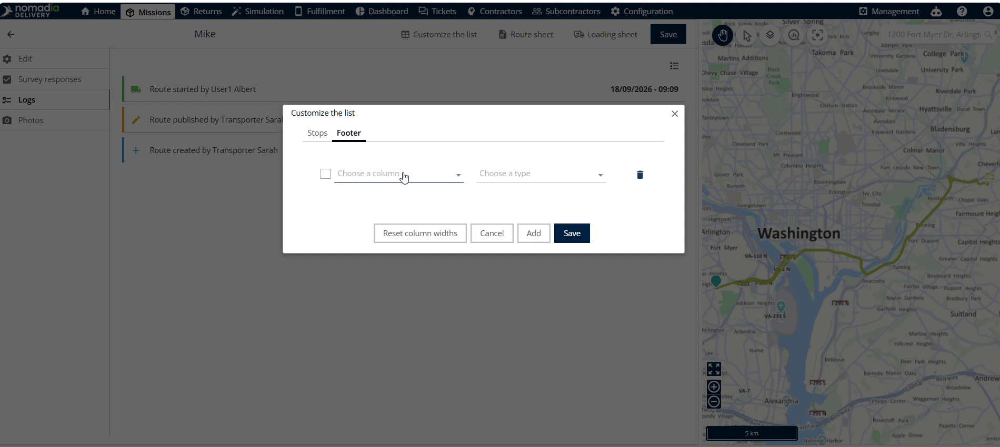

# Éditeur d’itinéraire

La fonctionnalité **Éditeur d’itinéraire** permet aux répartiteurs de gérer les détails d’un itinéraire et la configuration des enquêtes. Utilisez cet outil pour ajuster les horaires de l’itinéraire, suivre les réponses aux enquêtes, consulter les journaux et gérer les photos des véhicules. Vous disposez ainsi d’un contrôle complet sur les paramètres de l’itinéraire et sur les données d’inspection des livreurs.

## Avant de commencer

**Prérequis**

* Un compte utilisateur actif dans **Nomadia Delivery**.
* Un accès au module **Missions**.

**Étapes de configuration**

1. Connectez-vous à **Nomadia Delivery**.

2. Accédez à **Missions** et faites défiler la page jusqu’à la section **Itinéraire**.

3. Cliquez sur l’**icône de modification** à côté du **nom de la livraison**.

## Vue d’ensemble de la fonctionnalité

* **Date** : définit la date d’exécution prévue de l’itinéraire.
* **Heure de début** : définit l’heure de début officielle quotidienne de l’itinéraire.
* **Nom de la livraison** : affiche l’identifiant verrouillé de la livraison pour les itinéraires affectés.
* **Départ autorisé** : contrôle si le départ est bloqué, autorisé ou non restreint.
* **Utilisation du véhicule** : configure les règles et paramètres opérationnels des véhicules affectés.
* **Réponses aux enquêtes** : affiche le détail des enquêtes d’inspection du véhicule envoyées depuis les appareils mobiles.
* **Configuration** : active la capture des réponses aux enquêtes et les paramètres de stockage des réponses.
* **Journaux** : affiche un historique d’audit détaillé de toutes les modifications de l’itinéraire.
* **Photos** : charge les photos des véhicules et gère les calculs d’échantillons.
* **Feuille de route** : télécharge la feuille de synthèse imprimable de l’itinéraire.

## Modifier les détails de l’itinéraire

1. Cliquez sur l’**icône de modification** à côté du **nom de la livraison**.

2. Mettez à jour les champs **date** et **heure de début**.
3. Sélectionnez les autorisations de **départ autorisé** pour définir les règles de blocage.
4. Ajustez les paramètres d’**utilisation du véhicule** selon vos besoins.
5. Cliquez sur **Enregistrer** pour appliquer les modifications.

## Configurer et consulter les enquêtes véhicule

1. Cliquez sur **Configuration** pour ouvrir les options des enquêtes.

2. Cliquez sur **Configurer l’enquête**.
3. Cliquez sur l’**icône en forme de crayon** à côté de **l’enquête de contrôle du véhicule**.

4. Activez les options **stocker toutes les réponses** et **capturer**.
5. Cliquez sur **Enregistrer** pour sauvegarder les paramètres de l’enquête.

6. Cliquez sur **Réponses aux enquêtes** dans le coin supérieur gauche.

7. Sélectionnez **Enquête de contrôle du véhicule** et cliquez sur **Charger**.

## Consulter les journaux de modification de l’itinéraire

1. Cliquez sur **Journaux** dans le menu supérieur.

2. Passez en revue toutes les modifications passées de l’itinéraire et le détail des changements.

## Gérer les photos et les échantillons des véhicules

1. Cliquez sur **Photos** pour ouvrir les paramètres des photos et consulter les photos des véhicules.

## Personnaliser la liste

1. Cliquez sur **Personnaliser la liste** en haut de la page.

2. Sélectionnez les champs et cliquez sur la **flèche droite** pour les afficher.

3. Sélectionnez le pied de page et choisissez le **type d’échantillon**.

4. Cliquez sur **Enregistrer** et revenez en arrière pour afficher les calculs.

## Télécharger les feuilles de route et les bons de chargement

1. Cliquez sur **Feuille de route** et **Bon de chargement** pour générer le document.

2. Enregistrez le fichier téléchargé sur votre ordinateur.

### Dépannage

Si le champ **nom de la livraison** est verrouillé, vérifiez le statut d’affectation de l’itinéraire. Le statut du système empêche la modification des itinéraires affectés.

## Conseils


**Préconfiguration des enquêtes** : configurez d’abord les paramètres des enquêtes afin que les envois depuis le mobile s’affichent correctement dans la visionneuse des enquêtes.



**Modifications d’un itinéraire affecté** : évitez de renommer les itinéraires affectés, car le statut affecté verrouille le champ du nom de la livraison.



**Suivi d’audit** : consultez l’onglet des journaux pour vérifier toutes les modifications passées de l’itinéraire et garantir la traçabilité opérationnelle.



**Vues de champs personnalisées** : utilisez la flèche droite lors de la personnalisation de la liste pour contrôler les champs d’échantillon affichés.


## Rubriques connexes

* [Vue Gantt](ganttview.md)
* [Vue tableau](tableview.md)
* [Configuration de sondages personnalisés](../configuring-customized-surveys.md)
* [Terminer l’itinéraire](finishtheroute.md)
