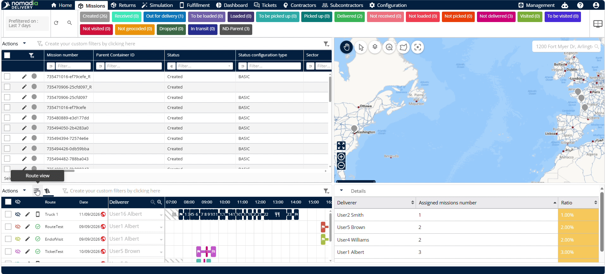
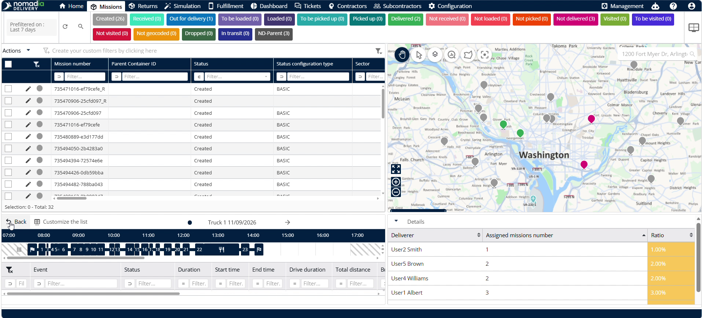
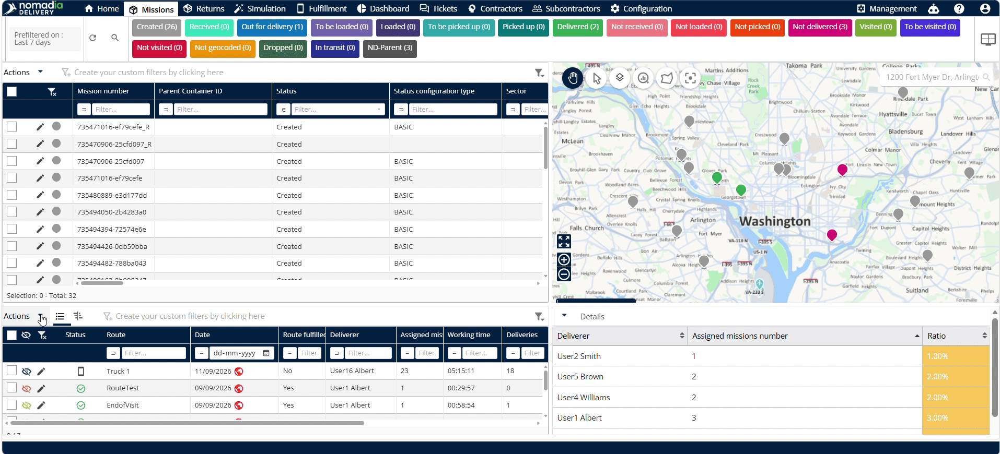

# Vue tableau

La fonctionnalité de **vue tableau** offre un affichage tabulaire structuré pour gérer les informations d’itinéraire dans **Nomadia Delivery**. Les planificateurs en ont besoin pour suivre la réalisation des itinéraires, les affectations des livreurs et le nombre de missions dans un format consolidé. Vous disposerez d’un contrôle total sur les colonnes d’itinéraire affichées, les vues des arrêts et les calculs de synthèse du pied de tableau.

## Avant de commencer

Prérequis et configuration requise :

* Accès à la section **Missions** de **Nomadia Delivery**.
* Itinéraires préconfigurés créés dans le système.

Étapes de configuration initiale :

1. Sélectionnez **Missions** dans le menu principal.
2. Faites défiler jusqu’à la section **Itinéraires**.
3. Repérez le **Menu Vue tableau** à côté de **Actions**.
4. Cliquez sur le **Menu Vue tableau** pour basculer l’affichage des **Itinéraires** en vue tableau.

## Présentation de la fonctionnalité

* **Icône Œil** : affiche les itinéraires affectés directement sur la carte interactive.
* **Vue Filtre** : masque ou affiche la ligne de filtres des colonnes dans l’ensemble du tableau.
* **Statut** : affiche le statut opérationnel actuel de chaque itinéraire.
* **Nom de l’itinéraire** : affiche le nom désigné de l’itinéraire et sa date d’affectation.
* **Réalisation de l’itinéraire** : indique l’état de réalisation de l’itinéraire avec une valeur oui ou non.
* **Nom du livreur** : affiche le nom du livreur affecté.
* **Missions affectées** : affiche le nombre total de missions affectées à l’itinéraire.
* **Temps de travail** : affiche le temps de travail calculé nécessaire pour l’itinéraire.
* **Détail du nombre de missions** : affiche les totaux détaillés des livraisons, retraits, visites, cross-docking, drop shipping et retraits signés.
* **Personnaliser la liste** : définit les champs affichés dans la section itinéraire ou arrêt.
* **Pied de tableau** : sélectionne les colonnes du tableau pour calculer des synthèses telles que les totaux de missions.

## Personnaliser les champs de la vue itinéraire

1. Cliquez sur **Actions** dans le menu de l’itinéraire.

2. Sélectionnez **Personnaliser la liste** dans les options du menu.

3. Sélectionnez les champs que vous souhaitez afficher dans la section itinéraire.
4. Cliquez sur la **Flèche droite** pour ajouter les champs sélectionnés à la liste d’affichage.
5. Cliquez sur **Enregistrer** pour appliquer votre sélection de champs d’itinéraire.

## Afficher les arrêts d’un itinéraire

1. Cliquez sur une ligne **Itinéraire** quelconque du tableau.
2. Passez en revue les détails de chaque arrêt de l’itinéraire sélectionné.
3. Cliquez sur **Retour** pour revenir à la vue principale des itinéraires.

## Personnaliser les champs de la vue arrêt

1. Cliquez sur **Actions** et sélectionnez **Personnaliser la liste**.
2. Sélectionnez **Arrêts** dans le panneau de personnalisation.

3. Sélectionnez les champs à afficher dans la vue arrêt.
4. Cliquez sur **Enregistrer** pour confirmer vos paramètres de la vue arrêt.

## Calculer les sommes des colonnes dans le pied de tableau

1. Cliquez sur **Pied de tableau** dans la fenêtre **Personnaliser la liste**.

2. Sélectionnez une colonne cible, par exemple **Nombre de missions affectées**.

3. Cliquez sur **Somme** pour activer le calcul du total.

4. Cliquez sur **Enregistrer** pour appliquer les paramètres du pied de tableau.

5. Consultez la somme totale calculée dans la ligne de pied du tableau.

## Conseils


**Basculer la vue Filtre** : cliquez sur **Vue Filtre** pour masquer la ligne de filtres et maximiser la zone d’affichage du tableau.



**Calculs de somme automatiques** : utilisez les options de somme du **Pied de tableau** pour calculer instantanément le total des missions affectées sur l’ensemble des lignes.



**Accès direct aux arrêts** : cliquez directement sur une ligne d’itinéraire pour ouvrir la vue des arrêts sans passer par des menus secondaires.


## Rubriques connexes

* [Vue Gantt](ganttview.md)
* [Éditeur d’itinéraires](routeeditor.md)
* [Création manuelle d’un itinéraire](manualroutecreation.md)
