# Gestion sécurisée des clés d’API

La gestion sécurisée des clés d’API permet aux administrateurs de créer, faire expirer et révoquer les clés d’API utilisées par vos intégrations. Vous pouvez créer une clé par intégration, donner à chaque clé une date d’expiration facultative, et désactiver ou supprimer une clé instantanément sans perturber vos autres intégrations. Chaque clé n’est affichée en entier qu’une seule fois, au moment de sa création.

## Avant de commencer

* Connectez-vous à **Nomadia Delivery** en tant qu’administrateur ayant accès à **Configuration**.
* Déterminez à quelle intégration chaque clé est destinée, afin de pouvoir la nommer et la décrire.

## Présentation de la fonctionnalité

* **Page Clés d’API** : page de **Configuration**, dans la section **Rôles et profils**, qui répertorie vos clés d’API avec leur nom, leur description, leur clé masquée, leur état d’activation et leur date d’expiration.
* **Clé d’API historique** : clé d’API que vous utilisiez avant les clés sécurisées. Un avertissement vous rappelle de créer de nouvelles clés sécurisées et de migrer vos intégrations. L’ancienne clé continue de fonctionner jusqu’à ce que vous la supprimiez.
* **Nom** et **Description** : nom et description d’une clé, qui permettent de savoir quelle intégration l’utilise.
* **Date d’expiration** : date facultative après laquelle la clé cesse de fonctionner.
* **Clé d’API créée** : fenêtre contextuelle qui affiche la nouvelle clé en entier, une seule fois.
* **Activée** : interrupteur qui active ou désactive une clé. Une clé désactivée est refusée instantanément.

## Créer une clé d’API

1. Accédez à **Configuration** > **Clés d’API**.

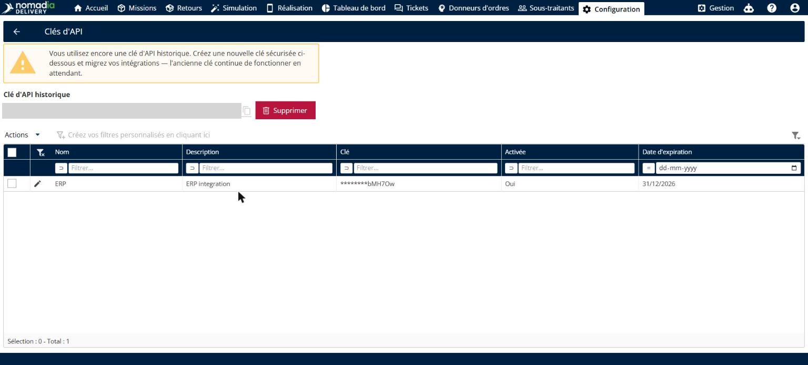

2. Cliquez sur **Actions**, puis sur **Ajouter**.

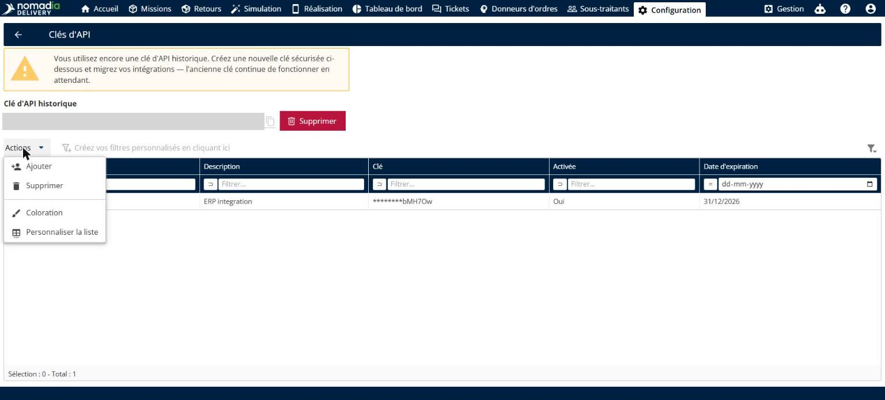

3. Saisissez un **Nom** et une **Description** pour la clé.

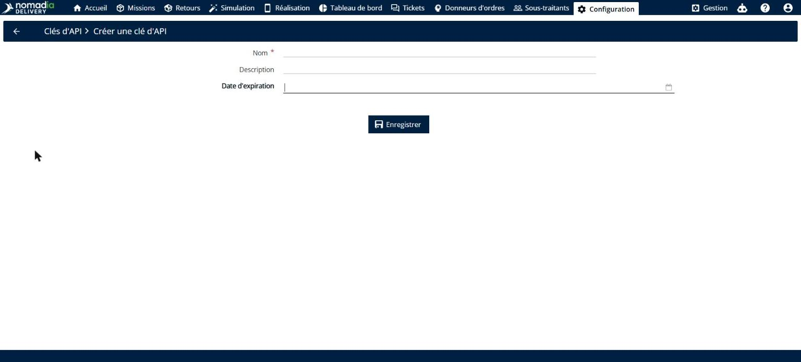

4. Facultatif : choisissez une **Date d’expiration**.

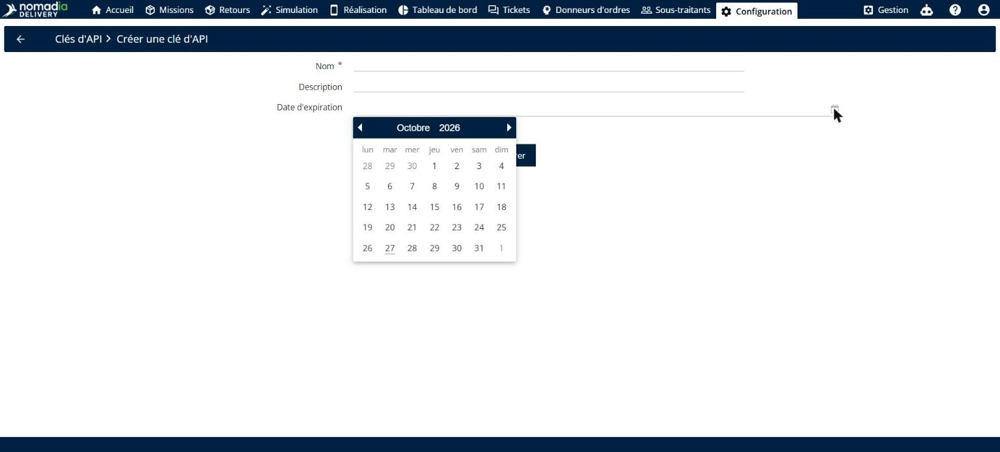

5. Cliquez sur **Enregistrer**.
6. Dans la fenêtre contextuelle de création de la clé, cliquez sur **Copier** pour copier la clé, puis sur **Fermer**.

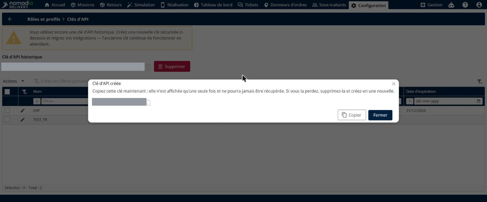

### Résultat

La clé est ajoutée à la liste. Seuls ses derniers caractères restent visibles dans la colonne **Clé**.

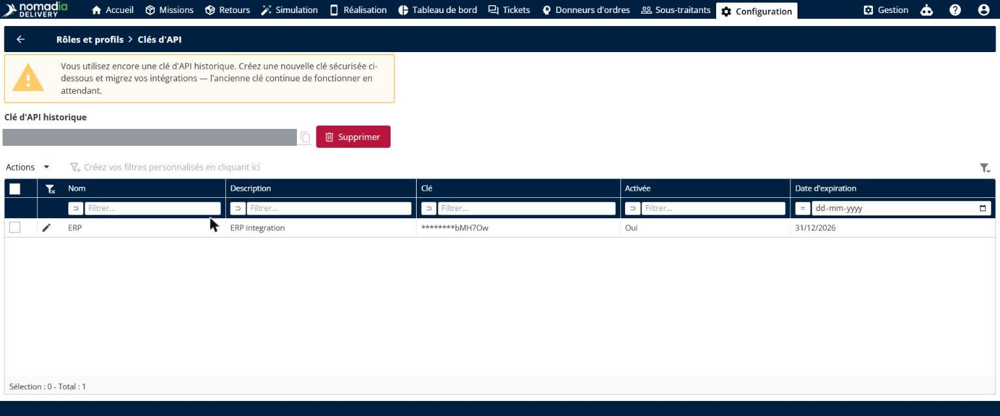

Pour connecter plusieurs intégrations, répétez ces étapes et créez une clé par intégration.

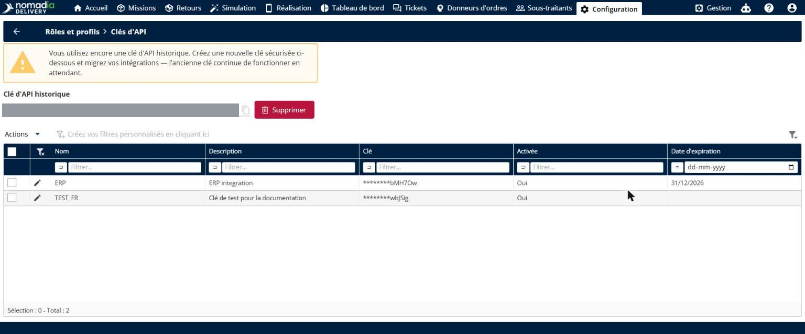

## Désactiver une clé d’API

1. Dans la liste des clés d’API, cliquez sur l’**icône crayon** à côté de la clé. La page **Modifier une clé d’API** s’ouvre.

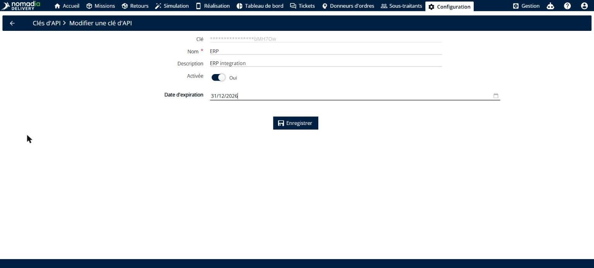

2. Désactivez l’interrupteur **Activée** pour qu’il affiche **Non**.

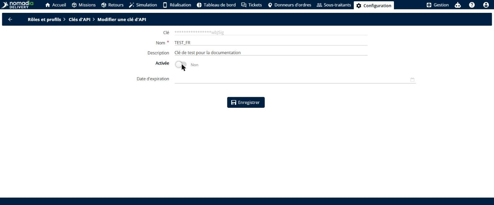

3. Cliquez sur **Enregistrer**.

### Résultat

Une notification confirme que la clé a été enregistrée, et la colonne **Activée** affiche **Non**. Les requêtes qui utilisent cette clé sont refusées instantanément.

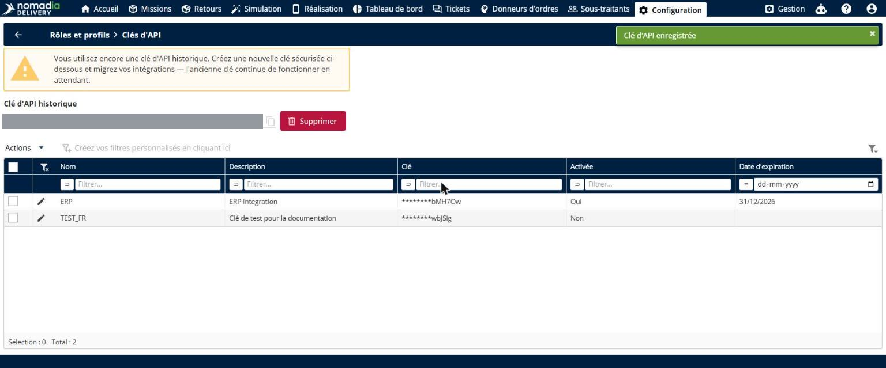

## Supprimer des clés d’API

1. Dans la liste des clés d’API, cochez les cases des clés que vous souhaitez supprimer.

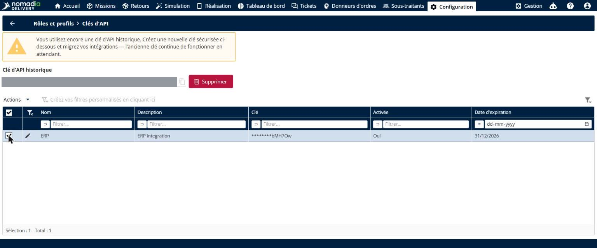

2. Cliquez sur **Actions**, puis sur **Supprimer**.
3. Dans la fenêtre contextuelle de confirmation, confirmez la suppression. Les clés cessent de fonctionner immédiatement.

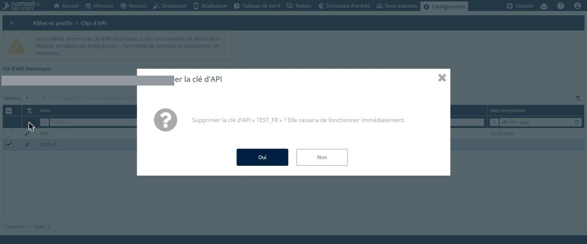

### Résultat

Les clés sont retirées de la liste. Vos autres intégrations continuent de fonctionner avec leurs propres clés.

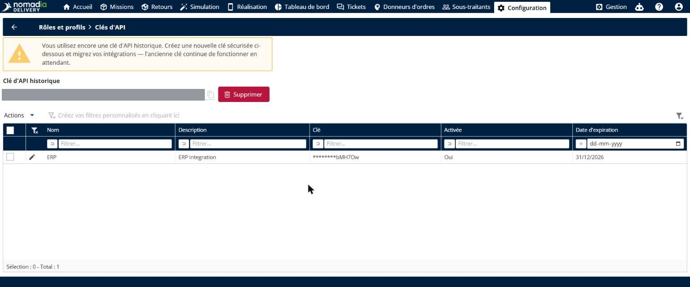

## Conseils


**Copiez la clé au moment de sa création** : la clé n’est affichée en entier qu’une seule fois et ne peut plus jamais être récupérée. Si vous la perdez, supprimez la clé et créez-en une nouvelle.



**Migrer depuis la clé historique** : créez de nouvelles clés sécurisées, mettez à jour vos intégrations, puis supprimez la **Clé d’API historique** avec son bouton **Supprimer**. L’ancienne clé continue de fonctionner jusqu’à ce que vous le fassiez.


## Rubriques connexes

* [Importer des missions](missions/import-missions/README.md)
* [Contrôler le partage des adresses avec les donneurs d’ordres](control-address-sharing-with-contractors.md)
