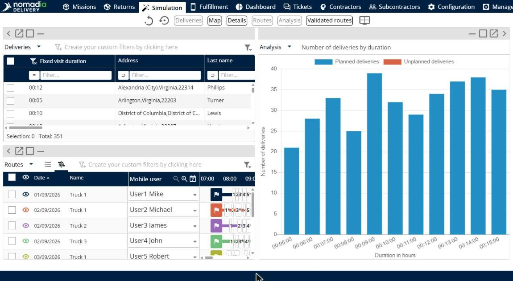

# Analyser les résultats

Cette page explique comment utiliser le panneau **Analyse** pour accéder aux graphiques d’analyse et mieux comprendre les résultats.

## Avant de commencer

* Ouvrez une simulation. Voir [Simulation](simulation.md).

## Étapes

1. Accédez à **Simulation**.
2. Cliquez sur **Modifier l’affichage des panneaux**.
3. Faites glisser **Analyse** sur la page.
4. Cliquez sur la flèche de la liste déroulante **Analyse**.
5. Cliquez sur un graphique. Les graphiques sont décrits dans [Graphiques d’analyse](simulation-analysis-charts.md).

## Fonctionnalités

* [Graphiques d’analyse](simulation-analysis-charts.md) : découvrez ce que montre chaque graphique.

## Résultat

Le panneau affiche le graphique que vous avez sélectionné. Les graphiques montrent les **Livraisons planifiées** et les **Livraisons non planifiées** dans des couleurs différentes.

## Conseils


**Revenir à votre disposition** : cliquez sur **Annuler les modifications de la disposition** ou **Réinitialiser la disposition** pour supprimer le panneau.


## Rubriques connexes

* [Simulation](simulation.md)
* [Consulter les détails d’un itinéraire](simulation-details.md)
